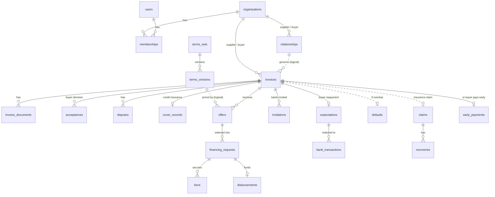
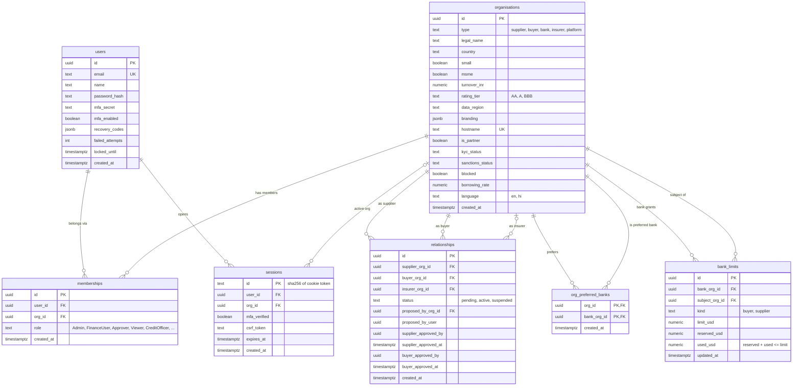
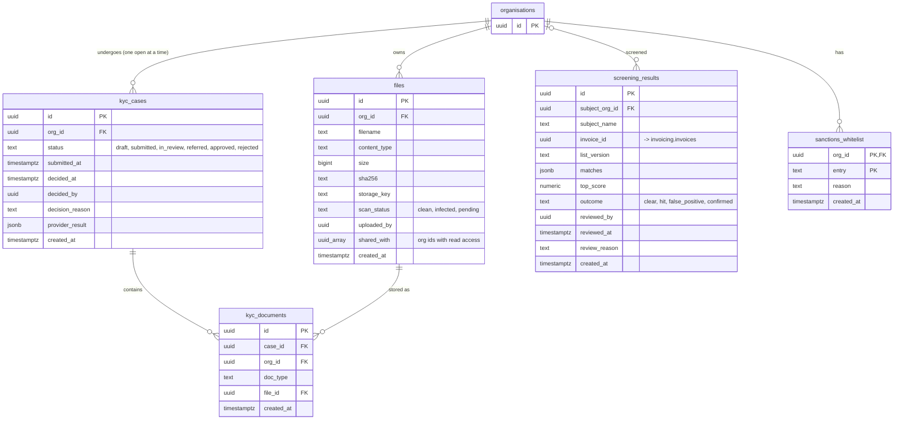
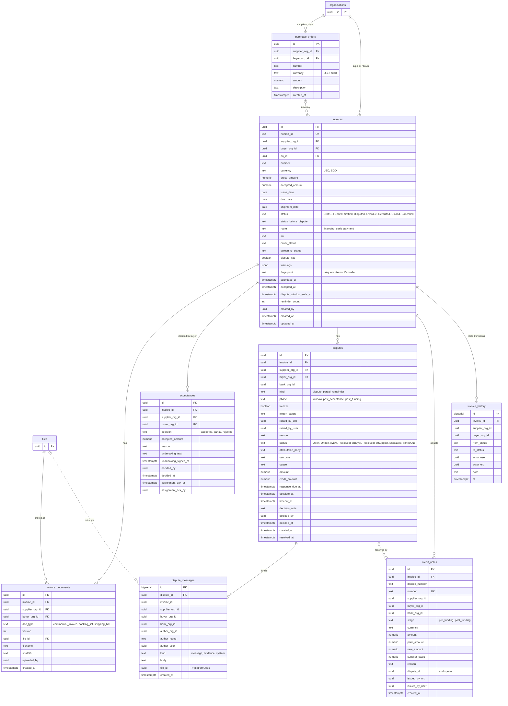
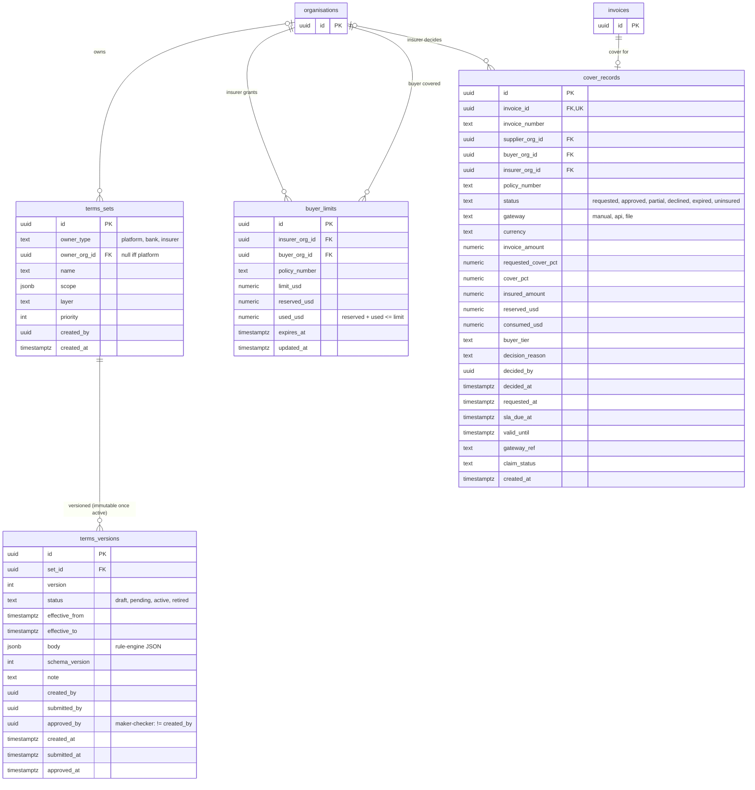
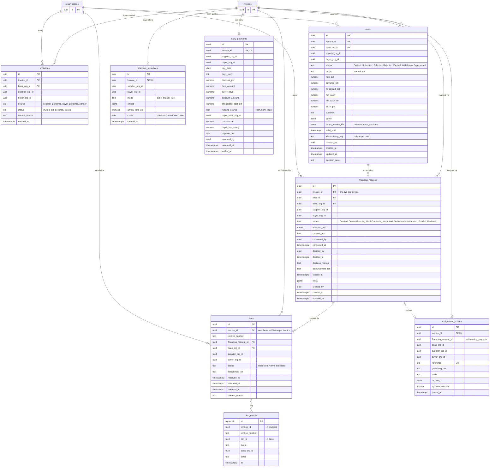
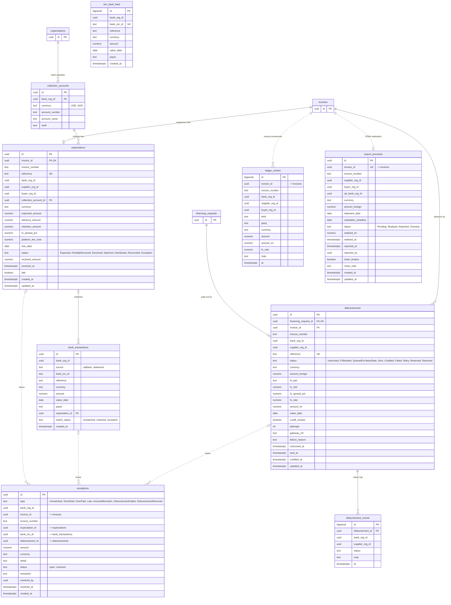
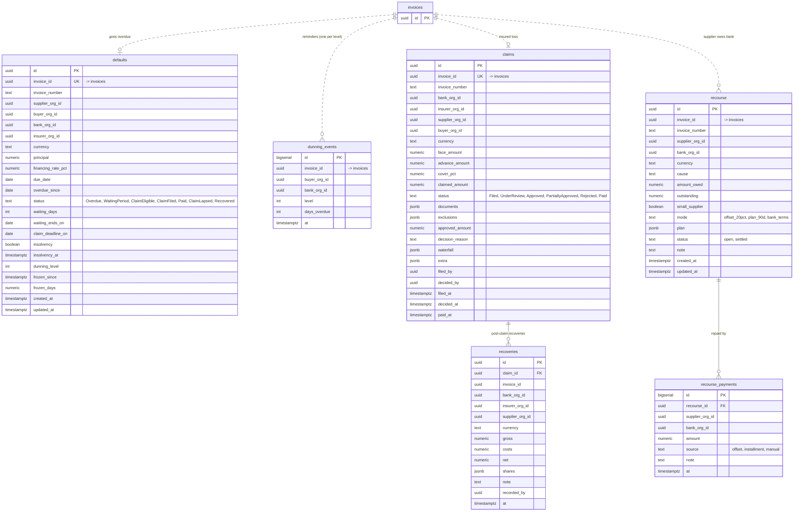

# Earlio — database ER diagrams

Derived from `apps/api/migrations/000_base.sql` … `013_language.sql`. Update this file when a migration adds or changes a table.

## Conventions

- One PostgreSQL database, one schema per module: `identity`, `audit`, `platform`, `compliance`, `invoicing`, `terms`, `insurance`, `marketplace`, `settlement`, `recovery`, `notify`, `integration`, `analytics` (plus `app` for the RLS helper functions `app.org_id()`, `app.user_id()`, `app.is_platform()`).
- **Solid line** = a real foreign-key constraint. **Dashed line** = a logical reference (a `uuid` column with no FK, usually a cross-module link or a denormalised copy kept for RLS).
- Almost every tenant table carries denormalised `supplier_org_id` / `buyer_org_id` / `bank_org_id` / `insurer_org_id` columns so RLS can filter without joins. Links from those columns to `identity.organisations` are drawn only where a FK exists, to keep diagrams readable.
- Money columns are `numeric(20,2)`; rates `numeric(8,4)`; status columns are `text` with a `check` constraint (values listed in the comment).
- `PK` primary key, `FK` foreign key (enforced), `UK` unique. Columns marked `"-> x"` are logical references without a FK.

## 1. Overview — main aggregates across modules

## 2. Identity, relationships and limits (`identity`)

Unique: `memberships (user_id, org_id)`, `relationships (supplier_org_id, buyer_org_id)`, `bank_limits (bank_org_id, subject_org_id, kind)`.

## 3. Compliance and files (`compliance`, `platform.files`)

## 4. Invoicing (`invoicing`)

Unique: `purchase_orders (supplier_org_id, buyer_org_id, number)`, `invoice_documents (invoice_id, doc_type, version)`.

## 5. Terms and insurance (`terms`, `insurance`)

Unique: `terms_versions (set_id, version)`, `buyer_limits (insurer_org_id, buyer_org_id)`. Triggers `terms_versions_guard` / `terms_versions_nodelete` block edits and deletes of active or retired versions.

## 6. Marketplace — offers, financing, liens, early payment (`marketplace`)

Unique: `invitations (invoice_id, bank_org_id)`. Partial unique indexes enforce at most one live `financing_requests` row and one `Reserved`/`Active` lien per invoice.

## 7. Settlement — disbursement, collection, reconciliation (`settlement`)

Unique: `collection_accounts (bank_org_id, currency)`, `bank_transactions (bank_org_id, source, bank_txn_id)`. `sim_bank_feed` is the simulated bank statement source read by the `Sim*` adapter; it has no links.

## 8. Recovery — defaults, claims, recourse (`recovery`)

All invoice/org references in this schema are logical (no FKs); only the two child tables are constrained.

Unique: `dunning_events (invoice_id, level)`.

## 9. Platform, audit, notifications, integration, analytics

```mermaid
erDiagram
    organisations {
        uuid id PK
    }
    audit_events {
        bigserial seq PK
        uuid id
        uuid org_id
        uuid actor_user_id
        text actor_label
        text action
        text entity_type
        text entity_id
        jsonb before
        jsonb after
        text correlation_id
        timestamptz occurred_at
        text prev_hash
        text hash "hash chain"
    }
    audit_chain_head {
        int id PK "always 1"
        text head_hash
        bigint last_seq
    }
    audit_anchors {
        bigserial id PK
        timestamptz anchored_at
        text head_hash
        bigint last_seq
        text token
    }
    outbox {
        bigserial id PK
        text topic
        jsonb payload
        uuid_array org_ids
        timestamptz created_at
        timestamptz processed_at
        int attempts
        text last_error
    }
    notifications {
        uuid id PK
        uuid recipient_org_id
        text topic
        text channel "in_app, email, sms, whatsapp"
        text status "queued, sent, delivered, failed"
        text lang
        text subject
        text body
        jsonb payload
        bigint outbox_id "-> outbox"
        timestamptz created_at
        timestamptz read_at
    }
    settings {
        text key PK
        jsonb value
        timestamptz updated_at
    }
    setting_changes {
        uuid id PK
        text key "-> settings"
        jsonb before
        jsonb after
        text status "pending, applied, rejected, withdrawn"
        text note
        uuid proposed_by
        timestamptz proposed_at
        uuid decided_by "maker-checker: != proposed_by"
        timestamptz decided_at
        text decision_note
    }
    idempotency_keys {
        text scope PK
        text key PK
        jsonb response
        timestamptz created_at
    }
    integration_messages {
        bigserial id PK
        text adapter
        text direction "request, response, callback"
        text reference
        jsonb payload
        timestamptz created_at
    }
    webhook_nonces {
        text nonce PK
        uuid bank_org_id
        timestamptz received_at
    }
    api_keys {
        uuid id PK
        uuid org_id
        text label
        text key_prefix UK
        text secret_hash
        text signing_secret
        text status "active, rotating, revoked"
        timestamptz expires_at
        timestamptz created_at
        uuid created_by
        timestamptz last_used_at
    }
    webhooks {
        uuid id PK
        uuid org_id
        text url
        text_array events
        boolean active
        timestamptz created_at
    }
    webhook_deliveries {
        bigserial id PK
        uuid webhook_id FK
        uuid org_id
        text event_type
        jsonb payload
        text status "pending, delivered, failed"
        int attempts
        text last_error
        timestamptz created_at
    }
    file_batches {
        uuid id PK
        uuid org_id
        text kind "offers_in, statement_in, instructions_out"
        text filename
        int rows_total
        int rows_ok
        jsonb errors
        text content
        timestamptz created_at
    }
    snapshots {
        text key PK
        text kind
        uuid org_id
        jsonb data
        timestamptz computed_at
    }

    audit_chain_head ||..|| audit_events : "points at last"
    audit_anchors }o..|| audit_events : "anchors up to seq"
    organisations ||..o{ audit_events : "scoped to"
    outbox ||..o{ notifications : "fans out to"
    organisations ||..o{ notifications : receives
    settings ||..o{ setting_changes : "changed via"
    organisations ||..o{ api_keys : owns
    organisations ||..o{ webhooks : registers
    webhooks ||--o{ webhook_deliveries : delivers
    organisations ||..o{ file_batches : uploads
```

Schemas: `audit_events`, `audit_chain_head`, `audit_anchors` are `audit.events`, `audit.chain_head`, `audit.anchors`. `outbox`, `settings`, `setting_changes`, `idempotency_keys`, `integration_messages`, `webhook_nonces` are in `platform`. `notifications` is `notify.notifications` (unique on `outbox_id, recipient_org_id, channel`). `api_keys`, `webhooks`, `webhook_deliveries`, `file_batches` are in `integration`; `snapshots` is `analytics.snapshots`.
