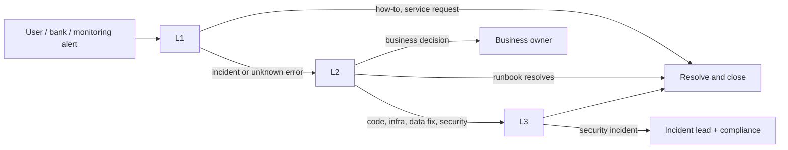

# 1. Support model

## Contents
- [1.1 Tiers and responsibilities](#11-tiers-and-responsibilities)
- [1.2 Severity levels](#12-severity-levels)
- [1.3 Escalation paths](#13-escalation-paths)
- [1.4 What to collect from the reporter](#14-what-to-collect-from-the-reporter)
- [1.5 Triage flow](#15-triage-flow)
- [1.6 Communication templates](#16-communication-templates)
- [1.7 Handover and post-incident review](#17-handover-and-post-incident-review)

## 1.1 Tiers and responsibilities

| Tier | Who | Does | Access |
| --- | --- | --- | --- |
| **L1 — Service desk** | Support analysts | Take tickets, classify severity, answer how-to questions from the user manuals, handle routine [service requests](04-service-requests.md), run the [daily checks](02-monitoring-and-daily-checks.md), escalate | Web app with a platform **Auditor** account (read-only); monitoring dashboards |
| **L2 — Application support** | Platform operations staff | Run the [runbooks](03-runbooks.md), read logs by correlation id, run [diagnostic queries](06-diagnostic-queries.md), resolve settlement exceptions, KYC/sanctions queue issues, unlock/reset users, coordinate with banks/insurers | Platform **PlatformAdmin** account; read-only database role; log platform |
| **L3 — Engineering on-call** | Developers / DevOps | Code and infrastructure faults, deployments and rollbacks, database restores, data corrections through reviewed scripts, security incidents | Production infrastructure (named accounts) |
| **Business owners** | Product owner, compliance, finance | Decisions on disputes, KYC/sanctions policy, customer communications, regulatory notifications | Application roles as appropriate |

Platform staff decisions (KYC approval, sanctions, dispute rulings) are **business** actions with legal weight: support staff perform them only if they hold that role and authority, never just to close a ticket.

## 1.2 Severity levels

| Severity | Definition | Examples | Response | Update cadence | Resolution target |
| --- | --- | --- | --- | --- | --- |
| **P1 — Critical** | Platform unavailable, money movement wrong or stuck for many users, data exposed across tenants, audit chain broken | `/ready` failing; nobody can sign in; disbursements not happening; a user sees another organisation's invoices | 15 min, 24×7 | Every 30 min | Workaround in 4 h |
| **P2 — High** | A major function degraded for one or more organisations, no workaround | One bank's webhooks failing; outbox backlog growing; KYC queue cannot open; slow pages (> 3 s) | 1 h, business hours (24×7 during pilot) | Every 2 h | 1 business day |
| **P3 — Medium** | A function impaired with a workaround, or a single user affected | One user cannot upload a document; settlement exception needs review; a parked event | 4 business hours | Daily | 5 business days |
| **P4 — Low** | Question, cosmetic issue, request for change | How-to question; label wording; new user request | 1 business day | On change | Planned |

If in doubt, choose the higher severity; it can be lowered later. Anything involving **wrong amounts, money sent to the wrong party, or cross-tenant data** is P1 regardless of how many users are affected.

## 1.3 Escalation paths

| Trigger | Escalate to | How |
| --- | --- | --- |
| P1 of any kind | L2 **and** L3 on-call immediately | Page on-call; open incident channel |
| Suspected security issue (cross-tenant data, leaked key, audit break, unknown admin activity) | L3 on-call + incident lead + compliance | Page; do not discuss in public channels |
| Error message not in the [catalogue](05-error-catalogue.md), or `Internal error.` | L2 | Ticket with correlation details |
| Runbook step says "escalate" or does not resolve within its time box | L3 | Ticket + page if P1/P2 |
| Bank/insurer system problem (their webhook endpoint down, their file rejected) | The bank's/insurer's technical contact | E-mail from the shared support mailbox; copy L2 |
| Dispute, KYC, sanctions, credit or legal question | Business owner | Ticket assignment |

Keep an up-to-date **contact sheet** (on-call rota, each bank's and insurer's technical contact, compliance officer, product owner) next to this guide; it is not stored in the repository.

## 1.4 What to collect from the reporter

Ask for — and record in the ticket:

1. **Who**: user e-mail, organisation name and type (supplier, buyer, bank, insurer).
2. **Where**: the URL (which portal — `app.` or a bank's), the page, and the invoice number (e.g. `INV-1005`) if any.
3. **What**: the action they took, what they expected, and the **exact error text** (a screenshot is best).
4. **When**: date, time and time zone of the attempt.
5. **How often**: once, every time, for everyone in their organisation?
6. **Browser** and whether a reload or signing out and in again changes anything.

Never ask for passwords, MFA codes or recovery codes. For bank integrations, ask for the request time, endpoint, HTTP status and the `x-correlation-id` response header — not the API key or signing secret.

## 1.5 Triage flow

1. **Is the platform up?** Open `https://app.<domain>/ready`. Not `{"ready":true,…}` → [R1](03-runbooks.md#r1-api-unavailable-or-not-ready).
2. **Is the error in the [catalogue](05-error-catalogue.md)?** Most messages are business rules; explain the rule and the next step to the user.
3. **Is it one user or many?** One user → account, role or data problem ([service requests](04-service-requests.md)). Many → incident; check monitoring.
4. **Is money or data integrity involved?** → P1, escalate.
5. **Find the matching runbook** in [section 3](03-runbooks.md) and follow it.

## 1.6 Communication templates

**Incident opened (to affected organisations)**

> Subject: Earlio — service issue affecting <function> (opened <time UTC>)
>
> We are investigating an issue affecting <what users see>. <Workaround, if any.> No action is needed from you at this time. We will send the next update by <time UTC>.

**Update**

> We have identified <cause in plain words> and are <action>. <Impact now.> Next update by <time UTC>.

**Resolved**

> The issue affecting <function> was resolved at <time UTC>. <What users should do, e.g. retry an action.> We will share a summary within 5 working days.

Do not speculate about cause, mention other customers by name, or promise compensation. Regulatory or data-breach notifications are sent by compliance, not by support.

## 1.7 Handover and post-incident review

- **Shift handover**: open P1/P2 incidents with current status and next step; settlement exceptions older than one business day; parked outbox events or failed webhooks not yet explained; anything waiting on a bank or insurer.
- **Post-incident review** for every P1 and for P2s with customer impact, within 5 working days: timeline (UTC), impact (organisations, invoices, amounts), root cause, what went well, actions with owners and dates. File it with the incident ticket; link new runbook steps back into this guide.
