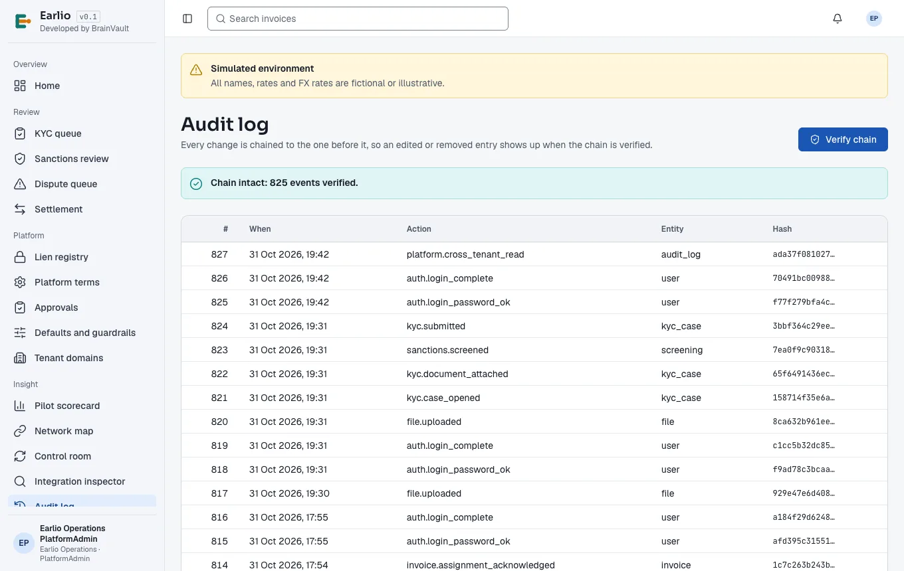
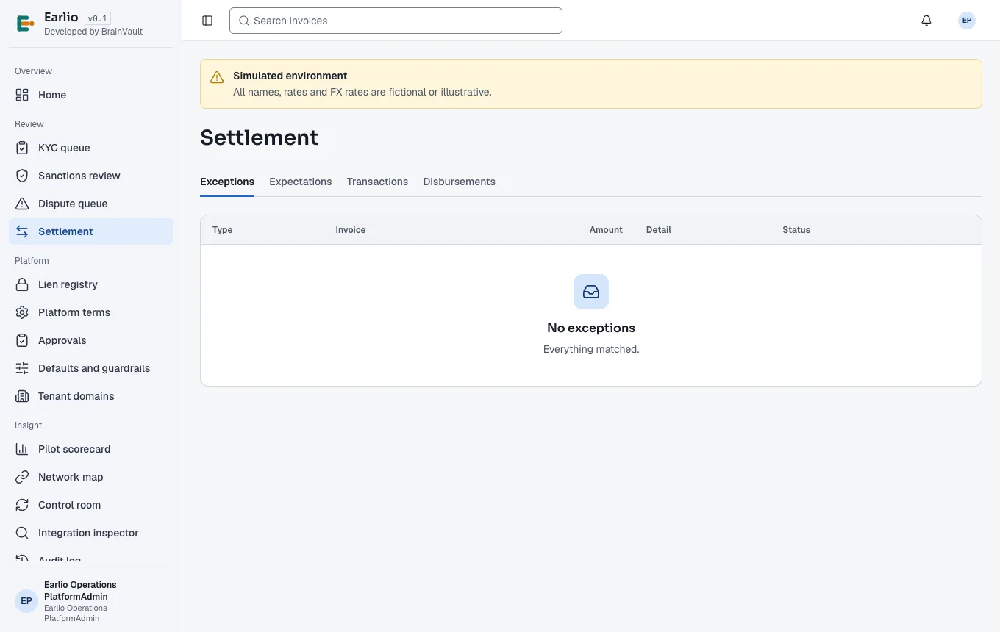
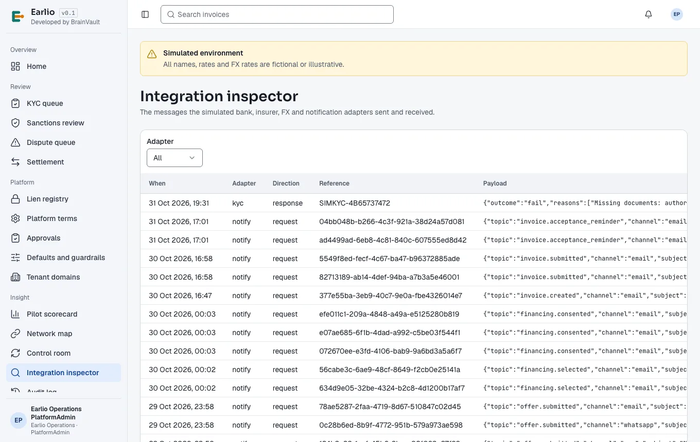
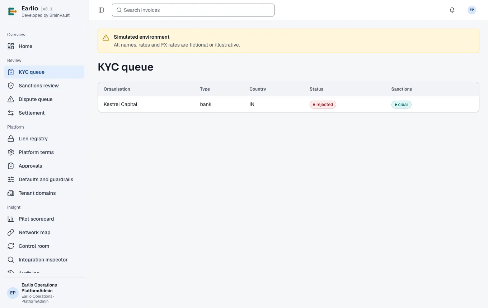
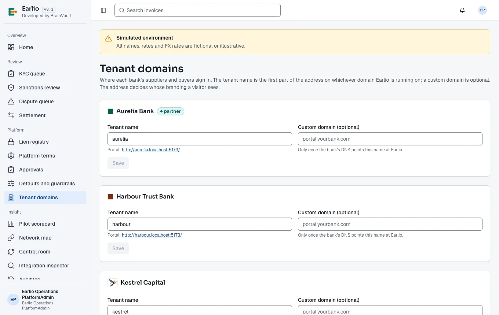
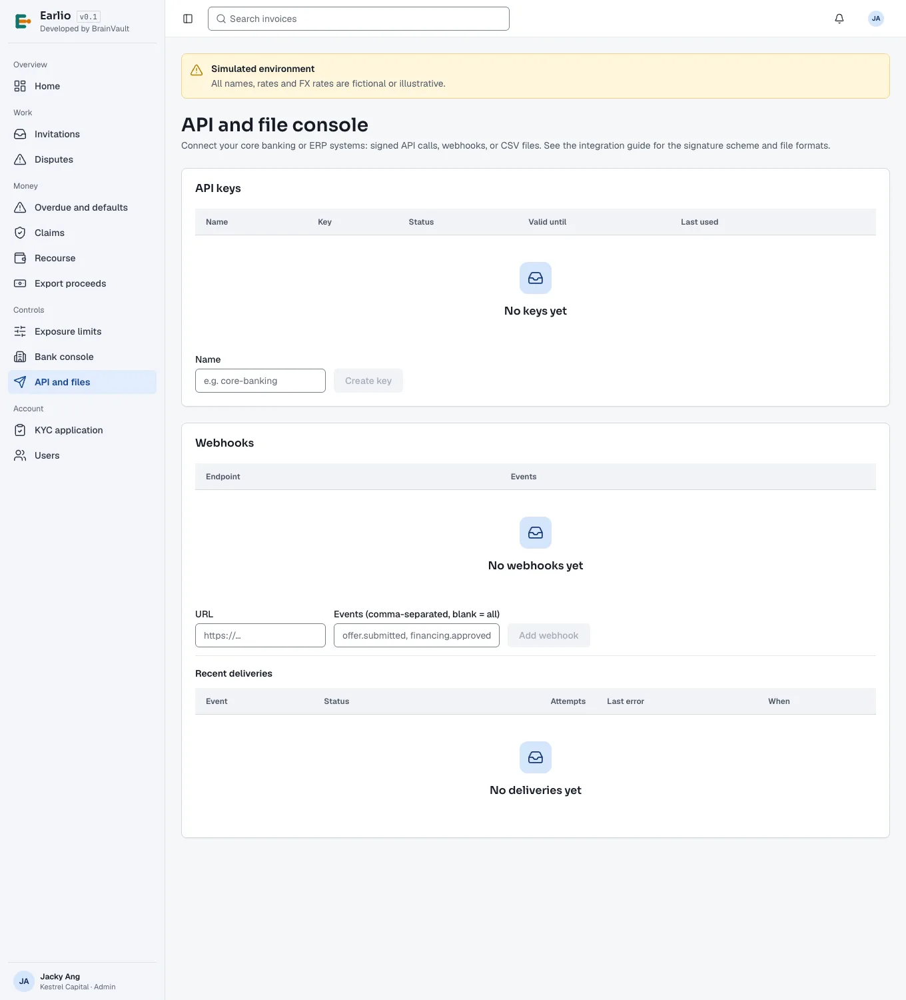

# 2. Monitoring and daily checks

## Contents
- [2.1 Start-of-day checklist](#21-start-of-day-checklist)
- [2.2 Health endpoints](#22-health-endpoints)
- [2.3 Alerts you may receive](#23-alerts-you-may-receive)
- [2.4 Admin screens support uses](#24-admin-screens-support-uses)

## 2.1 Start-of-day checklist

Run at the start of each business day (and at shift handover during the pilot). Record the result in the daily log.

| # | Check | How | Healthy | If not |
| --- | --- | --- | --- | --- |
| 1 | Platform ready | Open `https://app.<domain>/ready` | `{"ready":true, "migrations":<n>, "outboxBacklog":0}` | [R1](03-runbooks.md#r1-api-unavailable-or-not-ready) |
| 2 | Correct environment | Open `https://app.<domain>/api/v1/system/config` | `"env":"production","simulated":false` | P1 — escalate to L3 (wrong configuration deployed) |
| 3 | Monitoring dashboard | Error rate, p95 latency, outbox pending, DB pool waiting (last 24 h) | Error rate < 1 %, p95 < 3 s, outbox near 0, pool waiting 0 | [R2](03-runbooks.md#r2-errors-or-slow-responses), [R4](03-runbooks.md#r4-outbox-backlog-growing-background-work-stuck) |
| 4 | Audit chain | **Audit log → Verify chain** | "Chain intact: N events verified." | [R10](03-runbooks.md#r10-audit-chain-verification-fails) — P1 |
| 5 | Settlement exceptions | **Settlement → Exceptions** | Nothing open older than 1 business day | [R8](03-runbooks.md#r8-settlement-exceptions) |
| 6 | Parked events and failed webhooks | [Queries Q4 and Q8](06-diagnostic-queries.md) | No new rows since yesterday | [R5](03-runbooks.md#r5-parked-failed-outbox-events), [R7](03-runbooks.md#r7-bank-webhook-deliveries-failing) |
| 7 | Review queues | **KYC queue**, **Sanctions review**, **Dispute queue** | Items within their service level; nothing stuck in the same status for days | Notify the business owner |
| 8 | Backups | Database provider console | Last base backup < 26 h old; WAL archiving current | L3 |
| 9 | Overnight tickets | Ticket queue | All triaged with a severity | — |

## 2.2 Health endpoints

| Endpoint | What it tells you |
| --- | --- |
| `/health` | The API process is running **and** can query the database. |
| `/ready` | Additionally: migrations are recorded (`migrations` count) and background work is keeping up (`outboxBacklog` = events waiting more than 15 minutes). Turns `503` when the backlog passes 1,000 or the database fails. |
| `/api/v1/system/config` | Which environment and mode is deployed, and the API version. |
| `/metrics` | Prometheus metrics; needs the scrape token. Usually read through the monitoring dashboard, not directly. |

Typical readings:

```json
{"ready":true,"migrations":15,"outboxBacklog":0}
```
Healthy.

```json
{"ready":false,"reason":"outbox backlog 1342"}
```
Background work stuck or far behind → [R4](03-runbooks.md#r4-outbox-backlog-growing-background-work-stuck).

```json
{"ready":false,"reason":"connect ECONNREFUSED 10.0.1.5:5432"}
```
Database unreachable → [R3](03-runbooks.md#r3-database-unavailable-or-saturated).

The `migrations` number only changes on a release; if it drops or differs between instances, escalate to L3.

## 2.3 Alerts you may receive

| Alert | Meaning | Runbook |
| --- | --- | --- |
| API not ready | `/ready` failing for 2 minutes | [R1](03-runbooks.md#r1-api-unavailable-or-not-ready) |
| High error rate | More than 2 % of requests returning 5xx | [R2](03-runbooks.md#r2-errors-or-slow-responses) |
| High latency | p95 above 3 s | [R2](03-runbooks.md#r2-errors-or-slow-responses) |
| DB pool saturated | Requests waiting for a database connection | [R3](03-runbooks.md#r3-database-unavailable-or-saturated) |
| Outbox growing | Pending events rising for 15 minutes | [R4](03-runbooks.md#r4-outbox-backlog-growing-background-work-stuck) |
| Parked events | Events that failed 5 times | [R5](03-runbooks.md#r5-parked-failed-outbox-events) |
| Webhook failures | Deliveries to a bank marked failed | [R7](03-runbooks.md#r7-bank-webhook-deliveries-failing) |
| Exceptions ageing | Settlement exceptions open > 1 business day | [R8](03-runbooks.md#r8-settlement-exceptions) |
| Audit chain broken | Scheduled verification failed | [R10](03-runbooks.md#r10-audit-chain-verification-fails) |
| Certificate expiring | TLS certificate < 21 days | L3 |

## 2.4 Admin screens support uses

Sign in to `https://app.<domain>` with your platform account. Auditors see the *Insight* screens; PlatformAdmins also see *Review* and *Platform*. The screens are described in full in the [Platform manual](../user-manual/05-platform.md).

### Audit log

Every change in the system, newest first, each chained to the one before. **Verify chain** recomputes the whole chain.


*Figure 2-1 — Audit log with a successful chain verification.*

Use it to answer "who did what, when": the *Action* (e.g. `invoice.accepted`, `auth.login_failed`, `apikey.revoked`), the *Entity* and the time. Your own reads of the audit log are themselves audited (`platform.cross_tenant_read`). For filtering by organisation, invoice or correlation id, use [query Q10](06-diagnostic-queries.md).

### Settlement → Exceptions

Payments that could not be matched automatically, and disbursements that failed or were returned. Each row names the type, invoice, amount and what happened; the allowed resolutions are offered on the row.


*Figure 2-2 — Settlement exceptions (empty: everything matched).*

### Integration inspector

Every message exchanged with the (simulated) external systems: bank payments and statements, KYC, FX, insurer, notifications. Filter by **Adapter**; the *Reference* column links a message to a disbursement, KYC case or notification.


*Figure 2-3 — Integration inspector.*

Use it to answer "did we send the e-mail?", "what did the KYC check return?", "was the disbursement instruction sent?".

### KYC queue

Organisations whose KYC application is submitted, under review, referred, approved or rejected, with the sanctions result.


*Figure 2-4 — KYC queue.*

An organisation that cannot invoice, accept or fund is often still in KYC. Decisions belong to the compliance owner.

### Tenant domains

Each bank with its tenant name (the `https://<tenant>.<domain>` portal), live portal link and optional custom domain.


*Figure 2-5 — Tenant domains.*

Use it when a bank's users see the wrong branding ([R11](03-runbooks.md#r11-a-bank-portal-shows-the-wrong-branding-or-does-not-load)).

### A bank's API and file console (seen by the bank)

Banks manage their own API keys, webhook endpoints and CSV file drops. Ask the bank administrator to share what they see here — **Recent deliveries** shows each webhook's status, attempts and last error; **History** shows uploaded files with problem counts.


*Figure 2-6 — Bank API and file console (bank administrator view; no keys or webhooks configured yet).*
