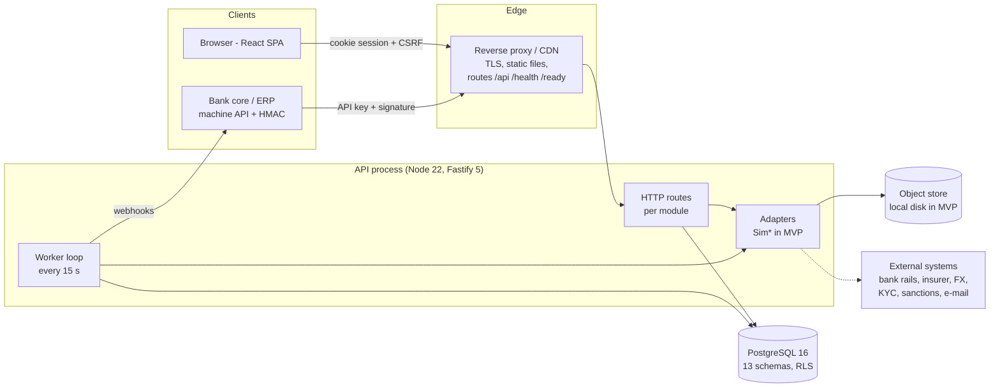

# 1. Architecture

## Contents
- [1.1 System overview](#11-system-overview)
- [1.2 Repository layout](#12-repository-layout)
- [1.3 The API process](#13-the-api-process)
- [1.4 Modules](#14-modules)
- [1.5 The background worker](#15-the-background-worker)
- [1.6 Data and tenancy](#16-data-and-tenancy)
- [1.7 Adapters and external systems](#17-adapters-and-external-systems)
- [1.8 The web app](#18-the-web-app)
- [1.9 Cross-cutting rules](#19-cross-cutting-rules)

## 1.1 System overview

Earlio is a **modular monolith** (ADR-001): one Node.js process serves the HTTP API *and* runs the background worker; one PostgreSQL database holds every module's schema; a React single-page app is served as static files.



| Component | Technology | Where |
| --- | --- | --- |
| API + worker | Node 22, TypeScript (run through `tsx`), Fastify 5, Zod 4, `pg` | `apps/api` |
| Database | PostgreSQL 16 (CI uses `postgres:16`), plain SQL migrations | `apps/api/migrations` |
| Web app | Vite 8, React 19, TanStack Query, React Router 7, `openapi-fetch`, i18next (English, Hindi) | `apps/web` |
| Design system | `@yaneshtyagi/design-system` 1.1.0, vendored as a tarball | `vendor/` |
| End-to-end tests | Playwright + axe-core | `e2e/` |
| Contract | OpenAPI 3.0.3, generated from the Zod route schemas | `docs/openapi.json` |

Why Node and not .NET is recorded in [ADR-000](../adr/ADR-000-stack-node-not-dotnet.md).

## 1.2 Repository layout

```
earlio/
├── AGENTS.md                 architecture rules (read first)
├── package.json              npm workspaces: apps/*
├── apps/
│   ├── api/
│   │   ├── migrations/       000_base.sql … 014_tenant_names.sql (applied in name order)
│   │   ├── src/
│   │   │   ├── server.ts     entry point: bootstrap → buildApp → worker → listen
│   │   │   ├── bootstrap.ts  config, migrate, clock, DB pool, adapters, dev seed
│   │   │   ├── app.ts        Fastify instance, hooks, security headers, /health /ready /metrics
│   │   │   ├── worker.ts     outbox subscribers and the periodic job pass
│   │   │   ├── services.ts   the Services bag passed everywhere (config, db, clock, adapters)
│   │   │   ├── kernel/       clock, config, env, errors, money, password, secrets, TOTP, metrics
│   │   │   ├── db/           pool + transaction helpers (Db, Tx), migration runner
│   │   │   ├── http/         request context, auth/permission pre-handlers
│   │   │   ├── platform/     audit chain, outbox, files
│   │   │   ├── adapters/     interfaces + Sim* implementations
│   │   │   ├── modules/      one folder per bounded context (see 1.4)
│   │   │   └── demo/         demo driver and pilot scenarios (development only)
│   │   └── test/             vitest suites (integration tests against real Postgres)
│   └── web/
│       ├── src/api/          generated schema.d.ts + typed client
│       ├── src/pages/        one file per area (InvoicesPage, SettlementPages, …)
│       ├── src/ui/           shared components
│       ├── src/shared/       navigation, money formatting, tenant helpers
│       └── src/i18n/         Hindi strings
├── e2e/                      Playwright journeys + accessibility
├── scripts/                  e2e-stack.sh, load-test.mjs
├── vendor/                   design-system tarball
└── docs/                     PRD, plan, ADRs, manuals, OpenAPI, Posting collection
```

## 1.3 The API process

`src/server.ts` does, in order:

1. **`bootstrap()`** — loads configuration ([chapter 3](03-configuration.md)), **runs pending migrations** using `MIGRATE_DATABASE_URL`, picks the clock (`VirtualClock` in development/demo/test, `SystemClock` in production), opens the connection pool (10 connections) on `DATABASE_URL`, builds the adapters and, outside production and test, **seeds the demo cast**.
2. **`buildApp()`** — registers cookies, CORS, the global rate limit (600 requests/min per client address by default), OpenAPI generation, security headers, metrics, the session hook and every module's routes.
3. Optionally seeds the pilot scenarios (`EARLIO_SEED_SCENARIOS=1`, never in production).
4. **`startWorker()`** — starts the background loop (not in `test`).
5. Listens on `HOST:PORT` (default `0.0.0.0:4000`). `SIGINT`/`SIGTERM` stop the worker, close the server and the pool.

Every request:

- gets a **correlation id** — the incoming `x-correlation-id` header or a new UUID — that appears in every log line and is echoed in the response header;
- is resolved to a session from the `earlio_sid` cookie (sessions last 8 hours; the cookie holds a token, the database stores its hash);
- runs its database work inside `db.tx(ctx, …)`, which sets `app.org_id`, `app.user_id` and `app.is_platform` for row-level security;
- must carry `x-csrf-token` on every `POST/PUT/PATCH/DELETE` (cookie-session routes);
- returns errors in one shape: `{ "code": "...", "message": "<plain-language reason>", "details": ... }`.

## 1.4 Modules

Each module under `src/modules/<name>` owns a PostgreSQL schema of the same name and exposes service functions; other modules call those functions or react to its outbox events, never write its tables directly. `test/architecture.test.ts` enforces the import boundaries.

| Module | Owns | Main responsibilities |
| --- | --- | --- |
| `identity` | `identity.*` | Users, organisations, memberships, sessions, MFA, relationships, exposure limits, demo seed |
| `compliance` | `compliance.*` | KYC cases and documents, sanctions screening and whitelist |
| `invoicing` | `invoicing.*` | Purchase orders, invoices, documents, acceptance, disputes, credit notes |
| `terms` | `terms.*` | Bank/insurer/platform terms as JSON, rule engine, guardrails, maker-checker publishing |
| `insurance` | `insurance.*` | Buyer limits, cover requests and records, insurer gateway |
| `marketplace` | `marketplace.*` | Invitations, offers, financing requests, liens, assignment notices, early-payment discounting |
| `pricing` | *(pure)* | Financing, early-payment and FX maths, holiday calendars |
| `settlement` | `settlement.*` | Disbursements, collection accounts, expectations, bank transactions, reconciliation, ledger, exceptions, export proceeds |
| `recovery` | `recovery.*` | Overdue, defaults, dunning, claims, recourse and waterfall |
| `notify` | `notify.*` | In-app notifications, e-mail/SMS/WhatsApp outbox (simulated delivery) |
| `governance` | `platform.settings`, `platform.setting_changes` | Governed settings (maker-checker), branding, tenant names, required information |
| `integration` | `integration.*` | Bank API keys, signed machine API, webhooks, CSV file drops |
| `analytics` | `analytics.*` | Dashboard snapshots, pilot scorecard |
| `audit` | `audit.*` (via `platform/audit.ts`) | Hash-chained audit log, verification, anchoring |

Shared platform tables live in `platform.*`: `outbox`, `settings`, `idempotency_keys`, `integration_messages`, `files`, `webhook_nonces`.

## 1.5 The background worker

The worker runs **inside the API process** every 15 seconds (`startWorker` in `src/worker.ts`); a pass is skipped if the previous one is still running. One pass (`runWorkOnce`) does, in this order:

| Step | What it does |
| --- | --- |
| `events` | Drain the outbox: deliver each unprocessed event to its subscribers (cover request on acceptance, disbursement on approval, collection expectation on funding, default on overdue; notifications and webhooks for every event) |
| `reminders` | Acceptance reminders to buyers |
| `insurerApi` | Process the insurer gateway (simulated) |
| `offersExpired`, `coversExpired` | Expire offers and covers past their validity; retire expired terms versions |
| `disbursements` | Send and confirm disbursements through the payment gateway |
| `statements`, `reconciled` | Fetch bank statements and match them to expectations (unmatched items become **exceptions**) |
| `overdue` | Mark invoices overdue |
| `disputeTimers` | Apply dispute deadlines |
| `installments`, `proceedsOverdue`, `earlyPaymentsSettled` | Recourse reminders, export-proceeds deadlines, early-payment settlement |
| `webhooks` | Deliver bank webhooks (up to 5 attempts, then `failed`) |
| `dashboards` | Refresh analytics snapshots |
| *(drain again ×4)*, `defaults`, *(drain)* | Follow chains of events within one pass; process defaults |
| `notificationsDelivered` | Deliver notifications |

**Outbox semantics** (ADR-003): an event is written in the same transaction as the state change. The drainer locks up to 200 events with `FOR UPDATE SKIP LOCKED` and runs each in a savepoint. A failing handler is retried on the next pass; after **5 attempts** the event is *parked* — marked processed with `last_error` set — so one poison event cannot block the queue.

> **Gap — one worker per deployment.** Every API instance runs its own worker loop and it cannot be switched off outside `test`. The outbox drain is safe to run concurrently, but the other jobs have not been verified for concurrent execution. Run **one API instance** until the worker is split out or every job is made concurrency-safe. See [Deployment § 6.9](06-deployment.md#69-production-gaps-to-close).

## 1.6 Data and tenancy

- **One database, many schemas**: `identity, audit, platform, compliance, invoicing, terms, insurance, marketplace, settlement, notify, recovery, analytics, integration`, plus `app` (helper functions such as `app.org_id()` and `app.is_platform()`).
- **Two database roles** (ADR-002):
  - the **owner** (`MIGRATE_DATABASE_URL`) runs migrations and owns the objects;
  - the **application role** `earlio_app` (`DATABASE_URL`) is not a superuser and is bound by **row-level security**. It may `select/insert/update/delete` in the module schemas but only `select/insert` on `audit.events` and `audit.anchors` (append-only), and cannot delete `audit.chain_head`.
- **RLS**: every tenant table has policies keyed on `app.org_id()` / `app.is_platform()`. Cross-tenant work (platform staff, the worker) runs with `app.is_platform = on` and is audited.
- **Audit chain** (ADR-005): each audit event stores the hash of the previous one. `GET /api/v1/audit/verify` recomputes the chain and reports the first broken link; `POST /api/v1/audit/anchor` records the head with a (simulated) trusted timestamp.
- **Money** is `numeric`, handled with `decimal.js` and passed as strings; `pg` is configured to return `numeric` and `int8` as strings and `date` as `YYYY-MM-DD`.

The full table list and diagrams are in [`docs/er-diagrams.md`](../er-diagrams.md).

## 1.7 Adapters and external systems

All external dependencies sit behind interfaces in `src/adapters` (ADR-004) and are wired in `defaultAdapters()`. **Only simulators ship in the MVP.**

| Adapter | Interface | MVP implementation | Production needs |
| --- | --- | --- | --- |
| `objectStore` | `ObjectStore` (put/get) | `LocalDiskObjectStore` in `OBJECT_STORE_DIR` | S3/MinIO/Azure Blob implementation, versioned and replicated |
| `fileScanner` | `FileScanner` | `SimFileScanner` (flags EICAR) | Real antivirus (ClamAV, cloud scanner) |
| `kyc` | `KycProvider` | `SimKycProvider` | KYC vendor |
| `sanctions` | `SanctionsProvider` | `SimSanctionsProvider` (seeded list) | Licensed list provider |
| `tsa` | `TimestampAuthority` | `SimTimestampAuthority` | RFC 3161 TSA |
| `einvoice`, `erp` | `EInvoiceService`, `ErpInvoiceSource` | `Sim*` | E-invoice portal / ERP connectors |
| `fx` | `FxRateProvider` | `SimFxRateProvider` | Market-data feed |
| `insurerApi` | `InsurerGateway` | `SimInsurerApi` | Insurer APIs |
| `payments` | `PaymentGateway` | `SimBankGateway` | Bank payment rails / statement feeds |

Every simulated request and response is recorded in `platform.integration_messages` and visible in the **Integration inspector** (platform staff). Notifications (e-mail, SMS, WhatsApp) are also simulated through the notification outbox.

## 1.8 The web app

- A static SPA built by Vite into `apps/web/dist`.
- It calls the API **on the same origin** (`baseUrl: ''`, cookies included). In development Vite proxies `/api` and `/health` to `VITE_API_URL` (default `http://localhost:4000`); in production the reverse proxy must do the same.
- It talks to the API only through the client generated from `docs/openapi.json` (`src/api/schema.d.ts`); `architecture.test.ts` checks this.
- **White-label portals**: a bank's portal is its *tenant name* in front of the platform domain (`kestrel.<domain>`) or a custom hostname. The API decides whose branding to show from `x-forwarded-host` (falling back to `Host`), so the proxy must forward the browser's host.
- Fetches `GET /api/v1/system/config` on load to know the environment, whether to show the *Simulated environment* banner and the platform mode (`network` or `white-label`).

## 1.9 Cross-cutting rules

The rules in [`AGENTS.md`](../../AGENTS.md) are part of this architecture. The ones that most often matter during maintenance:

| Rule | In practice |
| --- | --- |
| Time comes from `Clock` | Use `svc.clock.now()`. `Date.now()`/`new Date()` in domain code breaks the virtual clock used by tests and demos. |
| Money is `Decimal` | Round half away from zero to 2 dp per charge line, then sum; actual/365. Golden-number tests must pass exactly. |
| Explicit state machines | Each aggregate has a transition table; an illegal transition throws `DomainError`; each transition writes an audit event **and** an outbox event. |
| Idempotent money commands | Commands that move money accept an `Idempotency-Key` and store the result in `platform.idempotency_keys`. |
| Rules are data | Bank and insurer behaviour is JSON terms interpreted by the rule engine. Never add per-bank code. |
| Plain-language errors | A `DomainError` message is shown to end users verbatim. |
