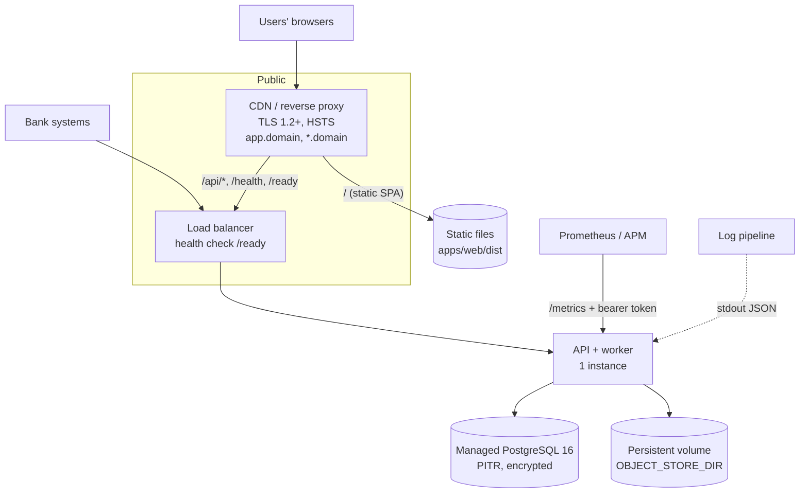

# 6. Deployment

## Contents
- [6.1 Reference topology](#61-reference-topology)
- [6.2 Build artefacts](#62-build-artefacts)
- [6.3 Container images (reference)](#63-container-images-reference)
- [6.4 Reverse proxy](#64-reverse-proxy)
- [6.5 DNS and white-label hostnames](#65-dns-and-white-label-hostnames)
- [6.6 First deployment of an environment](#66-first-deployment-of-an-environment)
- [6.7 Releasing a new version](#67-releasing-a-new-version)
- [6.8 Rolling back](#68-rolling-back)
- [6.9 Production gaps to close](#69-production-gaps-to-close)

The repository does not ship deployment manifests (Dockerfile, Helm chart, Terraform). This chapter gives the requirements and reference snippets; adapt them to your platform (ECS, Kubernetes, App Service, VMs). Anything marked *reference* is an example, not a tested artefact.

## 6.1 Reference topology



| Piece | Requirement |
| --- | --- |
| Web | Static hosting for `apps/web/dist`, SPA fallback (unknown paths → `index.html`), same origin as `/api`. |
| API | Node 22, 1 instance (see gap G1), ~512 MB–1 GB RAM to start; listens on `PORT`; stateless apart from the object store directory. |
| Database | PostgreSQL 16, TLS, encryption at rest, PITR (RPO < 15 min), connections ≥ 10 per API instance + admin headroom. |
| Object store | Persistent, backed-up volume mounted at `OBJECT_STORE_DIR` (gap G2). |
| Secrets | `DATABASE_URL`, `MIGRATE_DATABASE_URL`, `WEBHOOK_KEY`, `METRICS_TOKEN` from a secrets manager. |
| Residency | One complete deployment per data-residency zone (India, Singapore, …); the MVP is single-region. |

## 6.2 Build artefacts

| Artefact | Build | Run |
| --- | --- | --- |
| **Web** | `npm ci && npm run build -w @earlio/web` → `apps/web/dist/` | Any static host |
| **API** | `npm ci` (with dev dependencies — `tsx` and `typescript` are dev dependencies) and `npm run typecheck -w @earlio/api` as the gate | `npm run start -w @earlio/api` = `tsx src/server.ts` |

The API is **not compiled to JavaScript**; it runs TypeScript through `tsx`. It needs `apps/api/src`, `apps/api/migrations`, `apps/api/package.json`, the root `package.json`/`package-lock.json` and `node_modules`. Migrations are read from disk at start, so they must be in the image.

Tag every artefact with the git commit SHA, and build from a clean checkout of a commit whose CI is green.

## 6.3 Container images (reference)

**API** — `Dockerfile.api` (reference; place at the repository root):

```dockerfile
FROM node:22-bookworm-slim
WORKDIR /srv/earlio
ENV NODE_ENV=production EARLIO_ENV=production PORT=4000
COPY package.json package-lock.json ./
COPY apps/api/package.json apps/api/
COPY apps/web/package.json apps/web/
COPY vendor ./vendor
RUN npm ci --workspace @earlio/api --include-workspace-root
COPY apps/api ./apps/api
RUN npm run typecheck -w @earlio/api
RUN mkdir -p /var/lib/earlio/objects && chown -R node:node /var/lib/earlio
USER node
EXPOSE 4000
HEALTHCHECK --interval=30s --timeout=5s CMD node -e "fetch('http://127.0.0.1:4000/health').then(r=>process.exit(r.ok?0:1)).catch(()=>process.exit(1))"
CMD ["npm", "run", "start", "-w", "@earlio/api"]
```

Notes:
- `npm ci` with `NODE_ENV=production` would skip dev dependencies; the reference installs them because `tsx` is needed at run time. Make sure no `apps/api/.env` is copied in (add `**/.env` to `.dockerignore`).
- Mount the object store volume at `/var/lib/earlio/objects` and set `OBJECT_STORE_DIR` to it.

**Web** — build once and upload `apps/web/dist/` to the static host, or serve it from an nginx image:

```dockerfile
FROM node:22-bookworm-slim AS build
WORKDIR /src
COPY . .
RUN npm ci && npm run build -w @earlio/web

FROM nginx:1.27-alpine
COPY --from=build /src/apps/web/dist /usr/share/nginx/html
COPY deploy/nginx.conf /etc/nginx/conf.d/default.conf
```

## 6.4 Reverse proxy

The SPA and the API must share an origin (cookies are `SameSite=Lax`, the client uses relative URLs). Reference nginx server block:

```nginx
server {
  listen 443 ssl http2;
  server_name app.example.com *.example.com;        # platform host + bank tenant subdomains
  ssl_certificate     /etc/ssl/earlio/fullchain.pem; # wildcard certificate
  ssl_certificate_key /etc/ssl/earlio/privkey.pem;
  ssl_protocols TLSv1.2 TLSv1.3;
  client_max_body_size 12m;                          # uploads up to 10 MB + overhead

  root /usr/share/nginx/html;
  location /assets/ { expires 1y; add_header Cache-Control "public, immutable"; }
  location = /index.html { add_header Cache-Control "no-store"; }

  location ~ ^/(api/|health$|ready$) {
    proxy_pass http://earlio_api:4000;
    proxy_set_header Host              $host;
    proxy_set_header X-Forwarded-Host  $host;   # decides which bank's branding is shown
    proxy_set_header X-Forwarded-For   $proxy_add_x_forwarded_for;
    proxy_set_header X-Forwarded-Proto $scheme;
    proxy_set_header X-Correlation-Id  $request_id;
    proxy_read_timeout 60s;
  }
  location = /metrics { deny all; }                 # scrape the API directly on the private network
  location = /openapi.json { proxy_pass http://earlio_api:4000; }  # optional: publish the contract
  location / { try_files $uri /index.html; }
}
```

Points that matter:
- Forward **`X-Forwarded-Host`** — without it every bank portal shows default Earlio branding.
- Forward **`X-Forwarded-For`** — the rate limiter keys on the client address (`trustProxy` is on). Make sure only your proxy can reach the API, or clients can spoof the header.
- Keep `/metrics` off the public internet even though it needs a token.
- Body size: the API accepts up to 3 MB JSON and 10 MB files.

## 6.5 DNS and white-label hostnames

| Record | Points to | Purpose |
| --- | --- | --- |
| `app.<domain>` | CDN/proxy | Main platform entry (network mode) |
| `*.<domain>` | CDN/proxy | Bank portals by tenant name (`kestrel.<domain>`); needs a wildcard TLS certificate |
| Custom bank domains (e.g. `trade.kestrelbank.com`) | CDN/proxy, CNAME set by the bank | Optional; set by platform staff under **Tenant domains** and covered by a certificate on the proxy |

Platform labels such as `www`, `app`, `admin`, `api`, `earlio` are reserved and cannot be used as tenant names.

## 6.6 First deployment of an environment

1. **Database**: provision and prepare it ([Database § 4.7](04-database-and-migrations.md#47-preparing-a-production-database)); create `earlio_app` with a strong password.
2. **Secrets**: create `DATABASE_URL`, `MIGRATE_DATABASE_URL`, `WEBHOOK_KEY`, `METRICS_TOKEN` in the secrets manager ([Security § 8.2](08-security-and-secrets.md#82-secrets)).
3. **Storage**: create the persistent, backed-up volume for `OBJECT_STORE_DIR`.
4. **Deploy the API** with `EARLIO_ENV=production`. On first start it applies all migrations. Check the log for `Server listening` and no `migration … failed`.
5. **Verify configuration guards**: `GET /api/v1/system/config` must return `"env":"production","simulated":false`; `GET /api/v1/dev/totp?email=x@y.z` must return 404.
6. **Deploy the web** static files and the proxy; check `https://app.<domain>/health`.
7. **Bootstrap the platform organisation and first administrators.** Production does not run the demo seed, so there are no users.
   > **Gap G4:** there is no production bootstrap command yet. Until one exists, create the platform organisation and the first PlatformAdmin with a reviewed one-off script that uses the identity service functions (so passwords are hashed and audit events written), run it once, and store the evidence. Each administrator enrols MFA at first sign-in and stores their recovery codes.
8. **Monitoring**: register `/ready` with the load balancer and uptime monitor, scrape `/metrics`, ship logs ([chapter 7](07-operations-and-observability.md)).
9. **Run the smoke test** (§ 6.7 step 6) and the [pilot-readiness checklist](../pilot-readiness.md).
10. Run and record a **restore drill** before go-live ([Operations § 7.6](07-operations-and-observability.md#76-backup-and-restore)).

## 6.7 Releasing a new version

1. **Prepare**: the release commit is on `main`, CI (`ci` and `security`) is green, `docs/progress.md` is updated. Read the commit range for new migrations (`git diff --name-only <prev>..<new> -- apps/api/migrations`) and for new configuration.
2. **Check migrations** are backward compatible ([Database § 4.3](04-database-and-migrations.md#43-writing-a-migration)). If one rewrites a large table, plan a window.
3. **Back up**: note the current time for PITR, or take an on-demand snapshot if the release has migrations.
4. **Deploy the API**. With one instance there is a short interruption (seconds) while it restarts; schedule outside business hours for the pilot. Migrations apply at start; a failing migration stops the new process before it listens, so the load balancer keeps routing to nothing — roll back immediately (§ 6.8).
5. **Deploy the web** files *after* the API (new web code may call new endpoints). `index.html` must not be cached; hashed assets can be.
6. **Smoke test** (5 minutes):
   - `GET /ready` → `{"ready":true,"migrations":<expected count>,…}`;
   - sign in as a platform administrator (password + MFA); open Home, KYC queue, Settlement;
   - **Audit log → Verify chain** → "Chain intact";
   - for a bank portal, open `https://<tenant>.<domain>` and check its branding;
   - watch error rate and p95 latency for 15 minutes.
7. **Announce** the release with the commit SHA and the list of changes.

## 6.8 Rolling back

| Situation | Action |
| --- | --- |
| New code misbehaves, no migration in the release | Redeploy the previous image/artefact. |
| New code misbehaves, release had backward-compatible migrations | Redeploy the previous image. The old code ignores the new columns/tables. Fix forward later. |
| A migration failed on start | Nothing was committed for that file (it runs in one transaction). Redeploy the previous image; fix the migration in a new commit. |
| A migration destroyed or corrupted data | Stop the API (and worker). Restore the database to a new instance at the time noted in step 3 of the release, verify, and switch the connection string. Escalate as an incident. |
| Web only | Re-upload the previous `dist/`. |

## 6.9 Production gaps to close

These are known gaps between the MVP and a production deployment, from the code and [`docs/pilot-readiness.md`](../pilot-readiness.md):

| # | Gap | Impact | Suggested fix |
| --- | --- | --- | --- |
| G1 | The worker runs inside every API process and cannot be disabled outside `test` | Running more than one instance runs every job N times; only the outbox drain is known to be safe | Add a flag (e.g. `EARLIO_WORKER=off`) and run one dedicated worker; or make each job lock-safe |
| G2 | Only a local-disk object store exists | Files live on one volume; no versioning or replication | Implement `ObjectStore` for S3/Blob; versioned bucket with cross-region replication |
| G3 | `migrate()` creates `earlio_app` with the password `earlio_app` if the role is missing | Weak password if the role is not pre-created | Pre-create the role (§ 6.6 step 1); later, take the password from a secret |
| G4 | No production bootstrap for the first platform administrator | Manual one-off script needed | Add a CLI command that creates the platform org and first admin |
| G5 | All external integrations are simulators (payments, FX, KYC, sanctions, insurer, e-mail/SMS, TSA, antivirus) | Not usable with real money or real customers | Implement production adapters behind the existing interfaces |
| G6 | Secrets come from environment variables only | — | Implement `SecretProvider` for your vault |
| G7 | No data archiving jobs | Tables grow unbounded | See [Database § 4.8](04-database-and-migrations.md#48-data-retention-and-growth) |
| G8 | API runs through `tsx` (no compiled build) | Slower start, dev dependencies in the image | Add a `tsc` emit step and run `node dist/server.js` |
| G9 | The Users page cannot e-mail invitations or reset passwords | Support must handle resets | Add invitation and reset flows (see [support runbooks](../support/03-runbooks.md)) |
| G10 | Single region | Residency only by separate deployments | One deployment per residency zone |
