# Earlio user manual — Getting started

*For everyone who uses Earlio: suppliers, buyers, banks, insurers and Earlio staff.*

Earlio is a tri-party receivables financing platform. A **supplier** (an exporter) raises an invoice, the **buyer** accepts it and promises to pay, an **insurer** covers the buyer's credit risk, and one or more **banks** compete to advance cash against the invoice. Earlio runs the workflow, prices the offers, moves the money and keeps an audit trail that cannot be edited.

This guide covers what is the same for every organisation: registering, signing in with two-step verification, finding your way around, notifications, language, and the life of an invoice. When you have read it, go to the manual for your organisation:

| Manual | For |
| --- | --- |
| [Supplier manual](01-supplier.md) | Exporters who raise invoices and get paid early |
| [Buyer manual](02-buyer.md) | Importers who accept invoices and pay them |
| [Bank manual](03-bank.md) | Banks that price, fund and collect invoices |
| [Insurer manual](04-insurer.md) | Trade-credit insurers that cover buyers and pay claims |
| [Platform manual](05-platform.md) | Earlio operations staff and auditors |
| [Index](index.md) | Subject index, task index and list of figures for all manuals |

> **About the screenshots.** The screenshots were taken in Earlio's demo environment, which uses fictional companies (Shree Textiles, Northwind Retail Inc., Aurelia Bank and so on), simulated banks and exchange rates, and a virtual clock set to 2 November 2026. A yellow **Simulated environment** banner appears on every page there. In production the banner is absent and the names and figures are your own.

## Contents

1. [Registering your organisation](#gs-register)
2. [Signing in](#gs-sign-in)
   1. [Your first sign-in: setting up two-step verification](#gs-mfa-enrol)
   2. [Recovery codes](#gs-recovery-codes)
   3. [Signing in on a bank's own portal](#gs-bank-portal)
3. [Finding your way around](#gs-layout)
   1. [The sidebar](#gs-sidebar)
   2. [The top bar: search, notifications and your account](#gs-top-bar)
   3. [The home dashboard](#gs-home)
4. [Notifications](#gs-notifications)
5. [Language](#gs-language)
6. [Belonging to more than one organisation](#gs-switch-org)
7. [Roles and the four-eyes rule](#gs-roles)
8. [The life of an invoice](#gs-lifecycle)
   1. [Invoice statuses](#gs-statuses)
   2. [Invoice numbers](#gs-invoice-numbers)
   3. [The invoice page](#gs-invoice-page)
9. [Money, dates and rates](#gs-money)
10. [When Earlio says no](#gs-errors)
11. [Glossary](#gs-glossary)
12. [List of figures](#gs-figures)

---

<a id="gs-register"></a>
## 1. Registering your organisation

If your organisation is not on Earlio yet, one person registers it. That person becomes the organisation's first **Admin** and can add colleagues later (see the *Users* section of your organisation's manual).

1. Open the Earlio sign-in page and choose **Register your organisation**.
2. Under **I am a**, choose **Supplier (exporter)**, **Buyer**, **Bank** or **Insurer**.
3. Enter the organisation's **Legal name** exactly as it appears on its incorporation documents. Earlio screens this name against sanctions lists.
4. Enter the **Country** as a two-letter code (for example `IN`, `US`, `SG`).
5. Suppliers enter **Annual turnover (INR)**. Earlio uses it to tell whether you are a small supplier, which matters for some protections (for example the cap on what a small supplier can be charged).
6. Enter **Your name**, your **Work email** and a **Password**. The password needs at least 12 characters with upper- and lower-case letters, a digit and a symbol.
7. Choose **Register**. You are taken straight to two-step verification set-up (next section).

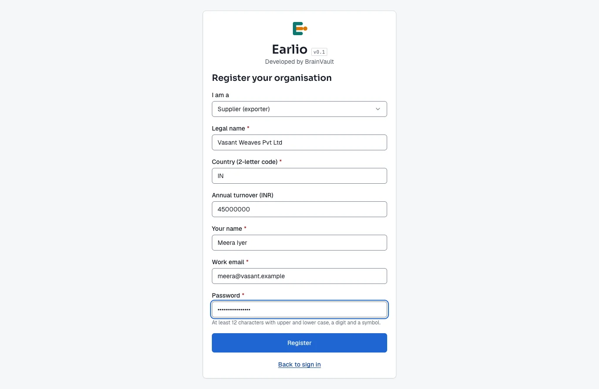
*Figure G-1. Registering a new supplier organisation.*

After registering, your organisation must pass **KYC** (know-your-customer) checks before it can trade. Upload the requested documents under **KYC application** and submit them; an Earlio reviewer approves or rejects the application. Each manual explains the KYC page for its organisation type.

<a id="gs-sign-in"></a>
## 2. Signing in

1. Open Earlio. Enter your **Email** and **Password** and choose **Continue**.
2. Earlio asks for an **Authentication code**. Open your authenticator app (Google Authenticator, Microsoft Authenticator, 1Password, Authy or similar), read the six-digit code for Earlio and type it in.
3. Choose **Verify**. Your home dashboard opens.

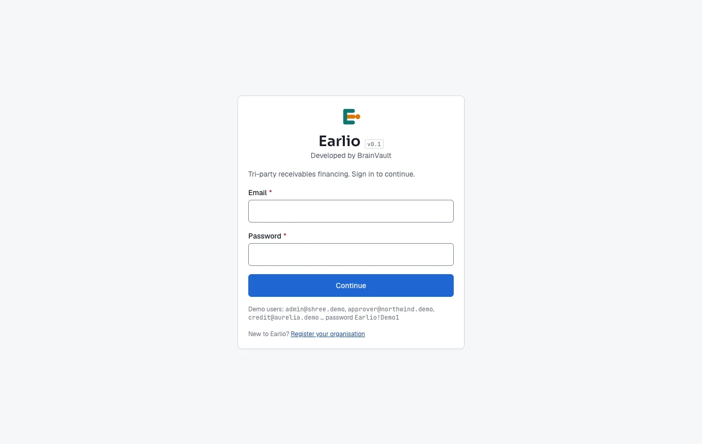
*Figure G-2. The sign-in page.*

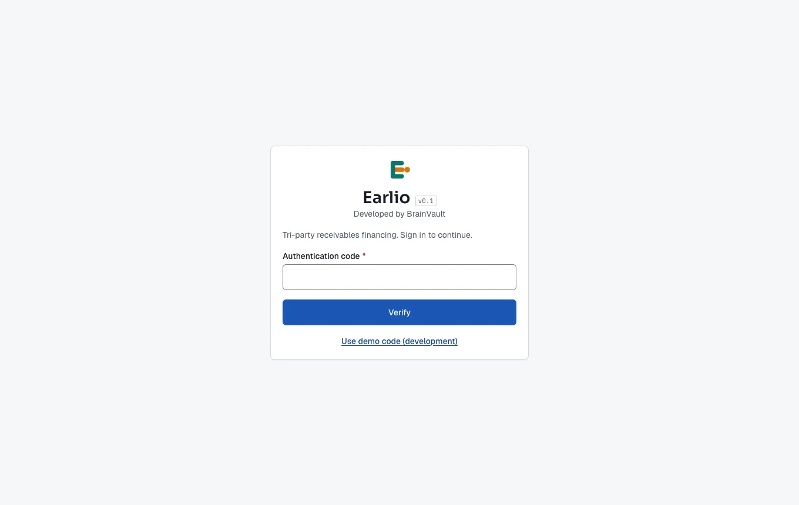
*Figure G-3. The second step: the six-digit code from your authenticator app.*

Two-step verification is mandatory for every user in every role; it cannot be turned off.

**If you type the wrong password five times in a row, your account is locked for 15 minutes.** Wait and try again; a successful sign-in resets the count.

> **Demo environment only.** On the demo and development sites the code step also shows **Use demo code (development)**, which fills in the current code for a demo user. This link does not exist in production.

<a id="gs-mfa-enrol"></a>
### 2.1 Your first sign-in: setting up two-step verification

The first time you sign in, Earlio shows a QR code instead of asking for a code.

1. In your authenticator app, add a new account and scan the QR code. If you cannot scan it, type the key shown under the QR code into the app instead.
2. Type the six-digit code the app now shows and choose **Verify**.

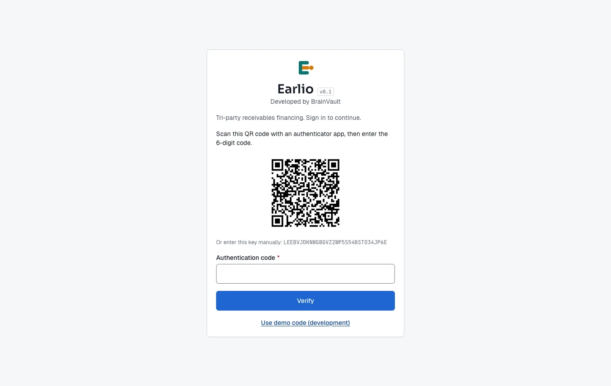
*Figure G-4. First sign-in: scan the QR code with your authenticator app.*

<a id="gs-recovery-codes"></a>
### 2.2 Recovery codes

Straight after enrolment Earlio shows eight one-time **recovery codes**. Each one can be used once instead of an authenticator code: type it into the **Authentication code** box, for example if you lose your phone.

- Save them somewhere safe (a password manager is ideal) **before** you choose **I have saved them**. They are never shown again.
- Do not share them. Anyone with your password and a recovery code can sign in as you.

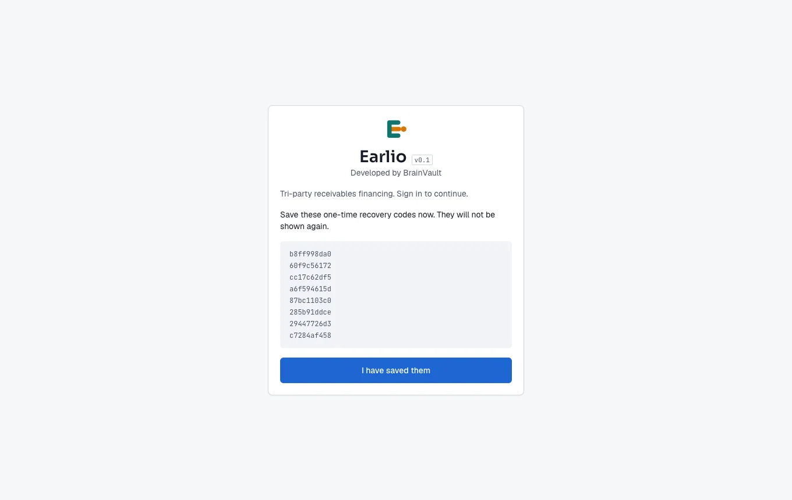
*Figure G-5. One-time recovery codes, shown once only.*

<a id="gs-bank-portal"></a>
### 2.3 Signing in on a bank's own portal

Some banks offer Earlio under their own name and colours ("white-label"). If your bank gave you a portal address such as `https://aurelia.<earlio-domain>/`, the sign-in page carries the bank's name, colours and welcome text, with **Powered by Earlio** underneath. Signing in works exactly the same way and you see the same Earlio account.

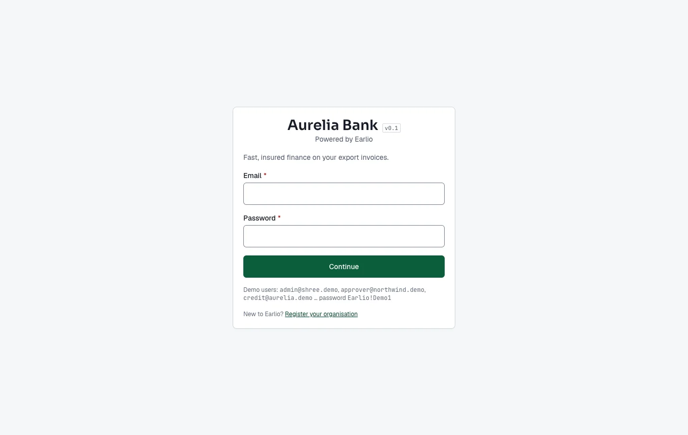
*Figure G-6. Sign-in on a bank's branded portal (Aurelia Bank in the demo).*

<a id="gs-layout"></a>
## 3. Finding your way around

<a id="gs-sidebar"></a>
### 3.1 The sidebar

The sidebar on the left lists the pages you can use. It is **role-aware**: you only see pages your organisation type and your role allow. Pages are grouped under headings such as **Overview**, **Work**, **Money**, **Controls** and **Account**. The button at the top left of the top bar collapses the sidebar to icons, which is useful on small screens.

Your name, organisation and role are shown at the foot of the sidebar.

<a id="gs-top-bar"></a>
### 3.2 The top bar: search, notifications and your account

| Control | What it does |
| --- | --- |
| **Search invoices** | Type an invoice number (yours or the Earlio number) and press Enter; the invoice list opens filtered to matching invoices. |
| Bell icon | Shows your unread notifications. See [Notifications](#gs-notifications). |
| Your initials | Opens the account menu: switch organisation (if you belong to more than one), switch language between English and हिन्दी, and **Sign out**. |

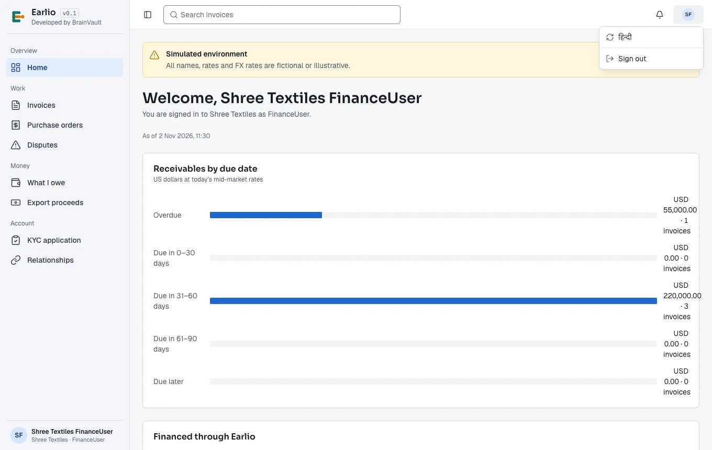
*Figure G-7. The account menu: language and sign out. Users who belong to several organisations also see "Switch to …" entries here.*

<a id="gs-home"></a>
### 3.3 The home dashboard

**Home** is the first page after sign-in. It greets you by name, says which organisation and role you are signed in as, shows the platform date ("As of …"), and shows figures that matter for your organisation type:

- **Suppliers** — receivables by due date, what has been financed and at what average cost, the estimated saving against your own borrowing rate, and invoices by status.
- **Buyers** — payables by due date, how quickly you accept invoices, early-payment savings and a list of your suppliers.
- **Banks** — invoices funded, amounts outstanding and overdue, invitations and offers by status, and exposure by buyer and supplier.
- **Insurers** — limit utilisation by buyer, decision times, cover requests by status.
- **Earlio staff** — the pilot scorecard (six measures of success) and network size.

A green **Target met** or amber **Below target** label next to a figure compares it with the pilot target. Admins also see a **Notification language** setting at the bottom of the home page (see [Language](#gs-language)).

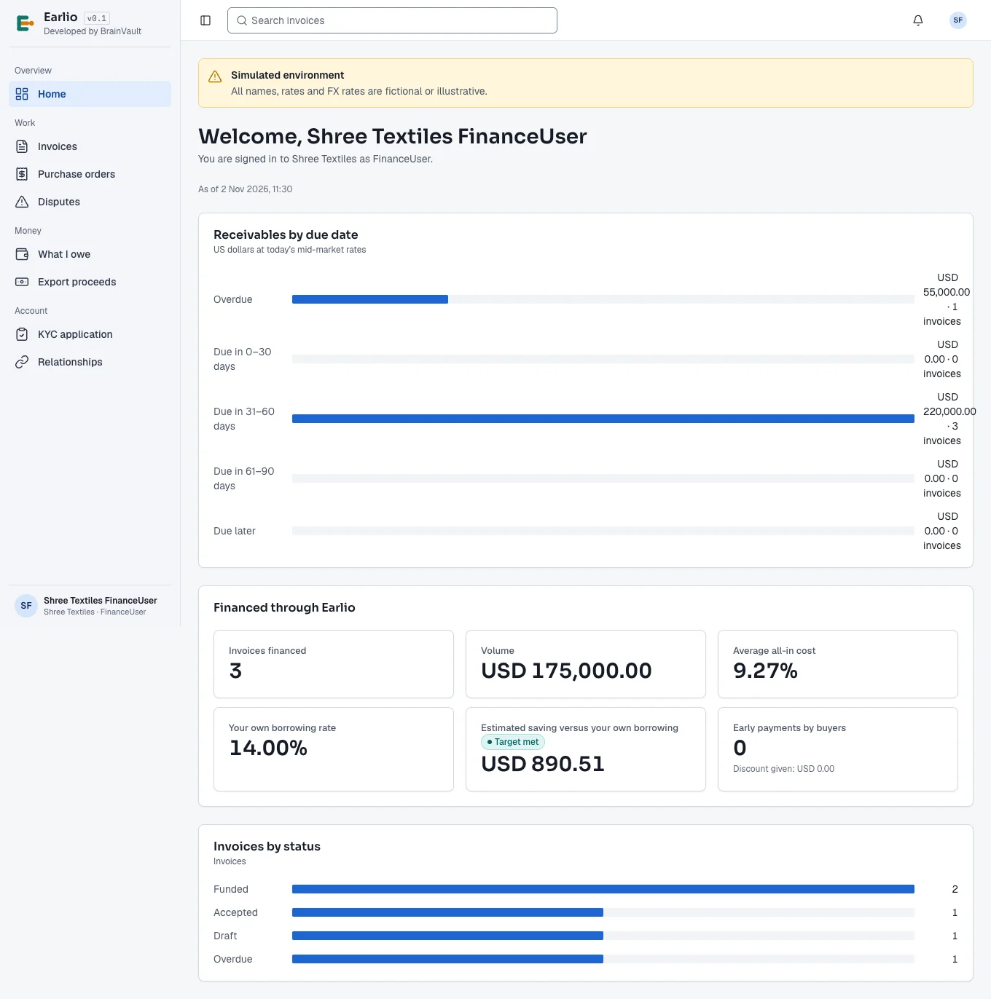
*Figure G-8. The home dashboard (supplier view).*

<a id="gs-notifications"></a>
## 4. Notifications

Earlio tells you when something needs your attention or has happened: an invoice was submitted to you, a buyer accepted your invoice, a bank sent an offer, money was credited, a dispute was raised, and so on.

- The **bell** in the top bar shows how many notifications are unread.
- The **Notifications** page lists them newest first. Each one says what happened and to which invoice. Choose **Mark read** on one, or **Mark all read**.
- Notifications go to your **organisation**, so everyone in it with access sees them.
- Depending on your organisation's settings, key events are also sent by email, SMS or WhatsApp.

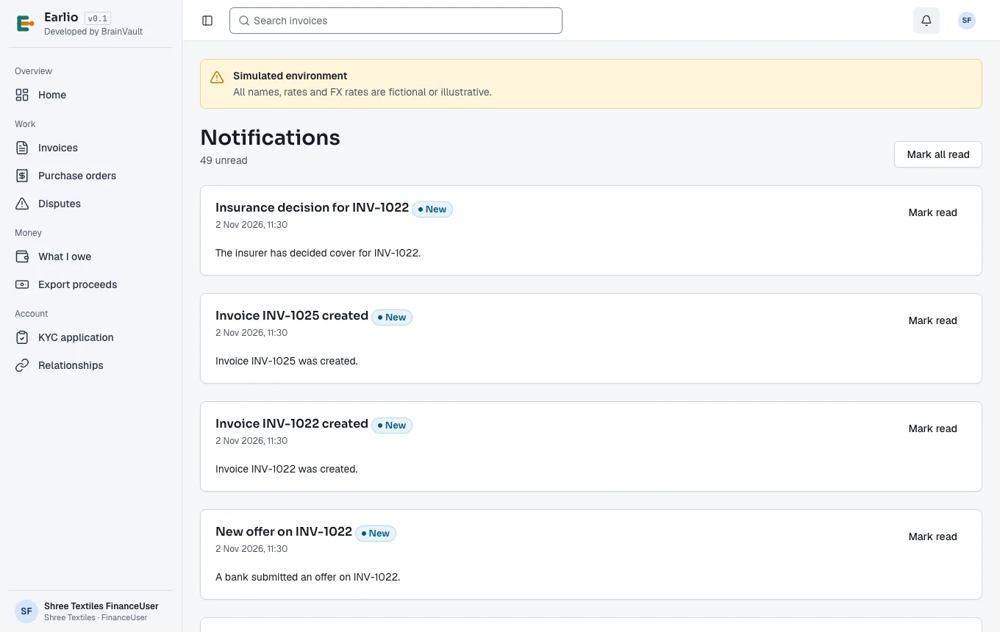
*Figure G-9. The notifications page.*

<a id="gs-language"></a>
## 5. Language

Earlio's screens are available in English and Hindi.

- **For yourself:** open the account menu (your initials, top right) and choose **हिन्दी**; choose **English** to switch back. The choice applies to your browser only. Parts of the interface that are not yet translated stay in English.
- **For your organisation's messages:** an Admin chooses the **Notification language** at the bottom of the home page. Emails, SMS and WhatsApp messages are sent in that language.

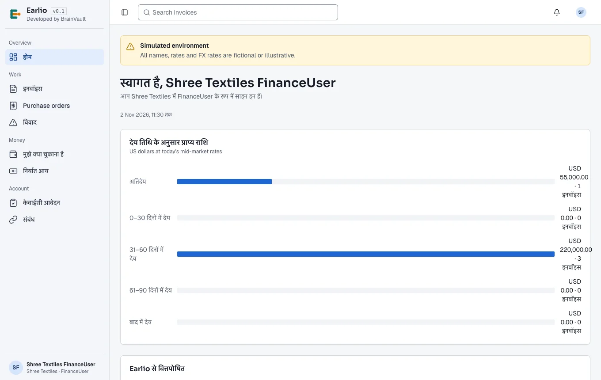
*Figure G-10. The home page with Hindi selected.*

<a id="gs-switch-org"></a>
## 6. Belonging to more than one organisation

One person can be a member of several organisations, with a different role in each (for example a consultant who works for two suppliers). The account menu then lists **Switch to *organisation* — *role*** entries. Choosing one reloads Earlio inside that organisation. Everything you see and do afterwards belongs to the organisation you switched to; nothing is shared between them.

<a id="gs-roles"></a>
## 7. Roles and the four-eyes rule

Each user has one **role** in each organisation. The role decides which pages and buttons you see. Every role can read its own organisation's dashboard, invoices, notifications, disputes and claims; the table shows what each role adds.

| Organisation | Roles |
| --- | --- |
| Supplier | Admin, FinanceUser, Approver, Viewer |
| Buyer | Admin, FinanceUser, Approver, Viewer |
| Bank | Admin, FinanceUser, Approver, CreditOfficer, Operations, RelationshipManager, Viewer |
| Insurer | Admin, Approver, Underwriter, ClaimsHandler, Viewer |
| Earlio | PlatformAdmin, Auditor |

The detailed list of what each role can do is in each organisation's manual.

**The four-eyes rule (maker-checker).** Earlio never lets one person both propose and approve an important change:

- the person who proposes a buyer–supplier relationship cannot approve it;
- the person who drafts a bank's or insurer's terms cannot publish them;
- one Earlio administrator cannot approve their own change to a platform setting.

If a button is missing or refuses with a message such as "a different approver must publish it", this rule is the reason. Ask a colleague with the right role.

<a id="gs-lifecycle"></a>
## 8. The life of an invoice

```
Supplier creates   Buyer accepts   Insurer       Banks       Supplier picks    Bank pays     Buyer pays     Earlio
Draft ──submit──▶ Submitted ──▶ Accepted ──▶ covers ──▶ OpenForFunding ──▶ OffersReceived ──▶ Funded ──▶ Settled ──▶ Closed
                      │                                              ▲
                      └──▶ Rejected                                   └── or the buyer pays early (no bank needed)
```

1. **Supplier** creates the invoice, attaches the commercial invoice and proof of delivery, and submits it to the buyer.
2. **Buyer** checks it and accepts it in full, accepts part of it, or rejects it with a reason. Accepting signs an irrevocable promise to pay. Silence is never treated as acceptance.
3. **Insurer** is asked automatically to cover the buyer's risk on the invoice and approves (possibly at a lower percentage) or declines.
4. **Supplier** requests funding. Earlio checks the funding gates and invites banks.
5. **Banks** send offers. The supplier compares them by all-in cost, net cash and exchange rate, and chooses one — or offers the buyer an early-payment discount instead.
6. **Supplier's approver** consents to the financing; the **buyer** acknowledges the assignment notice; the **bank** confirms and pays. The money reaches the supplier in rupees.
7. On the due date the **buyer** pays the bank's collection account, quoting the payment reference. Earlio matches the payment, releases the bank's claim and closes the invoice.

If something goes wrong — a dispute, a credit note, late payment, default and an insurance claim — the invoice takes a side path described in each manual.

<a id="gs-statuses"></a>
### 8.1 Invoice statuses

| Status | Meaning |
| --- | --- |
| **Draft** | Created by the supplier, not yet sent to the buyer. Can be edited or cancelled. |
| **Submitted** | Sent to the buyer, awaiting acceptance ("Awaiting acceptance" in filters). |
| **Rejected** | The buyer rejected it, with a reason. |
| **Accepted** | The buyer accepted it (in full or in part) and signed the payment undertaking. The accepted amount is locked. |
| **NotEligible** | The supplier asked for funding but a funding gate failed. The reason is shown; fix it and choose **Check again**. |
| **OpenForFunding** | Banks have been invited to make offers. |
| **OffersReceived** | At least one bank has sent an offer. |
| **Funded** | The bank has paid the supplier (or the buyer paid early). |
| **Disputed** | The buyer raised a dispute. The invoice is frozen while the dispute is open. |
| **Overdue** | The due date has passed without full payment. Reminders and late interest start. |
| **Defaulted** | Still unpaid after the insurer's waiting period; an insurance claim can be filed. |
| **Settled** | The buyer has paid and the money has been distributed. |
| **Closed** | Fully reconciled. Nothing more to do. |
| **Cancelled** | A draft the supplier cancelled. |

<a id="gs-invoice-numbers"></a>
### 8.2 Invoice numbers

Every invoice has two numbers, shown side by side in lists:

- the **Earlio number** (for example `INV-1018`), unique across the platform, used in payment references and notifications; and
- **your own invoice number** as the supplier entered it (for example `INV-1006`).

Search accepts either.

<a id="gs-invoice-page"></a>
### 8.3 The invoice page

Everyone involved in an invoice opens the same page, but each organisation sees only what it is entitled to. For example, a buyer never sees a bank's rate or the supplier's net cash, and a bank sees an invoice only once it is invited to price it. The page is built from panels:

| Panel | Shows |
| --- | --- |
| Header | Earlio number, status, supplier → buyer, your invoice number, the e-invoice reference (IRN), and the actions available to you right now. |
| **Amounts** | Invoice amount, accepted amount, issue and due dates, purchase order, sanctions screening result, and when the dispute window closes. |
| **Timeline** | Every status change with its date and reason, newest first. |
| **Insurance cover** | The insurer, policy, cover percentage and insured amount, or why there is no cover. |
| **Funding** | Offers, the chosen financing, the assignment notice, early-payment options — depending on who you are. |
| **Payment and settlement** | The payout to the supplier, the buyer's payment and the ledger entries. |
| **Documents** | Every document with its version and SHA-256 fingerprint, so anyone can check it was not altered. |
| **Acceptance** | The buyer's signed undertaking, word for word, with the time it was signed. |
| **Disputes, credit notes and overdue** | Forms to raise a dispute or issue a credit note, and the overdue status. |

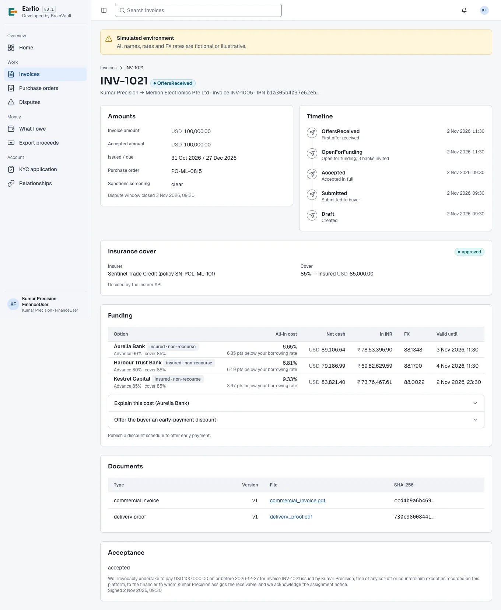
*Figure G-11. An invoice page as the supplier sees it, with three bank offers.*

<a id="gs-money"></a>
## 9. Money, dates and rates

- **Currencies.** Invoices are in US dollars (USD) or Singapore dollars (SGD). Suppliers are paid in Indian rupees (INR); every offer shows the INR amount and the exchange rate used.
- **All-in cost** is the total cost of financing — interest, fees and any premium passed on — expressed as a yearly percentage, so offers with different fees can be compared fairly.
- **Net cash** is what the supplier actually receives after all charges.
- **Exchange rates** are the bank's rate: the market mid-rate less the bank's spread. Earlio never allows a spread above 1%.
- **Rounding.** Each charge is rounded to two decimals (half away from zero) and then added up, so the lines on a cost breakdown always add up to the total.
- **Day count.** Interest uses the actual number of days over a 365-day year.
- **Dates and times** are shown in your browser's time zone. Banking days follow the holiday calendars of India, the United States and Singapore.

<a id="gs-errors"></a>
## 10. When Earlio says no

Earlio always explains a refusal in plain language — for example *"Tenor of 135 days is above this bank's maximum of 120 days"* or *"There is an open dispute on this invoice."* Read the message: it says what to change. Common causes:

| Message mentions | What to do |
| --- | --- |
| a different person / approver | The four-eyes rule. Ask a colleague with the right role. |
| sanctions | A party matched a sanctions list. Earlio staff review it; funding stays blocked until they clear it. |
| the dispute window | Funding can only complete after the buyer's dispute window (at least 24 hours after acceptance). Wait and try again. |
| relationship | The supplier–buyer relationship is not active yet. Both sides must approve it under **Relationships**. |
| limit | A bank or insurer limit has no room left for this invoice. |
| missing document | Attach the named document and try again. |

<a id="gs-glossary"></a>
## 11. Glossary

| Term | Meaning |
| --- | --- |
| **Advance** | The share of the invoice a bank pays up front (for example 90%). |
| **All-in cost** | The yearly cost of financing including every charge. |
| **Assignment notice** | The notice telling the buyer that the supplier has assigned the right to be paid to a bank, and that the buyer must now pay the bank. |
| **Benchmark rate** | The reference interest rate a bank adds its margin to. |
| **Collection account** | The bank account the buyer pays a financed invoice into. |
| **Cover** | The insurer's promise to pay a share of the invoice if the buyer does not. |
| **Credit note** | A reduction of an invoice issued by the buyer. |
| **Dispute window** | The period after acceptance (at least 24 hours) during which the buyer can still dispute an invoice before funding completes. |
| **Early payment** | The buyer pays before the due date in exchange for a discount, without a bank. |
| **Exposure limit** | The most a bank is willing to have outstanding on one buyer or supplier. |
| **IRN** | Invoice Reference Number from the Indian GST e-invoice system. |
| **KYC** | Know-your-customer checks on an organisation before it can trade. |
| **Lien** | Earlio's record that a bank has a claim on an invoice. One invoice can carry only one lien, so it can never be financed twice. |
| **Maker-checker** | The four-eyes rule: one person proposes, a different person approves. |
| **Non-recourse** | The bank cannot ask the supplier to repay if the buyer does not pay — except for disputes the supplier caused. |
| **Recourse** | Money the supplier owes back to the bank after a supplier-caused dispute or a credit note on a financed invoice. |
| **Tenor** | Days from funding to the due date. |
| **Terms** | A bank's or insurer's rules and prices, held as versioned data and approved under maker-checker. |
| **Undertaking** | The buyer's signed, irrevocable promise to pay the accepted amount on the due date. |
| **Waiting period** | Days after the due date the insurer waits before a claim can be filed. |

<a id="gs-figures"></a>
## 12. List of figures

| Figure | Title |
| --- | --- |
| G-1 | [Registering a new supplier organisation](#gs-register) |
| G-2 | [The sign-in page](#gs-sign-in) |
| G-3 | [The second step: the six-digit code from your authenticator app](#gs-sign-in) |
| G-4 | [First sign-in: scan the QR code with your authenticator app](#gs-mfa-enrol) |
| G-5 | [One-time recovery codes, shown once only](#gs-recovery-codes) |
| G-6 | [Sign-in on a bank's branded portal (Aurelia Bank in the demo)](#gs-bank-portal) |
| G-7 | [The account menu: language and sign out. Users who belong to several organisations also see "Switch to …" entries here](#gs-top-bar) |
| G-8 | [The home dashboard (supplier view)](#gs-home) |
| G-9 | [The notifications page](#gs-notifications) |
| G-10 | [The home page with Hindi selected](#gs-language) |
| G-11 | [An invoice page as the supplier sees it, with three bank offers](#gs-invoice-page) |
