# Earlio user manual — Suppliers

*For exporters who raise invoices on Earlio and want to be paid early.*

Read [Getting started](00-getting-started.md) first: it covers registration, signing in with two-step verification, the screen layout, notifications, invoice statuses and the glossary. This manual covers everything a supplier does on Earlio. The screenshots show the demo suppliers Shree Textiles, Kumar Precision and Anand Handicrafts.

## Contents

1. [What Earlio does for a supplier](#sup-overview)
2. [Your roles](#sup-roles)
3. [Your pages](#sup-pages)
4. [Before you start: KYC, relationships and preferred banks](#sup-setup)
   1. [Completing your KYC application](#sup-kyc)
   2. [Linking with your buyers](#sup-relationships)
   3. [Choosing preferred banks](#sup-preferred-banks)
5. [Purchase orders](#sup-purchase-orders)
6. [Invoices](#sup-invoices)
   1. [The invoice list](#sup-invoice-list)
   2. [Creating an invoice](#sup-create-invoice)
   3. [Importing invoices (CSV or ERP)](#sup-import)
   4. [Attaching documents and submitting to the buyer](#sup-submit)
   5. [What the buyer decides](#sup-buyer-decision)
   6. [Insurance cover](#sup-cover)
7. [Getting paid early](#sup-funding)
   1. [Requesting funding](#sup-request-funding)
   2. [When an invoice is not eligible](#sup-not-eligible)
   3. [Comparing offers](#sup-compare-offers)
   4. [Understanding the cost breakdown](#sup-cost-breakdown)
   5. [Choosing an offer](#sup-choose-offer)
   6. [Giving consent (Approver)](#sup-consent)
   7. [Cancelling during the cooling-off period](#sup-cancel)
   8. [Offering the buyer an early-payment discount](#sup-early-payment)
   9. [After funding: the payout](#sup-payout)
8. [When things go wrong](#sup-exceptions)
   1. [Disputes](#sup-disputes)
   2. [Credit notes](#sup-credit-notes)
   3. [Overdue invoices](#sup-overdue)
   4. [What I owe (recourse)](#sup-recourse)
9. [Export proceeds](#sup-export-proceeds)
10. [Managing users (Admin)](#sup-users)
11. [Frequently asked questions](#sup-faq)
12. [List of figures](#sup-figures)

---

## 1. What Earlio does for a supplier

You sell goods to an overseas buyer on credit — say 60 days. Earlio lets you turn that invoice into rupees within days instead of waiting two months:

1. You raise the invoice on Earlio and the buyer accepts it, promising in writing to pay.
2. An insurer covers the buyer's credit risk.
3. Several banks compete to advance you up to 90% of the invoice. You see every offer side by side with the **all-in cost**, the **net cash** you receive and the **exchange rate**, and you choose.
4. The bank pays you in rupees. On the due date the buyer pays the bank directly, and any balance (the retention) is released to you.

The financing is **insured and without recourse**: if the buyer simply fails to pay, the bank claims from the insurer, not from you. You only owe the bank money back if a dispute caused by you (for example faulty goods) is decided against you, or a credit note reduces the invoice after the advance — see [What I owe](#sup-recourse).

As an alternative to bank financing, you can offer the buyer a discount to pay early. No bank or insurance is involved.

## 2. Your roles

| Role | Can do |
| --- | --- |
| **Admin** | Add and manage users; set the notification language; choose preferred banks; upload and submit KYC; propose buyer relationships. |
| **FinanceUser** | Create invoices (by hand, CSV or ERP import); record purchase orders; attach documents, submit and cancel drafts; request funding; choose an offer; publish or withdraw an early-payment discount; cancel financing during cooling-off; raise and withdraw disputes; KYC; propose relationships. |
| **Approver** | Give consent to financing (sign the assignment); cancel financing during cooling-off; approve relationships (not ones they proposed); choose how to repay recourse; raise disputes. |
| **Viewer** | Read everything, change nothing. |

Typical set-up: a finance team member is the FinanceUser who does the day-to-day work, and a director or CFO is the Approver who signs consent. Because consent is a separate role, financing always passes through two people.

## 3. Your pages

| Sidebar | Page | Used for |
| --- | --- | --- |
| Overview | **Home** | Receivables by due date, financing summary, invoices by status. |
| Work | **Invoices** | Creating, submitting and financing invoices. |
| Work | **Purchase orders** | Recording the buyer's purchase orders. |
| Work | **Disputes** | Disputes raised on your invoices. |
| Money | **What I owe** | Recourse you owe a bank, and how you repay it. |
| Money | **Export proceeds** | The 9-month export realisation tracker. |
| Account | **KYC application** | Your KYC documents and status. |
| Account | **Relationships** | Your buyers and your preferred banks. |
| Account | **Users** | Admin only: your organisation's users. |

*Figure S-1. The supplier home dashboard.*

The home dashboard shows:

- **Receivables by due date** — your open invoices grouped into Overdue, 0–30, 31–60, 61–90 days and later, converted to US dollars at today's mid-market rate.
- **Financed through Earlio** — how many invoices you financed, the volume, the **average all-in cost**, your own borrowing rate, the **estimated saving** against borrowing at that rate, and early payments by buyers with the discount you gave.
- **Invoices by status** — a count of your invoices in each status.

## 4. Before you start: KYC, relationships and preferred banks

### 4.1 Completing your KYC application

Before you can trade, Earlio must verify your organisation. Open **KYC application**.

1. For each document in the list, choose **Upload** and pick the file:
   - **incorporation certificate**
   - **GST registration**
   - **IEC code** (Importer-Exporter Code)
   - **bank account proof**
2. Each uploaded file is listed with its name and a SHA-256 fingerprint. Choose **Replace** to upload a different version. Documents can only be added or replaced while the application is a draft.
3. When every document is uploaded, choose **Submit for review**.

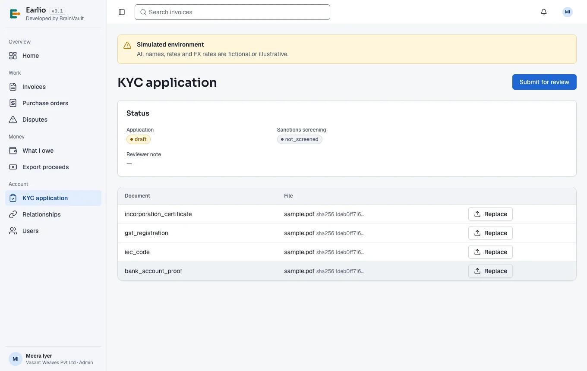
*Figure S-2. KYC application with the four documents uploaded.*

The **Status** box shows:

| Field | Meaning |
| --- | --- |
| **Application** | `not_started` (nothing uploaded yet), `draft` (documents being uploaded), `in_review` (submitted), `referred` (needs a closer look by Earlio), `approved` or `rejected`. |
| **Sanctions screening** | The result of screening your organisation's name: `clear`, or a hit under review. |
| **Reviewer note** | The Earlio reviewer's comment, if any. |

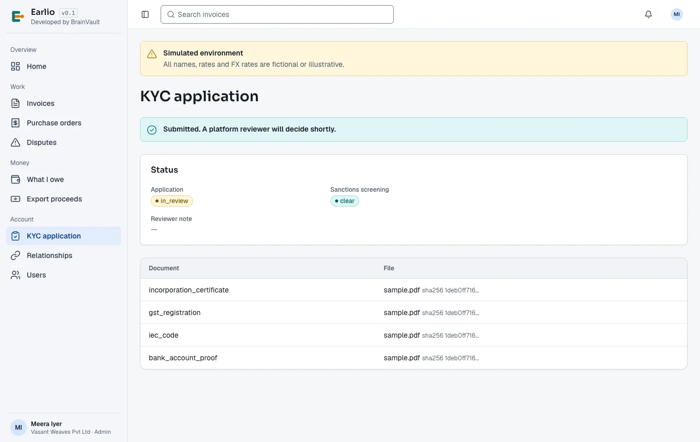
*Figure S-3. After submitting: the application is in review.*

An Earlio reviewer decides, usually within a working day. If the application is rejected, read the reviewer note, replace the documents and submit again.

### 4.2 Linking with your buyers

You can only invoice a buyer once there is an **active relationship** with it. Open **Relationships**.

1. Under **Link with a counterparty**, type part of the buyer's name in **Search organisations**.
2. Choose **Propose** next to the right buyer.
3. The relationship needs approval from **both sides**: an Approver at your organisation (not the person who proposed it) and an Approver at the buyer. The **Approvals** column shows who is still waiting. An Approver sees an **Approve** button on relationships waiting for them.

Once both have approved, the status becomes **active** and the buyer appears in the buyer list when you create an invoice.

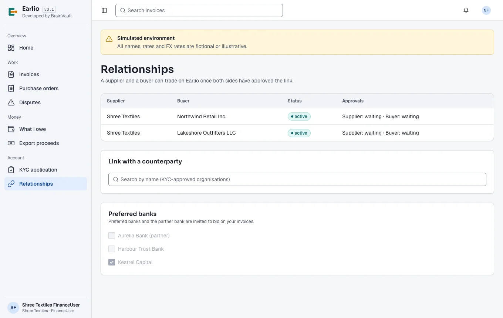
*Figure S-4. Relationships with buyers, and preferred banks.*

### 4.3 Choosing preferred banks

At the bottom of **Relationships**, **Preferred banks** lists the banks that are invited to make offers on your invoices. The platform's partner bank (marked **partner**) is always invited. An Admin ticks or unticks the other banks; other roles see the list but cannot change it. The buyer's preferred banks are invited too, so you may receive offers from banks you did not tick.

## 5. Purchase orders

Invoices backed by a purchase order (PO) are easier for buyers to accept; invoices without one are flagged for review. Record the buyer's PO before you raise the invoice against it.

1. Open **Purchase orders** and choose **New purchase order**.
2. Choose the **Buyer**, enter the **PO number** (it must be unique for that buyer), the **Currency**, the **Amount** and, optionally, a **Description**.
3. Choose **Record purchase order**.

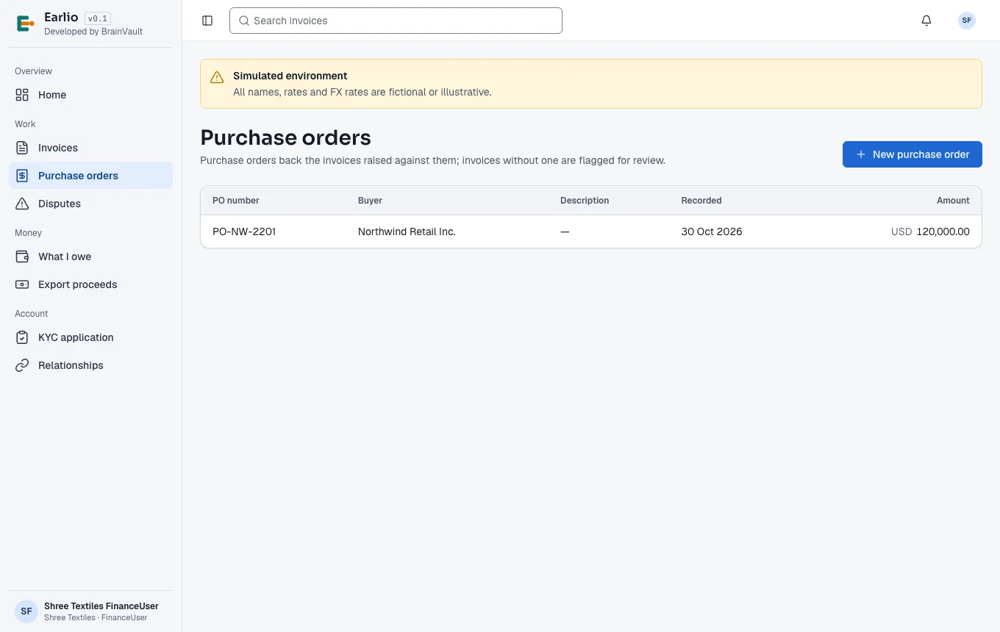
*Figure S-5. Purchase orders recorded for your buyers.*

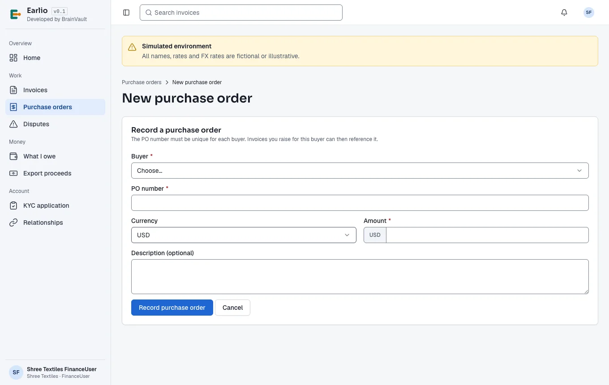
*Figure S-6. Recording a new purchase order.*

## 6. Invoices

### 6.1 The invoice list

**Invoices** lists every invoice you have raised, newest first. The tabs filter by status: **All**, **Draft**, **Awaiting acceptance**, **Accepted**, **Rejected** and **Disputed**. Each row shows the Earlio number and your own number, the buyer, issue and due dates, the amount and the status. Some rows carry a **Check** flag — hover over it to read why (for example, a missing purchase order). Select a row to open the invoice.

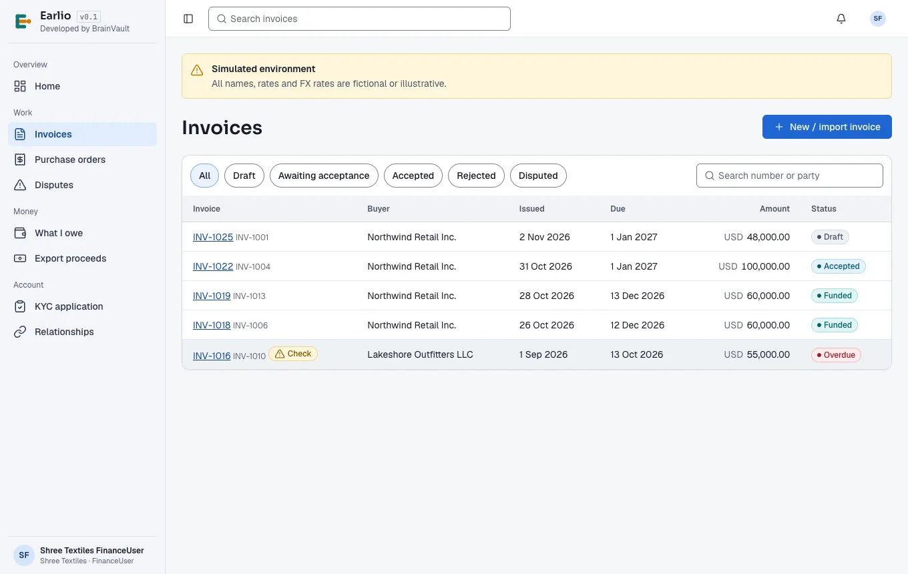
*Figure S-7. The invoice list.*

### 6.2 Creating an invoice

*Role: FinanceUser.*

1. On **Invoices**, choose **New / import invoice**.
2. Under **Enter an invoice**, fill in:

   | Field | What to enter |
   | --- | --- |
   | **Buyer** | Only buyers with an active relationship are listed. |
   | **Invoice number** | Your own invoice number. Earlio rejects a number you have already used for that buyer, and also an invoice that looks like a duplicate of an existing one. |
   | **Purchase order** | The PO this invoice is raised against. Choose **None (flagged)** if there is none; the invoice is then flagged for review. If the PO is missing from the list, record it first under **Purchase orders**. |
   | **Currency** | USD or SGD. |
   | **Amount** | The invoice total in that currency. |
   | **Issue date** | The date on the invoice. |
   | **Due date** | When the buyer must pay. It cannot be before the issue date. |

3. Choose **Create draft**. The invoice opens in **Draft** status.

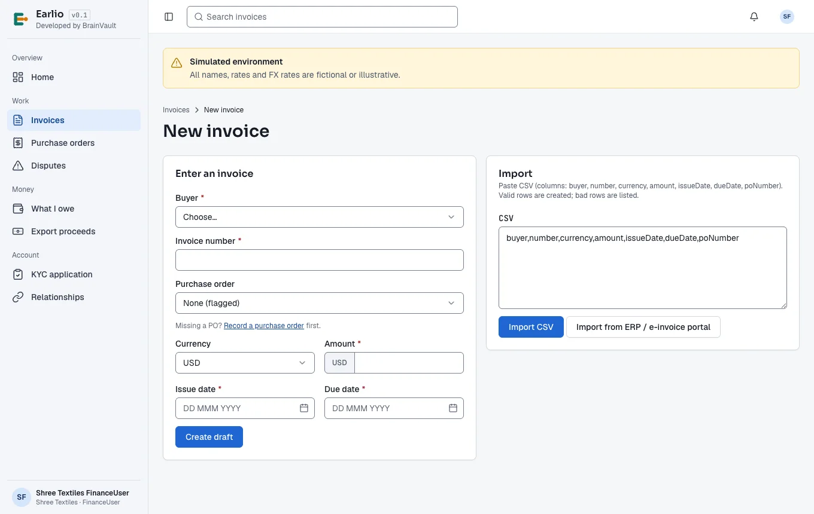
*Figure S-8. The new invoice page: enter one invoice, paste a CSV, or import from your ERP.*

### 6.3 Importing invoices (CSV or ERP)

**From a CSV file.** Under **Import**, paste CSV text with the columns `buyer, number, currency, amount, issueDate, dueDate, poNumber` and choose **Import CSV**. Each valid row becomes a draft invoice. Rows with problems are listed with the reason; fix them and import those rows again. Dates use the `YYYY-MM-DD` format.

**From your ERP or the GST e-invoice portal.** Choose **Import from ERP / e-invoice portal**. Earlio fetches new invoices from the connected system and creates drafts, each carrying its e-invoice reference (IRN).

### 6.4 Attaching documents and submitting to the buyer

A draft cannot be submitted until it has a **commercial invoice** and a **delivery proof** attached.

1. Open the draft invoice. Scroll to **Documents**.
2. Choose the **Document type** — Commercial invoice, Delivery proof, Packing list, Shipping bill or Transport document — and choose **Upload**.
3. Each document is stored with a version number and a SHA-256 fingerprint. Uploading the same type again creates a new version.
4. When the commercial invoice and delivery proof are attached, choose **Submit to buyer** at the top of the page.

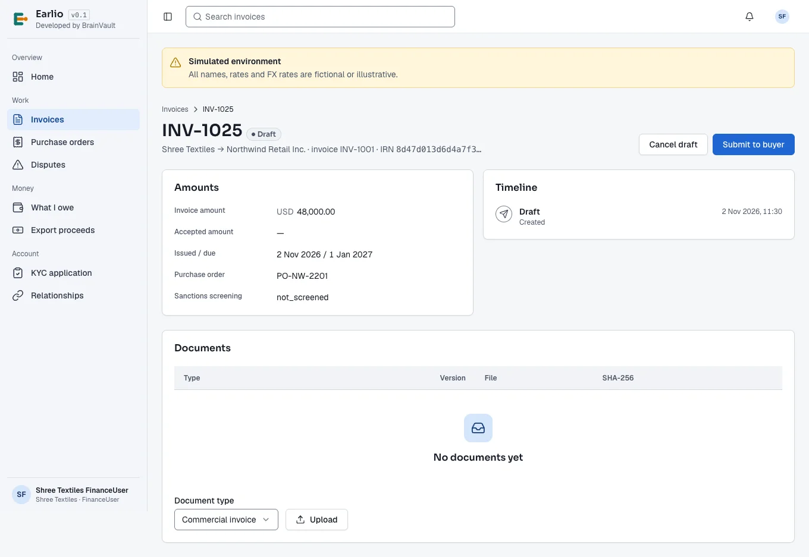
*Figure S-9. A draft invoice. Attach documents, then choose Submit to buyer.*

When you submit, Earlio screens both parties against sanctions lists and shares the documents with the buyer. The status becomes **Submitted**. To abandon a draft instead, choose **Cancel draft**; a cancelled draft cannot be reopened.

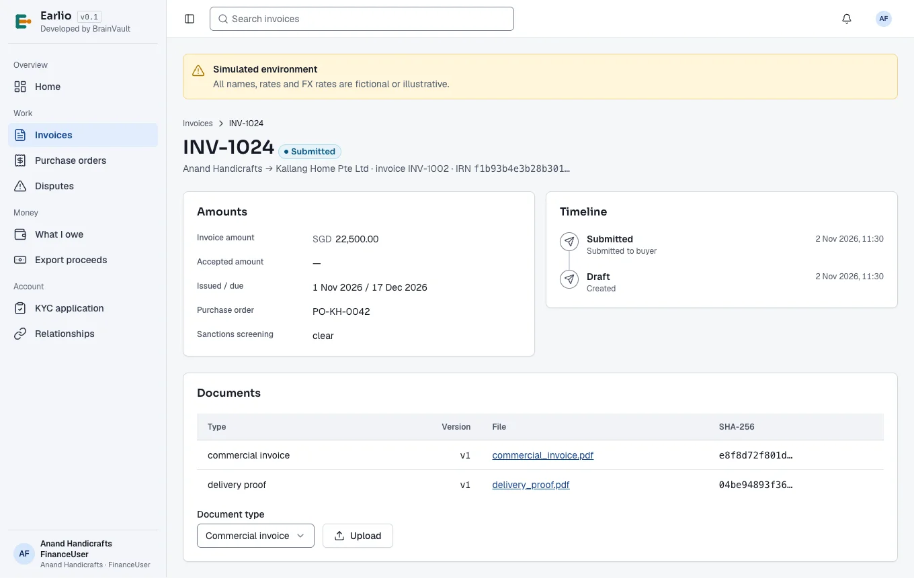
*Figure S-10. A submitted invoice, waiting for the buyer.*

After the buyer has accepted, you may still add **supporting papers** (packing list, shipping bill, transport document) that a bank asks for. The commercial invoice and delivery proof the buyer accepted are locked.

### 6.5 What the buyer decides

The buyer can:

- **Accept in full** — the status becomes **Accepted**, and the **Acceptance** panel shows the buyer's signed, irrevocable undertaking to pay.
- **Part-accept** — accept a lower amount. The remainder is recorded as a dispute that does not freeze the accepted part.
- **Reject** — with a reason, shown in the timeline.

Earlio sends the buyer reminders after one and three days. It never treats silence as acceptance.

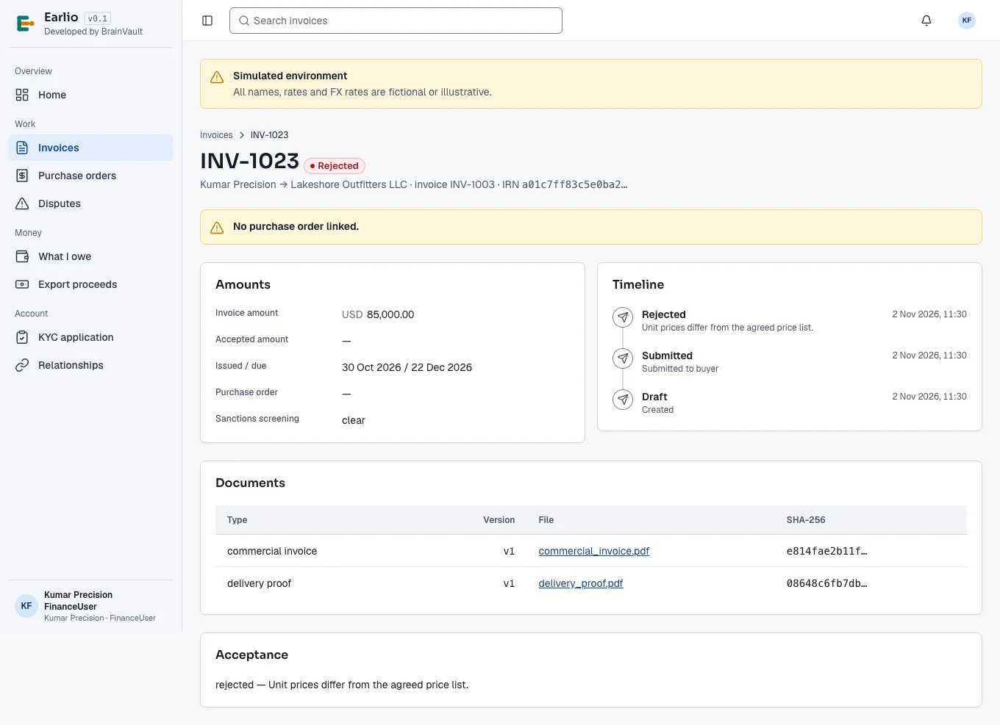
*Figure S-11. A rejected invoice. The buyer's reason is in the timeline.*

After acceptance there is a **dispute window** (at least 24 hours) shown under **Amounts**: "Dispute window closes …". You can request funding during the window, but the bank can only complete the funding after it closes.

### 6.6 Insurance cover

When the buyer accepts, Earlio automatically asks the insurer linked to your relationship with that buyer to cover the invoice. The **Insurance cover** panel shows:

| Status | Meaning |
| --- | --- |
| **requested** | Waiting for the insurer, who has 24 hours. Early payment does not need cover. |
| **approved** | Covered at the percentage shown (for example "90% — insured USD 54,000.00"). |
| **partial** | Covered at a lower percentage than asked. Some banks need a minimum cover and may not offer. |
| **declined** | No cover; the insurer's reason is shown. Bank financing is not available. |
| **uninsured** | No insurer is configured for this relationship. Bank financing is not available, but early payment is. |
| **expired** | Cover that was not used within 30 days lapsed. |

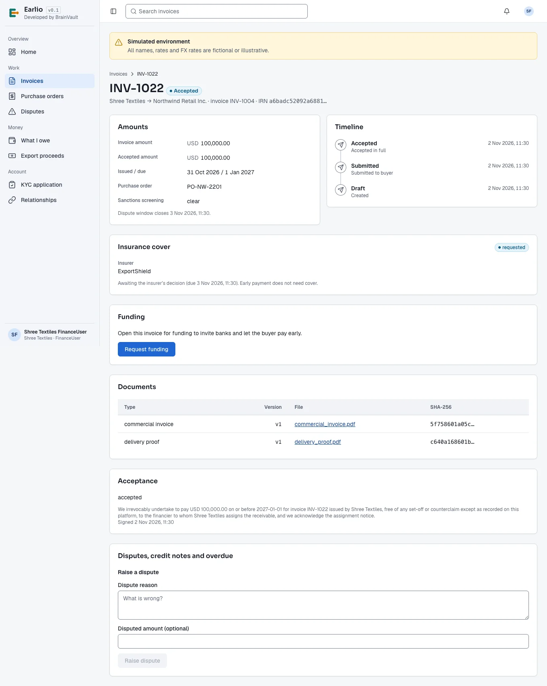
*Figure S-12. An accepted invoice. Cover has been requested; Request funding is available.*

> **Small suppliers.** If you are a small supplier (MSME), a bank's advance is capped at the insured percentage, so you are never exposed beyond what the insurer covers. Your all-in cost is also capped by a platform guardrail (18% a year).

## 7. Getting paid early

### 7.1 Requesting funding

*Role: FinanceUser.* Open an **Accepted** invoice and choose **Request funding** in the **Funding** panel.

Earlio runs four **funding gates** in order:

1. **Parties verified and not sanctioned** — your organisation and the buyer have passed KYC and are not blocked.
2. **Supplier–buyer relationship active.**
3. **Invoice accepted, amount locked.**
4. **No open dispute** (and, before the money moves, the dispute window has ended).

If all pass, the status becomes **OpenForFunding** and Earlio invites your preferred banks, the buyer's preferred banks and the partner bank. Each bank's own eligibility rules are then applied; a bank whose rules exclude your invoice simply does not see it.

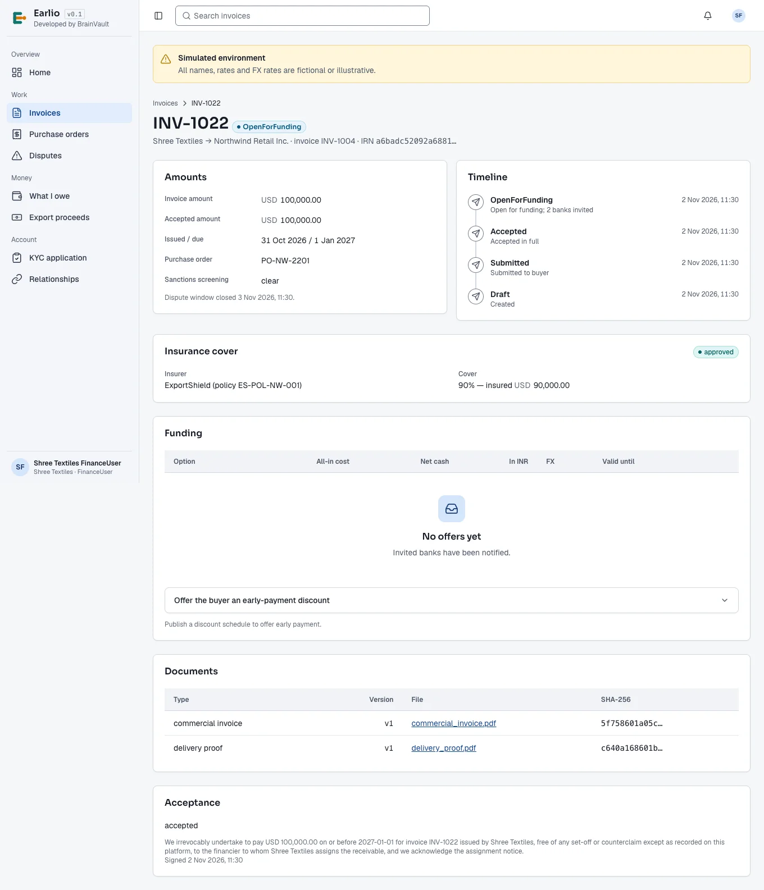
*Figure S-13. Open for funding: invited banks have been notified.*

### 7.2 When an invoice is not eligible

If a gate fails, the invoice moves to **NotEligible** and the **Funding** panel lists what to fix, in plain language — for example *"Zarnitsa Trading Ltd is blocked following a sanctions screening hit."* Fix the problem (or wait for Earlio to resolve it) and choose **Check again**. Early payment by the buyer may still be possible.

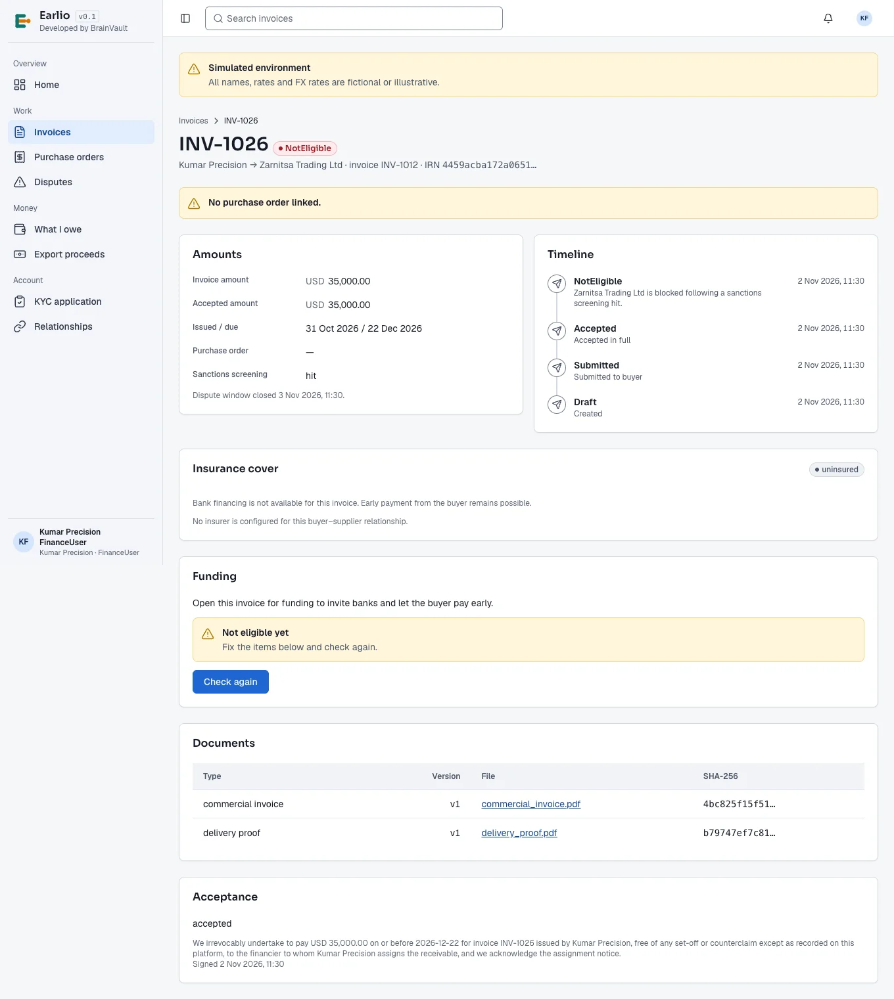
*Figure S-14. Not eligible: the buyer is blocked after a sanctions hit.*

### 7.3 Comparing offers

As banks respond, the status becomes **OffersReceived** and the **Funding** panel shows a comparison table, **cheapest first**:

| Column | Meaning |
| --- | --- |
| **Option** | The bank, its advance percentage and the insurance cover, with the label **insured · non-recourse**. |
| **All-in cost** | Total yearly cost including every charge. Underneath: how many points below your own borrowing rate it is. |
| **Net cash** | What you receive in the invoice currency after all charges. |
| **In INR** | Net cash converted at the bank's exchange rate — the rupees that reach your account. |
| **FX** | The bank's exchange rate (market mid-rate less its spread, never more than 1%). |
| **Valid until** | When the offer expires. Expired offers disappear; if none are left the invoice returns to OpenForFunding. |

If you published an early-payment discount (see [7.8](#sup-early-payment)), it appears in the same table as **Early payment by the buyer**, so you can compare it directly with the bank offers.

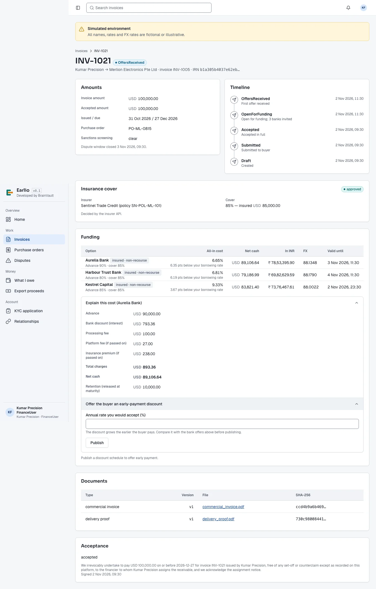
*Figure S-15. Three bank offers, cheapest first, with the cost breakdown expanded.*

### 7.4 Understanding the cost breakdown

Open **Explain this cost (*bank*)** under the table to see how an offer is built. For a USD 100,000 invoice with a 90% advance:

| Line | Example | Meaning |
| --- | --- | --- |
| **Advance** | USD 90,000.00 | The share of the invoice the bank pays up front. |
| **Bank discount (interest)** | USD 793.36 | Interest for the days until the due date, actual/365. |
| **Processing fee** | USD 100.00 | The bank's fee, subject to its minimum. |
| **Platform fee (if passed on)** | USD 27.00 | Earlio's fee. Only deducted if this bank passes it on to you. |
| **Insurance premium (if passed on)** | USD 238.00 | Only deducted if the bank passes it on. |
| **Total charges** | USD 893.36 | What is actually deducted. |
| **Net cash** | USD 89,106.64 | Advance minus total charges. |
| **Retention (released at maturity)** | USD 10,000.00 | The part not advanced. It is paid to you after the buyer pays, less anything owed. |

Each line is rounded to two decimals before adding, so the lines always add up.

### 7.5 Choosing an offer

*Role: FinanceUser.* Choose **Choose** on the offer you want.

Choosing reserves the bank's limits, records a **lien** on the invoice (so it cannot be financed twice) and locks in that bank. The other offers stay open until the financing completes. The **Funding** panel now shows **Financing with *bank*** in status **ConsentPending**, and says that an approver must give consent.

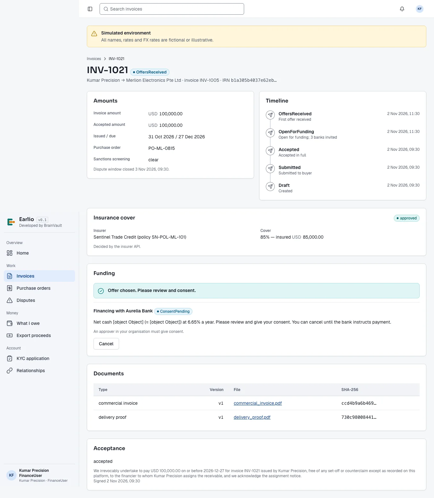
*Figure S-16. An offer has been chosen. An Approver must now give consent.*

### 7.6 Giving consent (Approver)

*Role: Approver.* Consent is your organisation's signature on the financing: you assign the right to be paid for this invoice to the bank, on the terms shown.

1. Open the invoice. The **Funding** panel shows the net cash, the INR amount and the all-in rate.
2. If the bank's terms require extra information, a **Required information** box lists the missing papers (with an **Upload** button) and any questions the bank asks. Complete them first; consent is refused with a plain message until they are done.
3. Choose **Review and consent**.

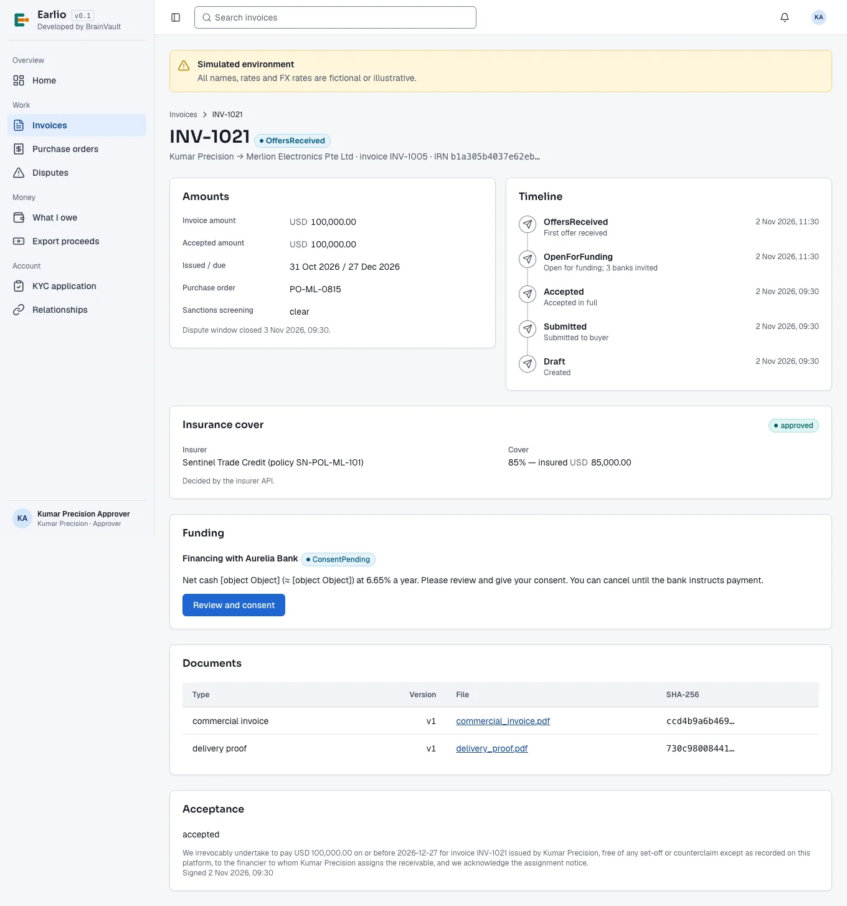
*Figure S-17. The Approver's view: Review and consent.*

After consent the financing moves to **BankConfirming**. Two things must happen next, in either order:

- the **buyer acknowledges the assignment notice**, which tells it to pay the bank instead of you; and
- the **bank confirms**, re-checking sanctions, KYC, cover, limits and the dispute window.

The full consent text (the assignment, the net cash, the all-in cost, non-recourse, governing law) is shown in the Funding panel and recorded with your name and time.

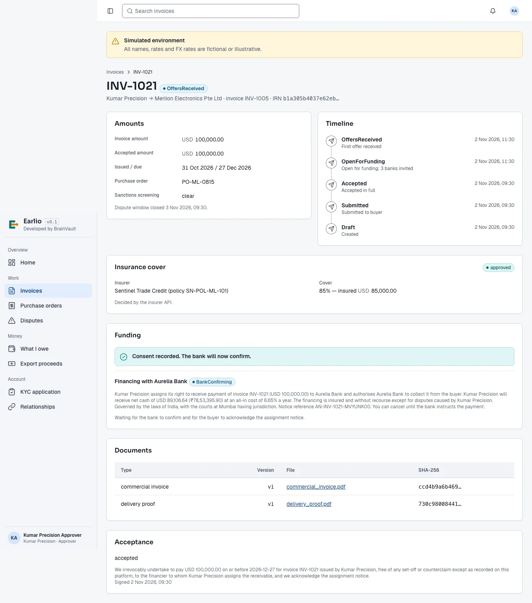
*Figure S-18. After consent, waiting for the bank to confirm.*

### 7.7 Cancelling during the cooling-off period

Until the bank instructs the payment, a FinanceUser or Approver can choose **Cancel** in the **Funding** panel. Cancelling releases the lien, the bank's limits and the cover reservation, and the invoice goes back to the offers.

### 7.8 Offering the buyer an early-payment discount

*Role: FinanceUser.* Instead of (or as well as) bank financing, you can offer the buyer a discount to pay before the due date. No bank or insurance is needed.

1. On an invoice that is open for funding, expand **Offer the buyer an early-payment discount**.
2. Enter the **Annual rate you would accept (%)**. The discount is pro rata: the earlier the buyer pays, the larger it is. Earlio warns you if the rate is above your own borrowing rate.
3. Choose **Publish**.

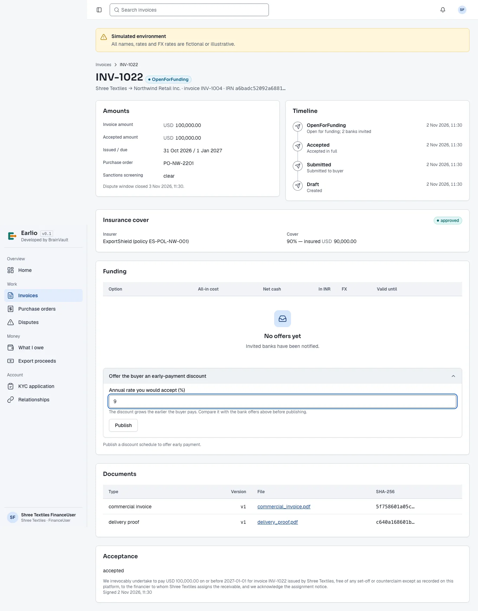
*Figure S-19. Entering the annual rate for an early-payment discount.*

The schedule appears in the comparison table as **Early payment by the buyer**, with its all-in cost and net cash. The buyer sees the offer on its copy of the invoice and can confirm a payment date. When the buyer confirms, the invoice becomes **Funded** by early payment, every bank offer is withdrawn, and the money is credited to you when the buyer pays.

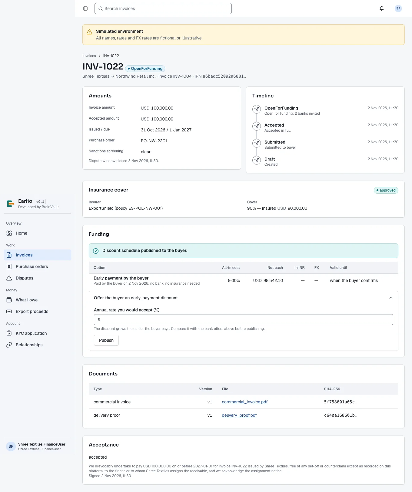
*Figure S-20. The published early-payment option appears in the comparison.*

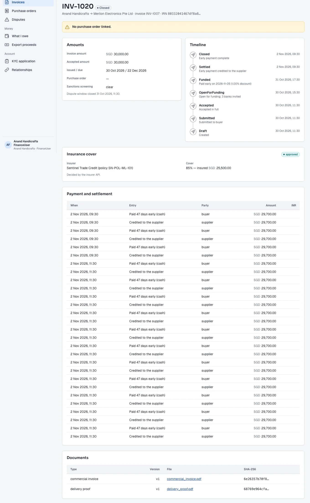
*Figure S-21. An invoice the buyer paid early, now Closed.*

### 7.9 After funding: the payout

When the bank confirms, it instructs the payment. The **Payment and settlement** panel tracks it step by step:

| Step | Meaning |
| --- | --- |
| **Instructed** | The bank instructed the payment to you. |
| **FXBooked** | The dollars were converted at the bank's rate (for example "USDINR at 88.1348 (mid 88.40, spread 0.30%)"). |
| **QueuedForValueDate** | Waiting for the value date. If the bank confirms after its daily cut-off, or on a holiday, the payment goes on the next banking day. |
| **Sent** | Sent to your bank. |
| **Credited** | The rupees are in your account. The invoice status becomes **Funded**. |

If the payment is rejected it is retried up to three times. If it still fails, the financing is reversed and Earlio staff are alerted.

On the due date the buyer pays the bank. When the payment is matched, the **retention** (the part that was not advanced, less anything owed) is released to you in rupees and the invoice moves to **Settled** and then **Closed**.

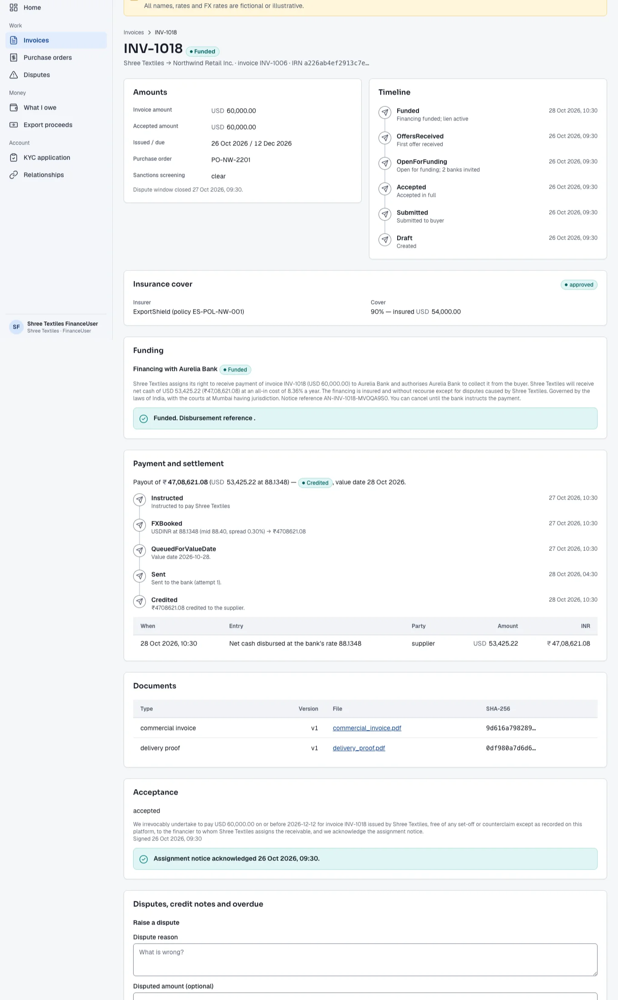
*Figure S-22. A funded invoice: assignment, payout and value date.*

## 8. When things go wrong

### 8.1 Disputes

A buyer can dispute an invoice before or after funding, for example over damaged goods. A dispute **freezes** the invoice: funding, late interest and reminders stop while it is open.

Open **Disputes** to see disputes on your invoices (tabs **Open**, **Resolved**, **All**). Each row shows the invoice (marked *financed* if a bank funded it), who raised it, the reason, the status and the next deadline. Choose **Open case** to see the case.

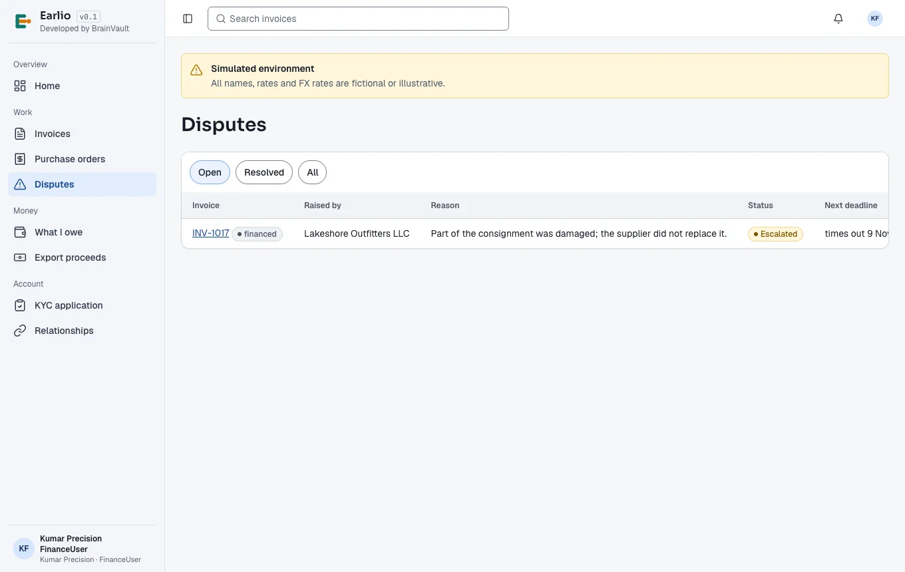
*Figure S-23. Disputes on your invoices.*

On the case page:

- **Raised by**, **Parties** and **Reason** describe the dispute.
- **Response due**, **Escalates** and **Times out** are the deadlines. If you do not respond in time (48 hours by default), the dispute is escalated to Earlio; an undecided dispute times out after 240 hours.
- The **Case thread** holds every message. Type in **Message** and choose **Send**; choose **Attach evidence** to upload photos, inspection reports and so on.

Earlio staff decide escalated disputes in favour of the supplier or the buyer, with a cause. If the cause is supplier-caused (non-delivery, quality, wrong documents, misrepresentation) on a financed invoice, you owe the bank — see [What I owe](#sup-recourse).

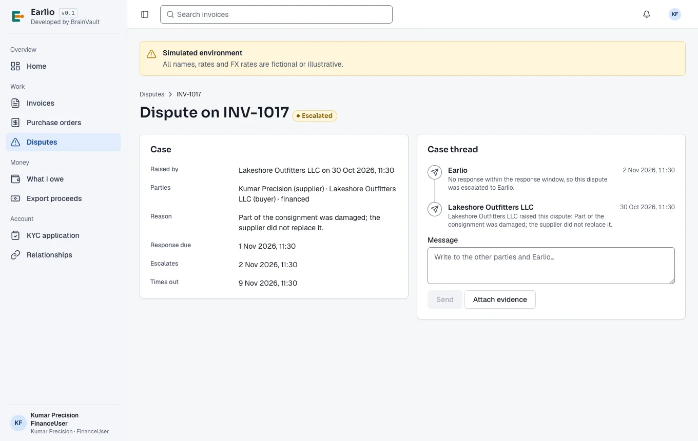
*Figure S-24. A dispute case: deadlines, thread, message and evidence.*

You can also raise a dispute yourself from the **Disputes, credit notes and overdue** panel on an invoice (**Dispute reason**, optional **Disputed amount**, **Raise dispute**), and a FinanceUser can withdraw a dispute you raised.

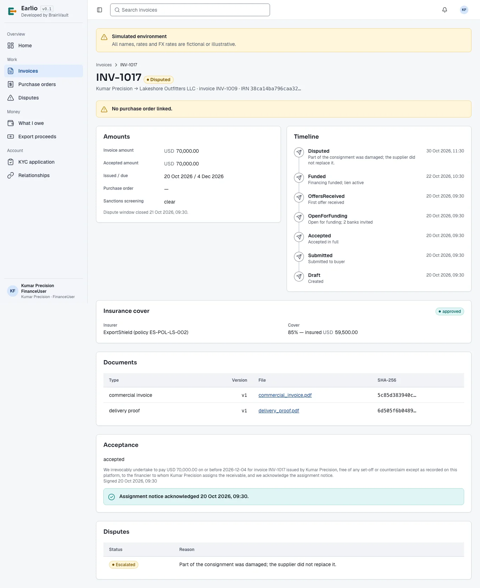
*Figure S-25. A funded invoice frozen by a dispute.*

### 8.2 Credit notes

A buyer may issue a **credit note** that reduces an invoice.

- **Before funding:** the invoice amount is reduced and any offers made on the old amount are withdrawn; banks can offer again on the new amount.
- **After funding:** the bank's advance is cut pro rata, the insurer's cover is rescaled, and you owe the bank the difference (see [What I owe](#sup-recourse)).

### 8.3 Overdue invoices

If the buyer has not paid by the due date the invoice becomes **Overdue**. The buyer is reminded on days 1, 7 and 30, and pays **late interest** (the financing rate plus 2 points). **You never pay late interest or penalties on a financed invoice.** If the buyer still has not paid after the insurer's waiting period, the bank files an insurance claim; the financing is non-recourse, so this does not come back to you.

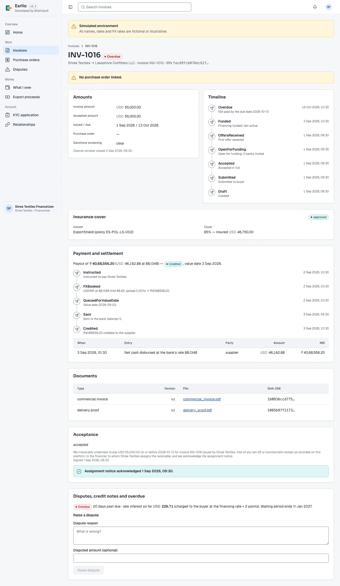
*Figure S-26. An overdue invoice.*

### 8.4 What I owe (recourse)

**What I owe** shows any money you owe a bank. Financing is without recourse, except when:

- a dispute is decided against you for a supplier-caused reason; or
- a credit note reduces a financed invoice after the advance.

There is no penalty interest. If you owe nothing, the page says **You owe nothing**.

When recourse arises, small suppliers choose how to repay (*role: Approver*):

- **Offset** — 20% of each future retention release is kept back until the debt is repaid; or
- **A 90-day plan** — three instalments, with reminders.

Choose **Switch to a 90-day plan** or **Switch to offset** to change the method. The page lists the plan, the instalments and every repayment the bank records.

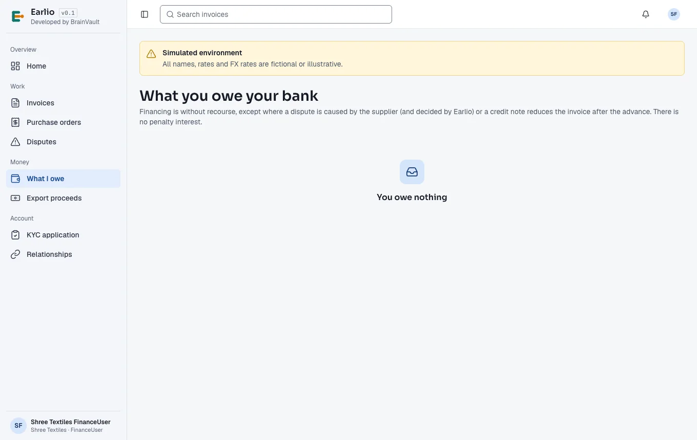
*Figure S-27. What I owe: nothing outstanding.*

## 9. Export proceeds

Indian exporters must normally realise export proceeds within **9 months of shipment** (confirm the period for your case with your authorised dealer bank or counsel). **Export proceeds** tracks each financed export invoice:

| Column | Meaning |
| --- | --- |
| **Invoice** | The invoice. A **Check** flag explains that the proceeds are paid to you by your financing bank under an assignment, not by the buyer directly — give your authorised dealer bank the assignment notice so it can match the payment to the shipping bill. |
| **Amount** | Invoice amount. |
| **Shipped** | Shipment date. |
| **Realise by** | Deadline and days left. |
| **Status** | Pending, Realised or Overdue. |
| **Rupees received** | What you have received so far. |

The bank reports realisation; you do not need to do anything on Earlio other than keep an eye on the deadlines.

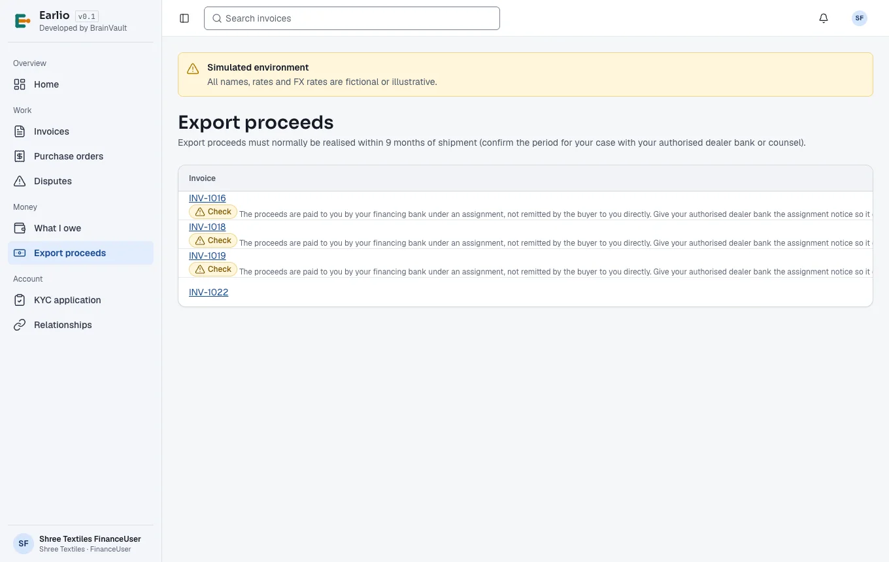
*Figure S-28. The export proceeds tracker.*

## 10. Managing users (Admin)

*Role: Admin.* **Users** lists everyone in your organisation with their role and whether two-step verification is on.

To add a user:

1. Under **Add a user**, enter **Name** and **Work email**.
2. Choose the **Role** (Admin, FinanceUser, Approver or Viewer). Give each person only the role they need. The person who proposes a change cannot also approve it, so keep FinanceUser and Approver with different people.
3. Enter a **Starting password** and choose **Add user**. Give the person the password securely; they set up two-step verification at first sign-in.

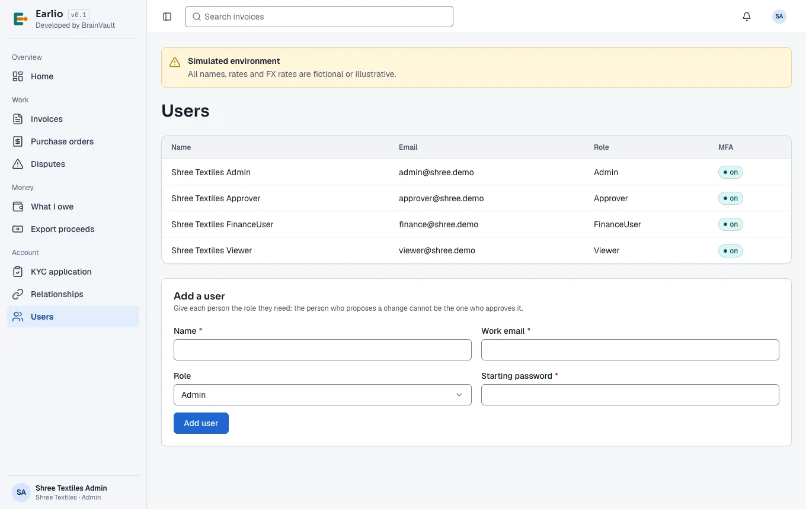
*Figure S-29. Managing your organisation's users.*

The Admin also sets the **Notification language** (English or Hindi) at the bottom of the home page.

## 11. Frequently asked questions

**Why can't I choose my buyer when creating an invoice?**
The relationship is not active yet. Both sides must approve it under **Relationships**.

**Why is "Submit to buyer" refused?**
Attach a commercial invoice and a delivery proof first.

**Why did I get no offers?**
Banks only see invoices that fit their terms (amount, tenor, buyer country and rating, currency, minimum cover). The cover may also be pending, partial or declined. Check the **Insurance cover** panel, and consider an early-payment discount.

**Why does the cheapest offer have a lower net cash than another?**
Offers differ in advance percentage. A 90% advance at 6.65% gives more cash than an 80% advance at 6.81%, but the retention you wait for is smaller. Compare **All-in cost** for price and **Net cash** for how much you get now.

**Can two banks finance the same invoice?**
No. Choosing an offer records a lien; a second financing request on the same invoice is refused and recorded.

**The buyer has not paid. Do I have to repay the bank?**
No, unless a dispute is decided against you for a supplier-caused reason. Non-payment is covered by the insurer.

**I lost my phone. How do I sign in?**
Type one of your recovery codes into the **Authentication code** box instead of an app code. Each code works once, so set up the authenticator again on your new phone as soon as you can (ask Earlio support if you have run out of codes).

## 12. List of figures

| Figure | Title |
| --- | --- |
| S-1 | [The supplier home dashboard](#sup-pages) |
| S-2 | [KYC application with the four documents uploaded](#sup-kyc) |
| S-3 | [After submitting: the application is in review](#sup-kyc) |
| S-4 | [Relationships with buyers, and preferred banks](#sup-relationships) |
| S-5 | [Purchase orders recorded for your buyers](#sup-purchase-orders) |
| S-6 | [Recording a new purchase order](#sup-purchase-orders) |
| S-7 | [The invoice list](#sup-invoice-list) |
| S-8 | [The new invoice page: enter one invoice, paste a CSV, or import from your ERP](#sup-create-invoice) |
| S-9 | [A draft invoice. Attach documents, then choose Submit to buyer](#sup-submit) |
| S-10 | [A submitted invoice, waiting for the buyer](#sup-submit) |
| S-11 | [A rejected invoice. The buyer's reason is in the timeline](#sup-buyer-decision) |
| S-12 | [An accepted invoice. Cover has been requested; Request funding is available](#sup-cover) |
| S-13 | [Open for funding: invited banks have been notified](#sup-request-funding) |
| S-14 | [Not eligible: the buyer is blocked after a sanctions hit](#sup-not-eligible) |
| S-15 | [Three bank offers, cheapest first, with the cost breakdown expanded](#sup-compare-offers) |
| S-16 | [An offer has been chosen. An Approver must now give consent](#sup-choose-offer) |
| S-17 | [The Approver's view: Review and consent](#sup-consent) |
| S-18 | [After consent, waiting for the bank to confirm](#sup-consent) |
| S-19 | [Entering the annual rate for an early-payment discount](#sup-early-payment) |
| S-20 | [The published early-payment option appears in the comparison](#sup-early-payment) |
| S-21 | [An invoice the buyer paid early, now Closed](#sup-early-payment) |
| S-22 | [A funded invoice: assignment, payout and value date](#sup-payout) |
| S-23 | [Disputes on your invoices](#sup-disputes) |
| S-24 | [A dispute case: deadlines, thread, message and evidence](#sup-disputes) |
| S-25 | [A funded invoice frozen by a dispute](#sup-disputes) |
| S-26 | [An overdue invoice](#sup-overdue) |
| S-27 | [What I owe: nothing outstanding](#sup-recourse) |
| S-28 | [The export proceeds tracker](#sup-export-proceeds) |
| S-29 | [Managing your organisation's users](#sup-users) |
