# Earlio user manual — Buyers

*For importers who receive invoices on Earlio, accept them and pay them.*

Read [Getting started](00-getting-started.md) first: it covers registration, signing in with two-step verification, the screen layout, notifications, invoice statuses and the glossary. This manual covers everything a buyer does on Earlio. The screenshots show the demo buyers Northwind Retail Inc., Lakeshore Outfitters LLC, Merlion Electronics Pte Ltd and Kallang Home Pte Ltd.

## Contents

1. [What Earlio asks of a buyer](#buy-overview)
2. [Your roles](#buy-roles)
3. [Your pages](#buy-pages)
4. [Before you start: KYC, relationships and preferred banks](#buy-setup)
5. [Accepting invoices](#buy-acceptance)
   1. [The acceptance inbox](#buy-inbox)
   2. [Reviewing an invoice](#buy-review)
   3. [Accepting in full](#buy-accept)
   4. [Accepting part of an invoice](#buy-part-accept)
   5. [Rejecting an invoice](#buy-reject)
6. [Acknowledging an assignment notice](#buy-assignment)
7. [Paying early for a discount](#buy-early-payment)
8. [Paying invoices](#buy-payments)
9. [Disputes and credit notes](#buy-exceptions)
   1. [Raising a dispute](#buy-raise-dispute)
   2. [Working a dispute case](#buy-dispute-case)
   3. [Issuing a credit note](#buy-credit-note)
10. [Overdue invoices and late interest](#buy-overdue)
11. [Purchase orders](#buy-purchase-orders)
12. [Managing users (Admin)](#buy-users)
13. [Frequently asked questions](#buy-faq)
14. [List of figures](#buy-figures)

---

## 1. What Earlio asks of a buyer

Your suppliers use Earlio to get paid early by banks. Your part is small but essential:

1. **Accept** the supplier's invoice (or reject it, with a reason). Accepting signs an irrevocable undertaking to pay the accepted amount on the due date.
2. **Acknowledge** the assignment notice when a bank finances the invoice, so you know to pay the bank instead of the supplier.
3. **Pay** on the due date into the bank's collection account, quoting the payment reference Earlio gives you.

Your payment terms do not change: you pay the same amount on the same date. In return your suppliers get cheaper finance, which supports stable supply. You can also choose to **pay early** in exchange for a discount, earning a return on your cash.

What you do **not** see: the bank's rate, its fees or the supplier's net cash. Those stay between the supplier and the bank.

## 2. Your roles

| Role | Can do |
| --- | --- |
| **Admin** | Add and manage users; set the notification language; choose preferred banks; KYC; propose supplier relationships. |
| **FinanceUser** | KYC; propose relationships; raise and withdraw disputes; issue credit notes. |
| **Approver** | Accept, part-accept or reject invoices; acknowledge assignment notices; get early-payment quotes and confirm early payment; approve relationships; raise disputes and issue credit notes. |
| **Viewer** | Read only, including payments due and early-payment quotes. |

Only an **Approver** can accept an invoice or acknowledge an assignment notice, because both bind your organisation to pay.

## 3. Your pages

| Sidebar | Page | Used for |
| --- | --- | --- |
| Overview | **Home** | Payables by due date, acceptance performance, early-payment savings, suppliers. |
| Work | **Acceptance inbox** | Invoices waiting for your decision. |
| Work | **Invoices** | Every invoice addressed to you. |
| Work | **Purchase orders** | Purchase orders your suppliers recorded against you. |
| Work | **Disputes** | Disputes on your invoices. |
| Money | **Payments due** | What to pay, by when, to which account, with which reference. |
| Account | **KYC application** | Your KYC documents and status. |
| Account | **Relationships** | Your suppliers and preferred banks. |
| Account | **Users** | Admin only. |

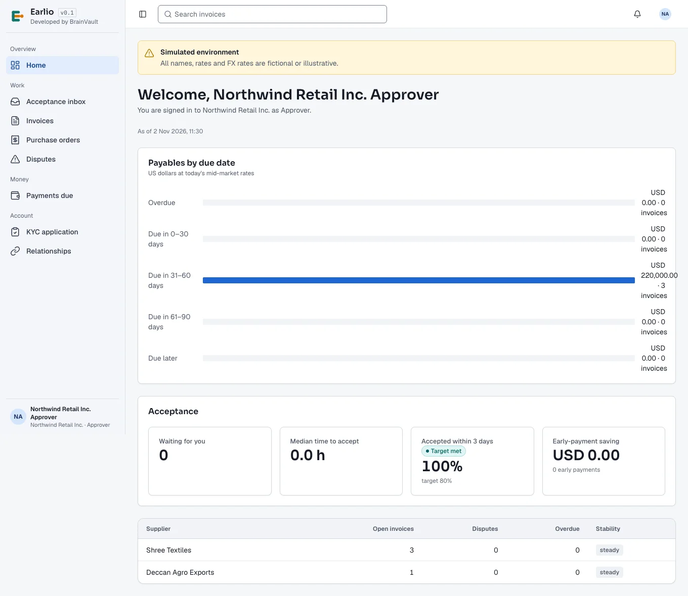
*Figure B-1. The buyer home dashboard.*

The home dashboard shows:

- **Payables by due date** — what you owe, grouped into Overdue, 0–30, 31–60, 61–90 days and later, in US dollars.
- **Acceptance** — invoices **waiting for you**, your **median time to accept**, and the share **accepted within 3 days** against the 80% target.
- **Early-payment saving** — discounts you earned by paying early.
- **Suppliers** — each supplier with open invoices, disputes, overdue invoices and a stability indicator.

## 4. Before you start: KYC, relationships and preferred banks

**KYC.** Open **KYC application**, choose **Upload** for each document requested, then **Submit for review**. An Earlio reviewer approves the application. The page works the same way as the supplier's — see the [supplier manual, section 4.1](01-supplier.md#sup-kyc).

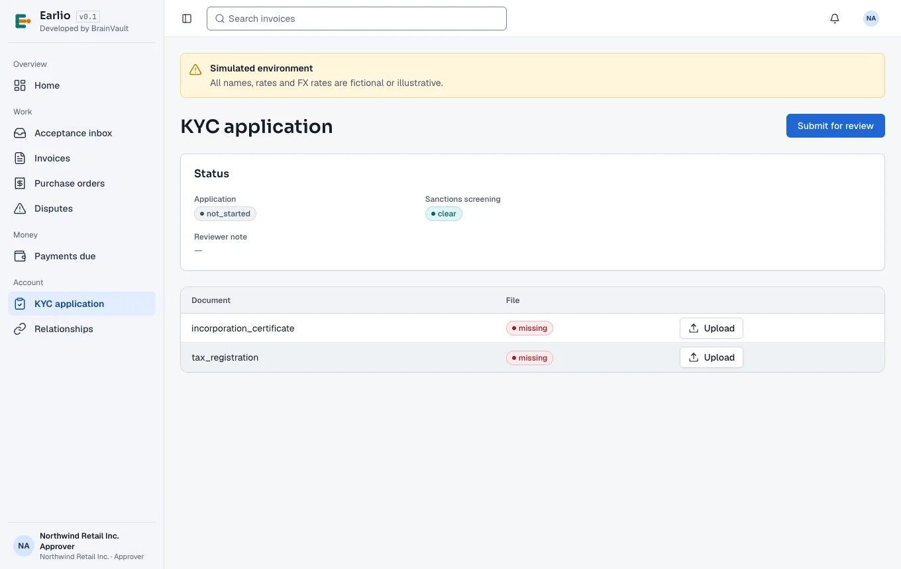
*Figure B-2. The KYC application page.*

**Relationships.** A supplier can only invoice you once the relationship is **active**. Either side proposes it; an Approver at each side approves it (the proposer cannot approve their own proposal). Open **Relationships**, search for the supplier under **Link with a counterparty** and choose **Propose**, or choose **Approve** on a relationship a supplier proposed.

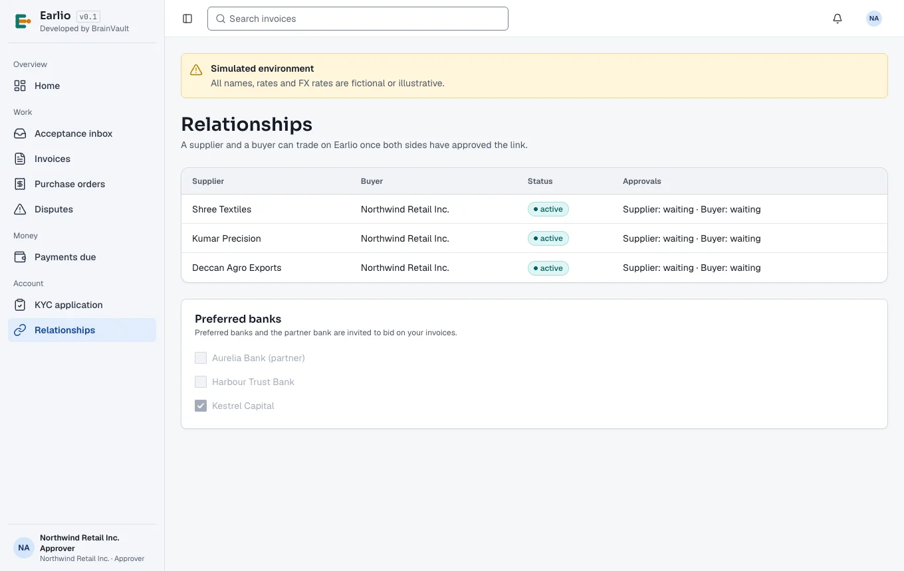
*Figure B-3. Relationships with suppliers, and preferred banks.*

**Preferred banks.** The banks you tick under **Preferred banks** are invited to make offers on invoices addressed to you, alongside the supplier's banks and the partner bank. Only an Admin can change the list. If you want to fund early payments with a bank loan, that bank should be on your list.

## 5. Accepting invoices

### 5.1 The acceptance inbox

When a supplier submits an invoice to you, it appears in the **Acceptance inbox** and you are notified. The tabs filter by **All**, **Awaiting acceptance**, **Rejected** and **Disputed**. Earlio reminds you after one day and again after three days. **An invoice is never accepted by silence** — it waits until an Approver decides.

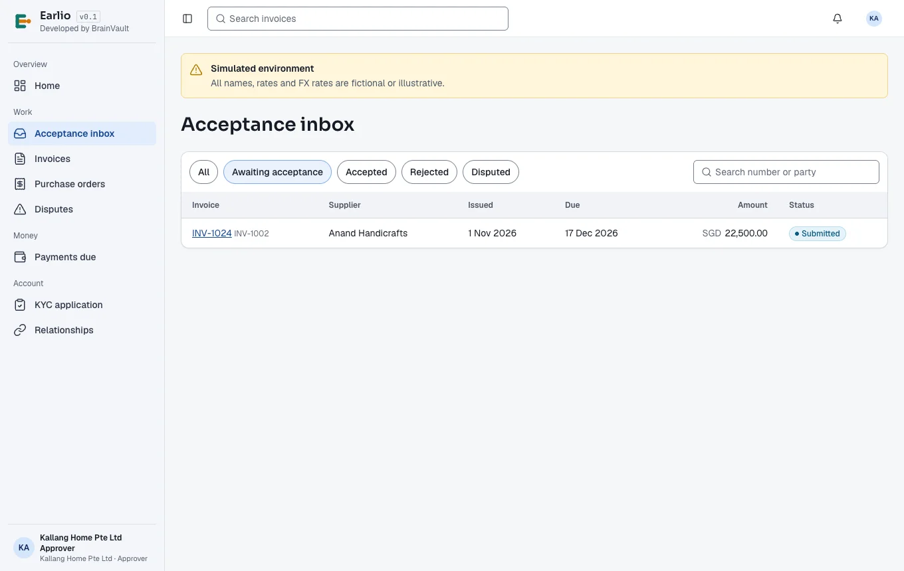
*Figure B-4. The acceptance inbox with one invoice awaiting acceptance.*

**Invoices** lists every invoice addressed to you, whatever its status, with the same filters.

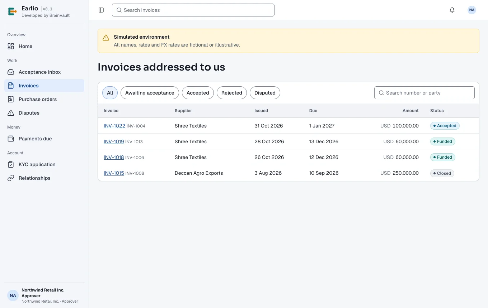
*Figure B-5. Every invoice addressed to you.*

### 5.2 Reviewing an invoice

Open the invoice from the inbox. Before deciding, check:

- **Amounts** — invoice amount, issue and due dates, and the **Purchase order**. "No purchase order linked" means the supplier raised the invoice without one.
- **Documents** — open the **commercial invoice** and the **delivery proof**. Each has a SHA-256 fingerprint, so the version you accept is exactly the version the bank will see.
- **Sanctions screening** — normally `clear`.

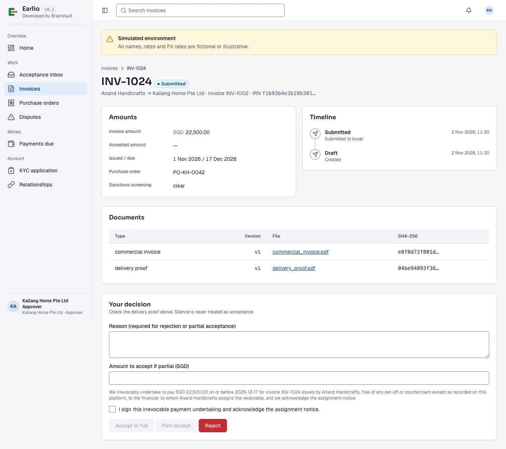
*Figure B-6. Reviewing a submitted invoice. The decision panel is at the bottom.*

### 5.3 Accepting in full

*Role: Approver.*

1. In **Your decision**, read the undertaking text. It states the amount, the due date, that you will pay free of set-off or counterclaim (except as recorded on Earlio), that you will pay whichever financier the supplier assigns the invoice to, and that you acknowledge the assignment notice.
2. Tick **I sign this irrevocable payment undertaking and acknowledge the assignment notice.**
3. Choose **Accept in full**.

The invoice becomes **Accepted**. The undertaking, your name and the time are stored in the **Acceptance** panel and cannot be changed. A **dispute window** of at least 24 hours then runs: during it you can still dispute the invoice before any bank pays the supplier.

### 5.4 Accepting part of an invoice

If you agree with only part of the invoice (for example, part of the delivery is missing):

1. Enter the **Amount to accept if partial** and a **Reason**.
2. Tick the undertaking box and choose **Part-accept**.

You undertake to pay the lower amount. The remainder is recorded as a dispute that does not freeze the accepted part, so the supplier can still finance what you accepted.

### 5.5 Rejecting an invoice

Enter a **Reason** (required) and choose **Reject**. The supplier sees your reason in the invoice timeline — for example *"Unit prices differ from the agreed price list."* — and can raise a corrected invoice.

## 6. Acknowledging an assignment notice

When a supplier finances an invoice, it assigns its right to be paid to the bank. Earlio shows you an **assignment notice** in the **Funding** panel of the invoice and asks an Approver to acknowledge it. The notice states:

- which invoice and amount is assigned, and to which bank;
- that the bank is authorised to collect the payment from you;
- that the financing is insured and without recourse, except for disputes caused by the supplier;
- the governing law and courts;
- a notice reference (for example `AN-INV-1021-…`);
- for US buyers, a simulated public filing reference; for Singapore buyers, the data-handling consent.

*Role: Approver.* Read the notice and choose **Acknowledge**. The bank cannot pay the supplier until you have acknowledged it. Your payment obligation does not change — only who you pay.

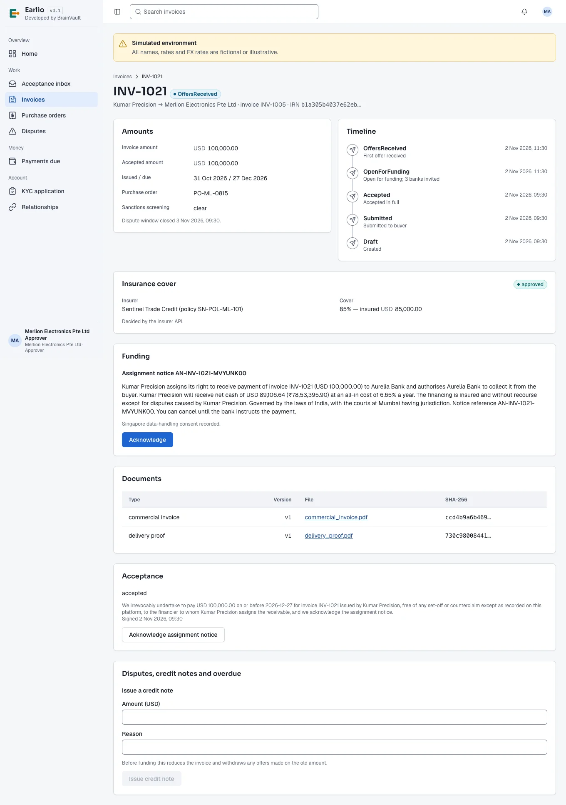
*Figure B-7. An assignment notice waiting for acknowledgement.*

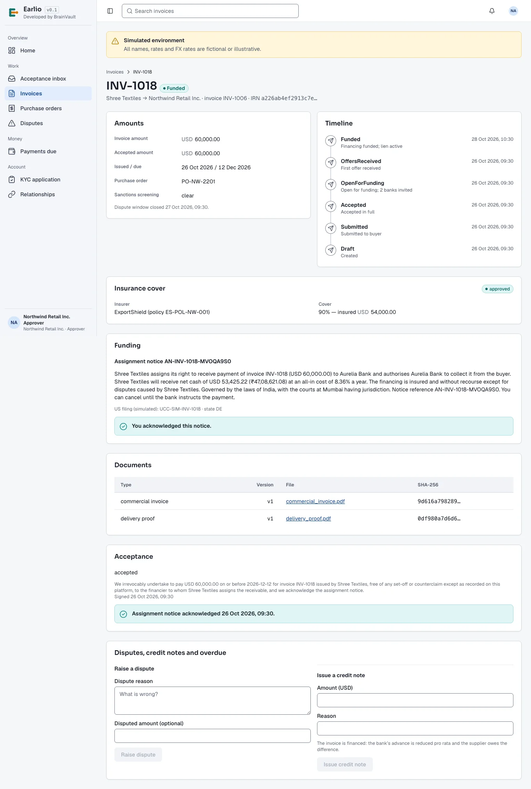
*Figure B-8. A funded invoice. The notice has been acknowledged.*

## 7. Paying early for a discount

A supplier may publish an **early-payment discount** on an accepted invoice. If it has, the invoice's **Funding** panel shows **Pay early and earn a discount** with the supplier's annual rate (for example "9.0000% a year, pro rata").

1. Choose the **Pay on** date. It cannot be in the past.
2. Choose **Funded from**:
   - **Cash** — you pay from your own funds; or
   - **Bank loan** — choose the **Bank** that lends you the money for the period. The bank earns a commission, shown in the quote.
3. Choose **Calculate**. Earlio shows:

   | Line | Meaning |
   | --- | --- |
   | **You pay** | The discounted amount due on your chosen date. |
   | **Discount** | The discount in money, its percentage and how many days early. |
   | **Return on your cash (annualised)** | The yearly return the discount represents. |
   | **Bank commission** | Zero for cash; the lending bank's share for a bank loan. |
   | **Your net saving** | Discount less commission. |

4. *Role: Approver.* Choose **Confirm early payment**.

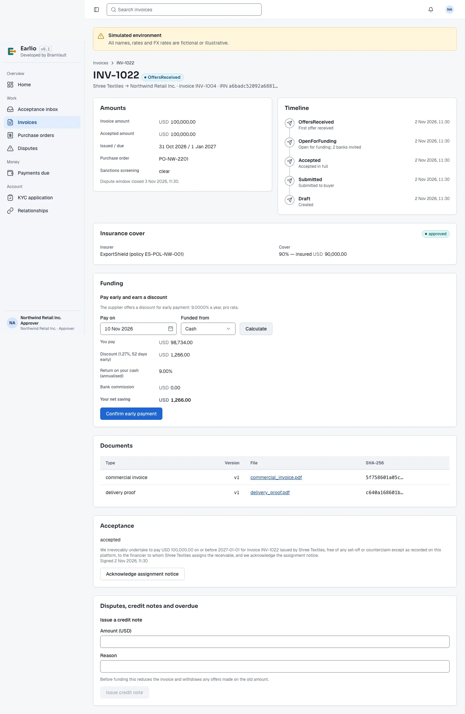
*Figure B-9. An early-payment quote: pay USD 98,734.00 and save USD 1,266.00.*

Confirming is only possible once the dispute window has ended. When you confirm, the invoice is marked **Funded** by early payment, all bank offers on it are withdrawn, and you pay the discounted amount on the chosen date. Earlio credits the supplier and closes the invoice.

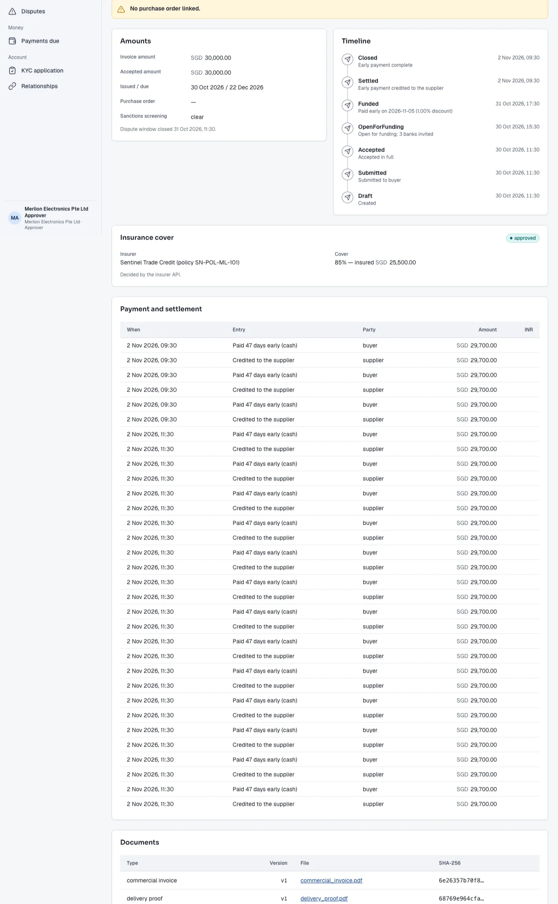
*Figure B-10. An invoice that was paid early and closed.*

## 8. Paying invoices

**Payments due** lists every financed invoice you must pay, with everything your treasury team needs:

| Field | Meaning |
| --- | --- |
| **Amount due** | The amount and the due date. |
| **Payment reference** | For example `EARL-INV-1018-EE1E`. **Quote it exactly** in the payment. |
| **Pay to** | The bank's collection account: account name, number and SWIFT code. |
| **Received so far** | What has arrived. |
| Status | **Expected** (nothing received yet), **PartiallyReceived** (a short payment), **Received** / **Matched** / **Distributed** (paid and being processed), **Reconciled** (complete), or **Exception** (the bank is looking into it). |

Pay the **full amount** into the collection account and quote the reference exactly, so the payment is matched automatically. If you pay less, pay late, pay without the reference or pay in the wrong currency, the payment goes to the bank's exceptions queue and someone has to match it by hand; a short payment leaves the balance outstanding and late interest may run on it.

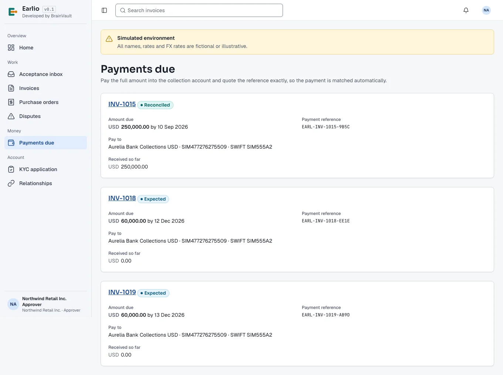
*Figure B-11. Payments due: amount, reference and account for each invoice.*

## 9. Disputes and credit notes

### 9.1 Raising a dispute

*Roles: FinanceUser or Approver.* If something is wrong with goods you have already accepted — damage, short delivery, quality — raise a dispute rather than simply not paying.

1. Open the invoice and go to **Disputes, credit notes and overdue**.
2. Under **Raise a dispute**, enter the **Dispute reason** and, if only part of the invoice is affected, the **Disputed amount**.
3. Choose **Raise dispute**.

A dispute **freezes** the invoice: funding stops, and if it is overdue, late interest and reminders stop while the dispute is open. The supplier is notified and must respond.

A FinanceUser can withdraw a dispute your organisation raised if it is resolved between you.

### 9.2 Working a dispute case

Open **Disputes** and choose **Open case** on the dispute.

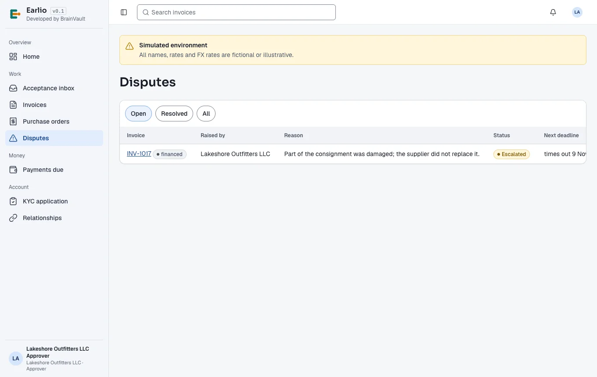
*Figure B-12. Your disputes, with status and next deadline.*

The case page shows who raised it, the parties (and whether the invoice is financed), the reason, and three deadlines:

- **Response due** — the other side should respond by then (48 hours by default);
- **Escalates** — if there is no response, the case goes to Earlio (72 hours by default);
- **Times out** — an undecided case closes after 240 hours by default.

Use the **Case thread** to talk to the supplier: type a **Message** and choose **Send**, or **Attach evidence** (photos, inspection reports). Earlio staff decide escalated cases in favour of the buyer or the supplier, with a cause.

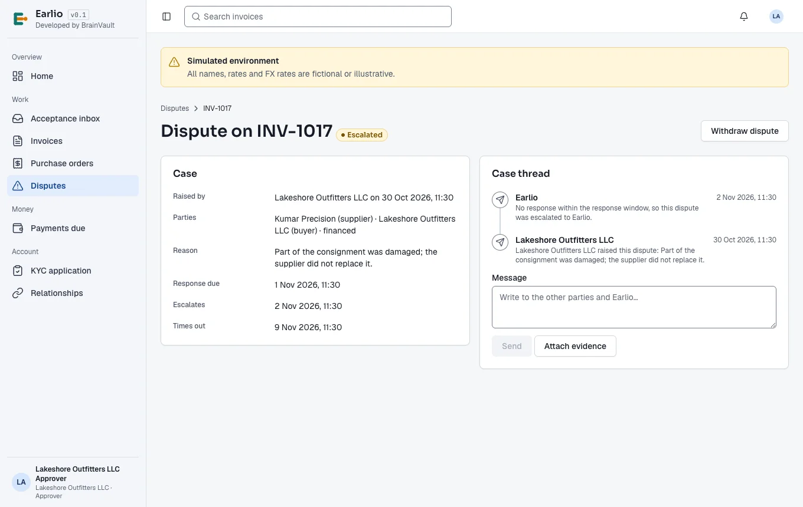
*Figure B-13. A dispute case page.*

### 9.3 Issuing a credit note

*Roles: FinanceUser or Approver.* When you and the supplier agree a reduction, issue a credit note rather than short-paying.

1. Open the invoice. Under **Issue a credit note**, enter the **Amount** and a **Reason**.
2. Choose **Issue credit note**.

Before funding, the credit note reduces the invoice and withdraws offers made on the old amount. After funding, the bank's advance is cut pro rata and the supplier owes the bank the difference; you pay the reduced amount.

## 10. Overdue invoices and late interest

If a financed invoice is not paid in full by the due date, it becomes **Overdue**. The **Disputes, credit notes and overdue** panel shows how many days past due, the **late interest so far**, and when the insurer's waiting period ends.

- You are reminded on days **1, 7 and 30** after the due date.
- **Late interest** is charged to you at the financing rate plus 2 points a year, from the due date. It stops while a dispute is open.
- If the invoice is still unpaid at the end of the insurer's waiting period, it **defaults** and the bank files a claim with the insurer. The debt is not cancelled: any amount later recovered from you is shared between the bank and the insurer.

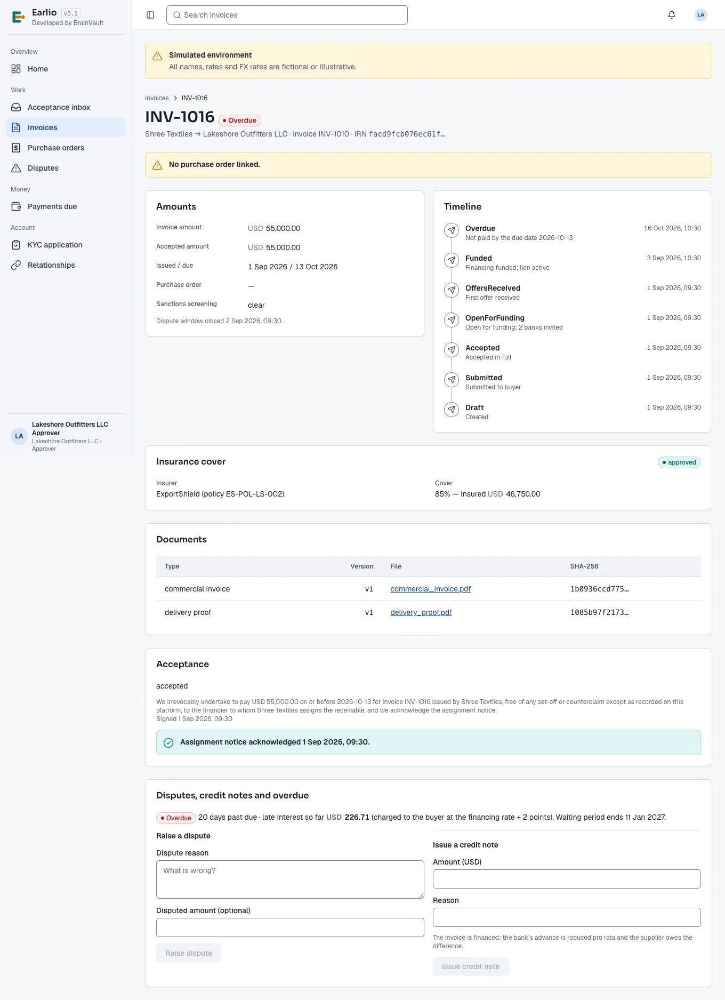
*Figure B-14. An overdue invoice: 20 days past due, with late interest so far.*

## 11. Purchase orders

**Purchase orders** lists the POs your suppliers have recorded against you: PO number, supplier, description, date recorded and amount. Invoices raised against a PO are easier to check; invoices without one are flagged. If a PO here is not one you issued, contact the supplier before accepting invoices against it.

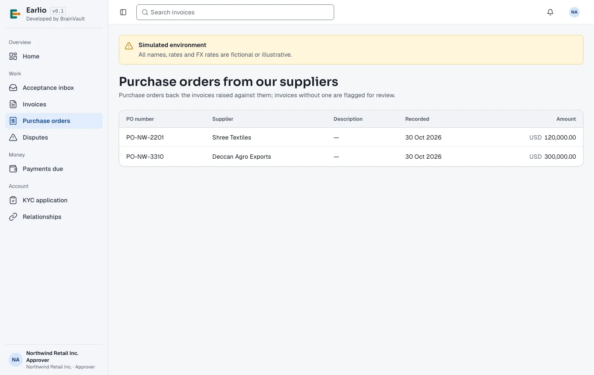
*Figure B-15. Purchase orders your suppliers recorded.*

## 12. Managing users (Admin)

*Role: Admin.* **Users** lists your organisation's users with their role and two-step verification status. Under **Add a user**, enter **Name**, **Work email**, **Role** (Admin, FinanceUser, Approver or Viewer) and a **Starting password**, then choose **Add user**. Give the Approver role only to people authorised to commit your organisation to pay.

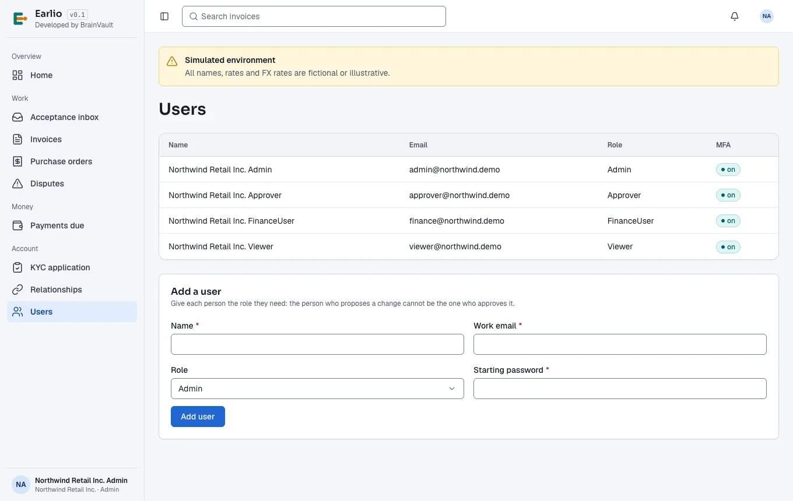
*Figure B-16. Managing users.*

The Admin also chooses the **Notification language** at the bottom of the home page.

## 13. Frequently asked questions

**What happens if we do not respond to an invoice?**
Nothing: it waits in the inbox and you are reminded. It is never accepted automatically. But the supplier cannot be financed until you decide, so please decide promptly.

**Does accepting cost us anything?**
No. You pay the same amount on the same date. Only the payee may change, to the financing bank.

**Can we still dispute an invoice after accepting it?**
Yes. Raise a dispute from the invoice. During the dispute window (at least 24 hours after acceptance) this stops the funding altogether.

**Why can't we see the bank's rate?**
By design: financing terms are between the supplier and the bank.

**We paid but the invoice still shows Expected.**
Check that you quoted the payment reference exactly and paid the full amount in the invoice currency into the account shown. Otherwise the bank's operations team matches it by hand, which takes longer.

**Can we pay early on an invoice that is already funded by a bank?**
No. Early payment is offered by the supplier before funding; confirming it withdraws the bank offers.

## 14. List of figures

| Figure | Title |
| --- | --- |
| B-1 | [The buyer home dashboard](#buy-pages) |
| B-2 | [The KYC application page](#buy-setup) |
| B-3 | [Relationships with suppliers, and preferred banks](#buy-setup) |
| B-4 | [The acceptance inbox with one invoice awaiting acceptance](#buy-inbox) |
| B-5 | [Every invoice addressed to you](#buy-inbox) |
| B-6 | [Reviewing a submitted invoice. The decision panel is at the bottom](#buy-review) |
| B-7 | [An assignment notice waiting for acknowledgement](#buy-assignment) |
| B-8 | [A funded invoice. The notice has been acknowledged](#buy-assignment) |
| B-9 | [An early-payment quote: pay USD 98,734.00 and save USD 1,266.00](#buy-early-payment) |
| B-10 | [An invoice that was paid early and closed](#buy-early-payment) |
| B-11 | [Payments due: amount, reference and account for each invoice](#buy-payments) |
| B-12 | [Your disputes, with status and next deadline](#buy-dispute-case) |
| B-13 | [A dispute case page](#buy-dispute-case) |
| B-14 | [An overdue invoice: 20 days past due, with late interest so far](#buy-overdue) |
| B-15 | [Purchase orders your suppliers recorded](#buy-purchase-orders) |
| B-16 | [Managing users](#buy-users) |
