# Earlio user manual — Banks

*For banks that price, fund and collect invoices on Earlio.*

Read [Getting started](00-getting-started.md) first: it covers signing in with two-step verification, the screen layout, notifications, invoice statuses and the glossary. This manual covers everything a bank does on Earlio, role by role. The screenshots show the demo banks Aurelia Bank (the partner bank), Kestrel Capital and Harbour Trust Bank.

## Contents

1. [How a bank works on Earlio](#bnk-overview)
2. [Your roles](#bnk-roles)
3. [Your pages](#bnk-pages)
4. [The bank dashboard](#bnk-home)
5. [Credit: invitations and offers](#bnk-credit)
   1. [The invitations inbox](#bnk-invitations)
   2. [Reviewing an invited invoice](#bnk-review-invoice)
   3. [Pricing and sending an offer](#bnk-send-offer)
   4. [Withdrawing an offer](#bnk-withdraw-offer)
   5. [Confirming or declining the financing](#bnk-confirm)
   6. [The payout to the supplier](#bnk-disbursement)
6. [Operations: settlement](#bnk-settlement)
   1. [Exceptions](#bnk-exceptions)
   2. [Expectations](#bnk-expectations)
   3. [Transactions](#bnk-transactions)
   4. [Disbursements](#bnk-disbursements)
7. [Overdue invoices, defaults and claims](#bnk-recovery)
   1. [Overdue and defaults](#bnk-overdue)
   2. [Reporting buyer insolvency](#bnk-insolvency)
   3. [Filing an insurance claim](#bnk-file-claim)
   4. [Following a claim](#bnk-claims)
8. [Recourse](#bnk-recourse)
9. [Export proceeds](#bnk-export-proceeds)
10. [Exposure limits](#bnk-limits)
11. [The terms studio](#bnk-terms)
    1. [Terms sets and overrides](#bnk-terms-sets)
    2. [Editing terms: the Settings tab](#bnk-terms-settings)
    3. [Eligibility rules](#bnk-terms-rules)
    4. [Required information](#bnk-terms-required)
    5. [What they will see](#bnk-terms-preview)
    6. [The simulator](#bnk-terms-simulator)
    7. [JSON, import and export](#bnk-terms-json)
    8. [Saving, checking and submitting a version](#bnk-terms-submit)
12. [Approvals (checker)](#bnk-approvals)
13. [The bank console: branding and your portal](#bnk-console)
14. [API and files](#bnk-integration)
15. [Users and KYC (Admin)](#bnk-users)
16. [Frequently asked questions](#bnk-faq)
17. [List of figures](#bnk-figures)

---

## 1. How a bank works on Earlio

Earlio brings you invoices that are already **accepted** by the buyer (an irrevocable undertaking to pay) and **insured** by a trade-credit insurer. You decide which invoices you want through your **terms** — eligibility rules, pricing, advance rates, timing — held as versioned data that you maintain yourself in the terms studio. Earlio applies your terms automatically: you are only invited to price invoices that fit them, and every offer is priced from them.

The flow for a financed invoice:

1. A supplier requests funding. Earlio invites the supplier's and buyer's preferred banks and the partner bank. **Your CreditOfficer** prices and sends an offer.
2. The supplier chooses your offer. Earlio reserves your exposure limits, records a **lien** (so the invoice cannot be financed twice) and asks the supplier's Approver to consent.
3. The supplier consents and the buyer acknowledges the **assignment notice**: the buyer must now pay you.
4. **Your CreditOfficer** confirms. Earlio re-checks everything, books the exchange rate and instructs the rupee payout to the supplier.
5. On the due date the buyer pays your **collection account**, quoting a reference. **Your Operations team** sees the payment matched; your principal and charges are settled and the retention is released to the supplier.
6. If the buyer does not pay, late interest runs; after the insurer's waiting period you **file a claim** and the insurer pays you.

Earlio enforces platform guardrails your terms cannot override: an FX spread of at most 1%, a cost cap for small suppliers (18% a year), a minimum dispute window of 24 hours, a mandatory assignment notice, and no funding after a sanctions hit.

## 2. Your roles

| Role | Can do |
| --- | --- |
| **Admin** | Manage users; manage API keys (create, rotate, revoke) and webhooks; edit branding; KYC. |
| **CreditOfficer** | See invitations; price, send and withdraw offers or decline invitations; upload offers as a CSV file; confirm or decline financing; file insurance claims; record recoveries and recourse repayments; report buyer insolvency. |
| **Operations** | Settlement: expected payments, transactions, the exceptions queue and resolving exceptions; import statements; statement and instruction file drops; report export-proceeds realisation. |
| **RelationshipManager** | Draft, import, simulate and submit terms for approval; set buyer and supplier exposure limits; edit branding. |
| **Approver** | Approve and publish terms as the checker. Must be a different person from whoever drafted them. |
| **FinanceUser** | KYC only. |
| **Viewer** | Read only. |

## 3. Your pages

Which pages you see depends on your role.

| Sidebar | Page | Used by |
| --- | --- | --- |
| Overview | **Home** | Everyone |
| Work | **Invitations** | CreditOfficer |
| Work | **Disputes** | Everyone (read) |
| Money | **Settlement** | Operations |
| Money | **Overdue and defaults** | CreditOfficer |
| Money | **Claims** | CreditOfficer |
| Money | **Recourse** | CreditOfficer |
| Money | **Export proceeds** | Operations |
| Controls | **Exposure limits** | RelationshipManager |
| Controls | **Terms studio** | RelationshipManager |
| Controls | **Approvals** | Approver |
| Controls | **Bank console** | Admin, RelationshipManager |
| Controls | **API and files** | Admin, CreditOfficer, Operations |
| Account | **KYC application**, **Users** | Admin |

## 4. The bank dashboard

**Home** summarises your book:

- **Funded** — invoices funded, total advanced, advanced in the last 30 days, outstanding, and overdue (with **Below target** when overdue is high).
- **Invitations by status** and **Offers by status**.
- **Exposure by buyer** and **Exposure by supplier**, in US dollars.

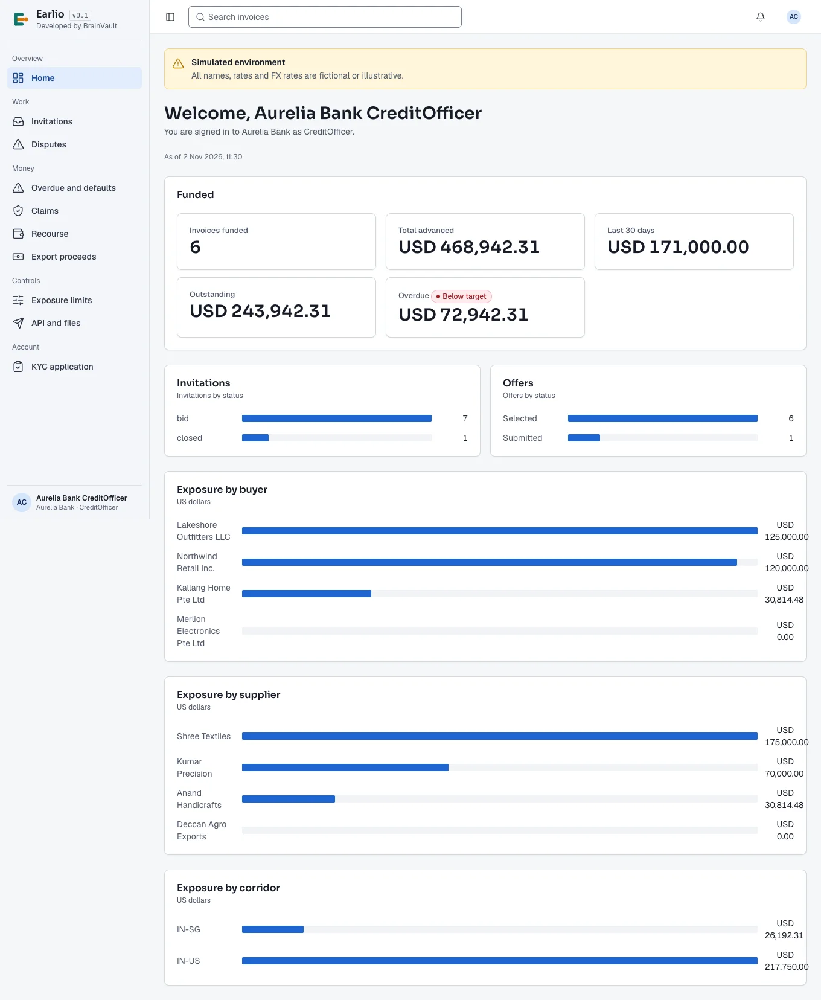
*Figure K-1. The bank dashboard.*

## 5. Credit: invitations and offers

### 5.1 The invitations inbox

*Role: CreditOfficer.* **Invitations** lists every invoice you were invited to price:

| Column | Meaning |
| --- | --- |
| **Invoice** | Earlio number. Select it to open the invoice. |
| **Supplier**, **Buyer** | The parties, with the buyer's rating tier (AA, A, BBB). |
| **Amount**, **Due** | Invoice amount and due date. |
| **Cover** | The insurer's decision and percentage, for example `approved 90%`. |
| **Invoice status** | Where the invoice is now. |
| **My offer** | `none`, or your offer's status and all-in rate (for example `Submitted 9.33%`). |

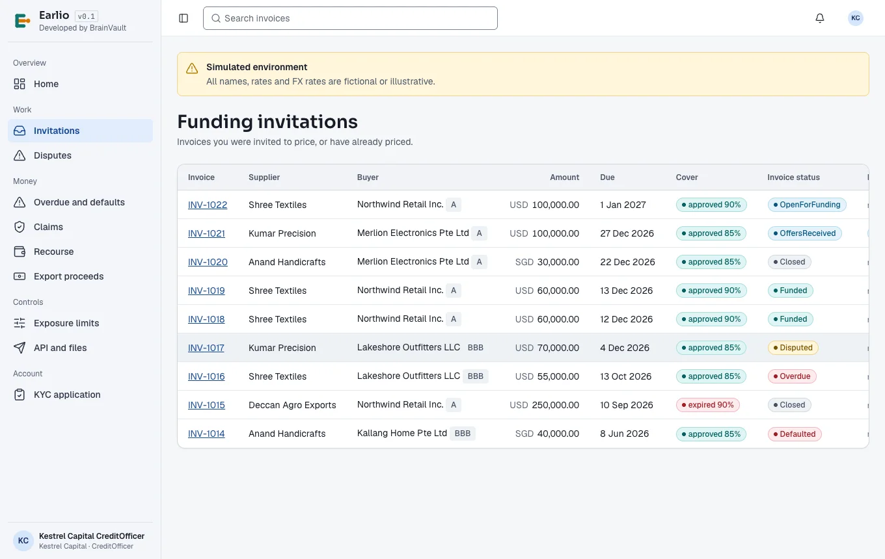
*Figure K-2. Funding invitations. INV-1022 has no offer from this bank yet.*

You only see invoices you were invited to, and you only see an invoice's details once invited.

### 5.2 Reviewing an invited invoice

Open the invoice. You see the amounts, timeline, the insurer's cover, the documents with their fingerprints and the buyer's signed undertaking — the same evidence the supplier and buyer see. Check:

- the **cover** (percentage and insured amount) against your minimum;
- the **dispute window** under **Amounts**;
- the **documents** — commercial invoice, delivery proof and any supporting papers.

### 5.3 Pricing and sending an offer

*Role: CreditOfficer.* The **Your offer** panel is the offer composer. Every field defaults to your terms; change only what you want to differ for this invoice.

| Field | Meaning |
| --- | --- |
| **Rate % p.a.** | Your annual discount rate. Blank = from your terms (benchmark + margin by buyer rating, or a fixed rate). Must be between 0 and 60. |
| **Advance %** | Share of the invoice you advance. Cannot exceed your terms. Small suppliers are also capped at the insured percentage. |
| **FX spread %** | Your margin on the exchange rate. The platform caps it at 1%. |
| **Valid for (hours)** | How long the offer stays open. |

1. Fill in the fields you want to change.
2. Choose **Price it**. Earlio shows the result exactly as the supplier will see it: all-in cost, net cash, the INR amount at your rate, the cover, and the breakdown — advance, bank discount (interest), processing fee, platform fee and insurance premium (each marked *if passed on*), total charges and net cash.
3. If it is right, choose **Send offer**.

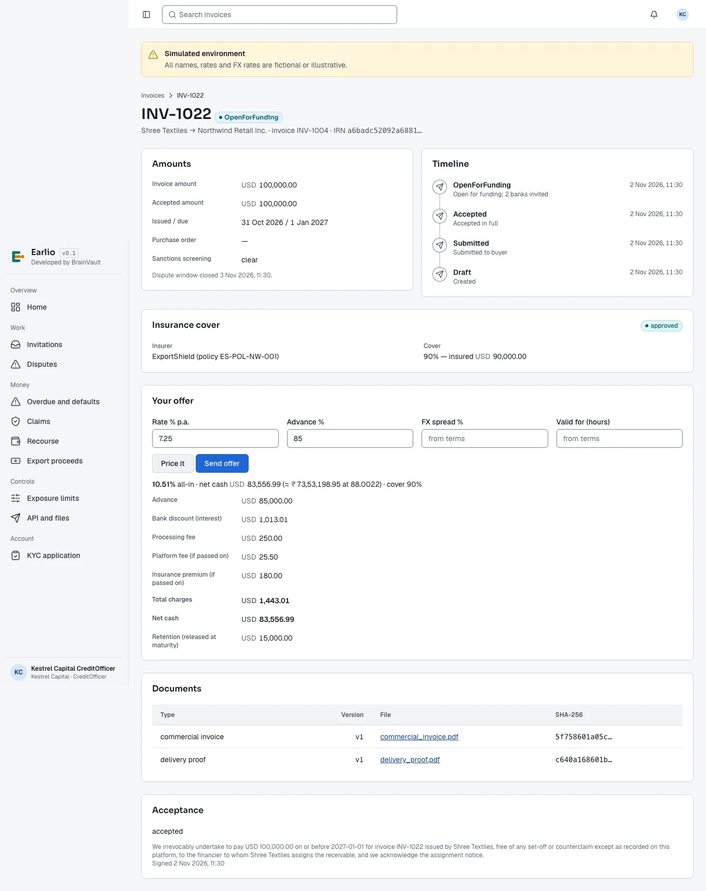
*Figure K-3. The offer composer after Price it: 10.51% all-in, net cash USD 83,556.99.*

Sending re-prices the offer with the terms and cover in force at that moment. If the offer breaks a guardrail (for example the small-supplier cost cap), Earlio refuses it and says which one. The supplier sees offers ranked cheapest first, so price competitively.

Offers also arrive through the API or as a CSV file (see [API and files](#bnk-integration)). Each API offer carries an idempotency key, so a retried call never creates a second offer.

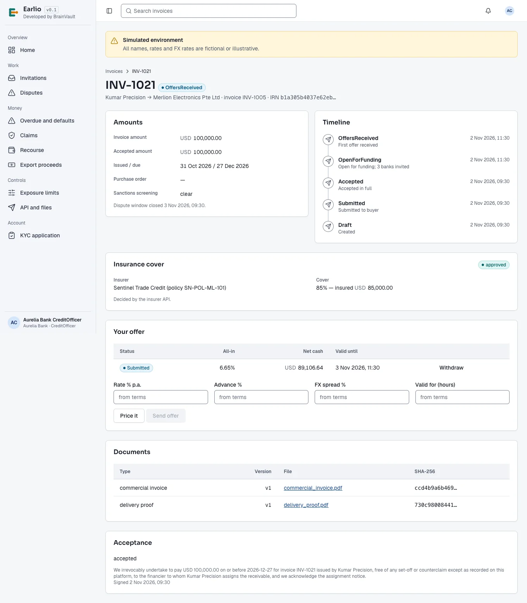
*Figure K-4. An invoice with your submitted offer, its status and the Withdraw action.*

### 5.4 Withdrawing an offer

While your offer is **Submitted** you can choose **Withdraw** in the **Your offer** table. Offer statuses:

| Status | Meaning |
| --- | --- |
| **Drafted** | Being prepared. Invisible to the supplier. |
| **Submitted** | Live; the supplier can choose it. |
| **Selected** | The supplier chose it. |
| **Rejected** | Another offer was funded. |
| **Expired** | It passed its validity time. |
| **Withdrawn** | You withdrew it. |
| **Superseded** | Replaced by a newer offer from you. |

### 5.5 Confirming or declining the financing

When the supplier chooses your offer, the financing request goes to **ConsentPending** (waiting for the supplier's Approver), then to **BankConfirming**.

*Role: CreditOfficer.* When the request is **BankConfirming** and the buyer has acknowledged the assignment notice, the **Financing request** panel offers:

- **Confirm and instruct payment** — Earlio re-checks the parties (sanctions, KYC), the dispute window, the insurance cover against your minimum, your limits and the buyer's acknowledgement. If all pass, the lien becomes active and the payout is instructed.
- **Decline** — enter a reason. The lien, limits and cover reservation are released and the supplier can choose another offer.

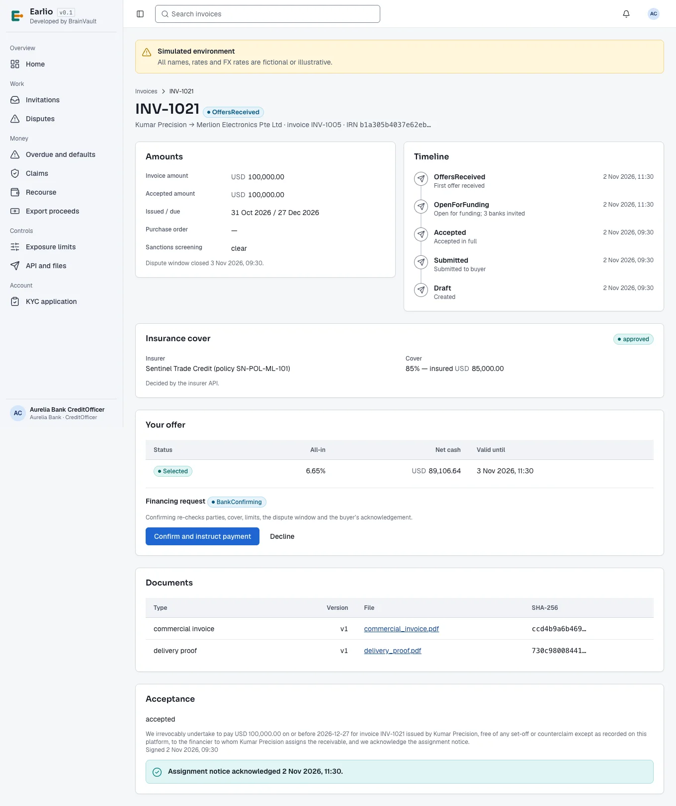
*Figure K-5. A financing request waiting for the bank's confirmation.*

If the supplier's consent asked for extra information required by your terms, the answers are shown on the financing request.

### 5.6 The payout to the supplier

After you confirm, Earlio runs the payout and shows each step in **Payment and settlement**:

1. **Instructed** — payment instructed to the supplier.
2. **FXBooked** — converted at your rate (for example `USDINR at 88.1348 (mid 88.40, spread 0.30%)`).
3. **QueuedForValueDate** — the value date is set from your daily **cut-off time** and the India, US and Singapore holiday calendars. Confirming after the cut-off moves the payment to the next banking day.
4. **Sent** — sent to the bank.
5. **Credited** — the rupees reached the supplier. Only now does the invoice become **Funded**, the lien become active and your limits and the insurer's cover become used.

A rejected payment is retried up to three times; after that it is reversed, the financing fails, everything is released and a **DisbursementFailed** exception appears in [Settlement](#bnk-exceptions). A credit for a different amount raises **AmountMismatch**; funds sent back raise **DisbursementReturned**.

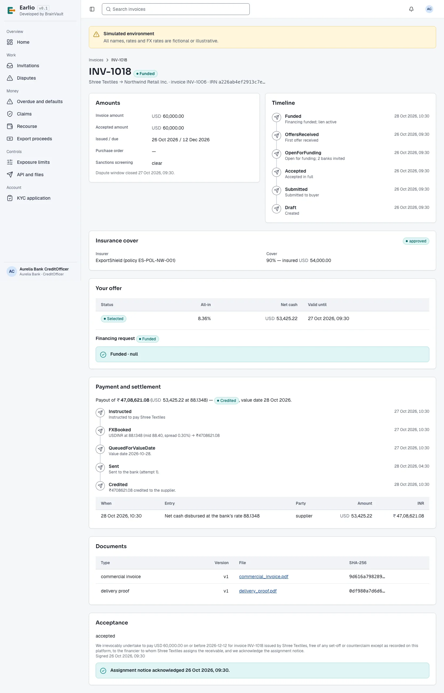
*Figure K-6. A funded invoice: your selected offer and the payout steps.*

## 6. Operations: settlement

*Role: Operations.* **Settlement** has four tabs. The number on **Exceptions** shows how many are open.

### 6.1 Exceptions

Anything that does not match automatically lands here, with a plain description and the actions allowed for that type:

| Type | When it happens | Actions |
| --- | --- | --- |
| **Unmatched** | A payment arrived with no reference Earlio can match. | **Assign to invoice** |
| **ShortPaid** | Less than the amount due was received (for example USD 59,000 against 60,000). | **Wait for balance**, **Accept as full** |
| **OverPaid** | More than the amount due was received. | **Refund buyer** |
| **Late** | The payment arrived after the due date. | **Acknowledge** |
| **AmountMismatch** | The supplier's bank credited a different amount from the payout. | **Accept credited amount**, **Acknowledge** |
| **DisbursementFailed** | The payout was rejected three times and reversed. | **Acknowledge** |
| **DisbursementReturned** | The payout came back from the supplier's bank. | **Acknowledge** |

Choose the action that fits; the exception closes and the ledger is updated. When the queue is empty the tab says **Everything matched**.

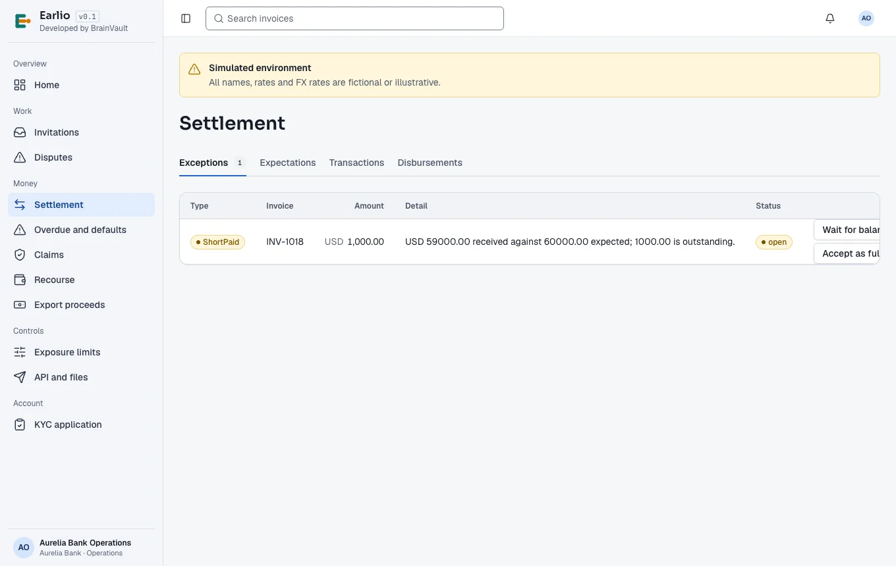
*Figure K-7. A short payment in the exceptions queue.*

### 6.2 Expectations

One row per funded invoice: the **Reference** the buyer must quote (`EARL-<invoice>-<check>`), the buyer, **Expected** and **Received** amounts, the due date and the status (**Expected**, **PartiallyReceived**, **Received**, **Matched**, **Distributed**, **Reconciled** or **Exception**).

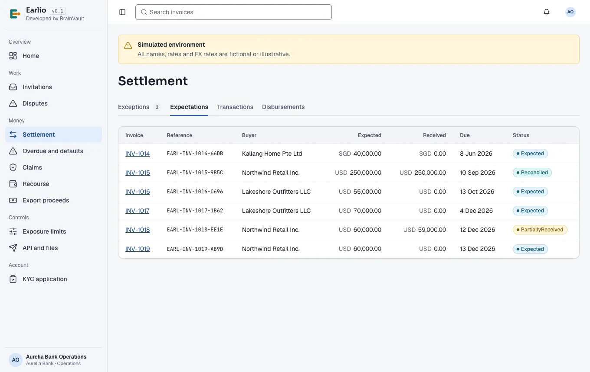
*Figure K-8. Expected payments and their status.*

### 6.3 Transactions

Every incoming payment, whether it came by **callback** (a signed webhook from your bank) or a **statement** line: bank transaction id, reference, amount, value date and what it matched. The same bank transaction is never booked twice; a statement line that repeats a callback is linked to it instead.

When a payment matches exactly, Earlio distributes it — your principal and charges first, then the retention to the supplier in rupees — releases the lien and limits, and marks the invoice **Settled**. The next statement pass reconciles it to **Closed**.

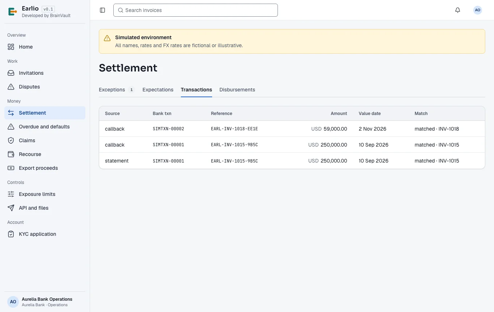
*Figure K-9. Incoming transactions and how they matched.*

### 6.4 Disbursements

Every payout to a supplier: status, foreign amount, FX rate, INR amount, value date (with *cut-off missed* where relevant) and the number of attempts.

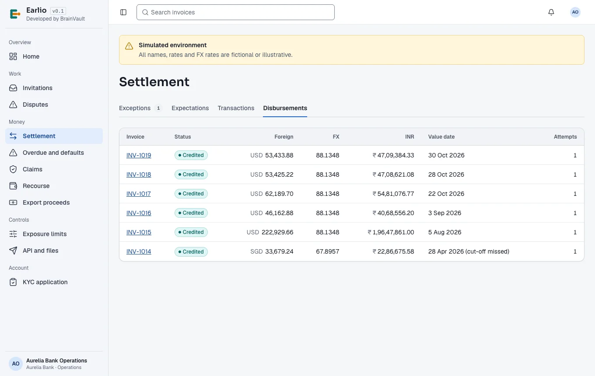
*Figure K-10. Payouts to suppliers.*

## 7. Overdue invoices, defaults and claims

### 7.1 Overdue and defaults

**Overdue and defaults** lists your financed invoices that were not paid on the due date. For each:

- what the buyer owes in principal, days overdue, **late interest** so far (financing rate + 2 points, paid by the buyer, never the supplier), and how many of the three reminders (days 1, 7 and 30) have been sent;
- the insurer's **waiting period** (for example 90 days) and when it ends, and the **claim deadline** (60 days after the waiting period).

Late interest and the waiting period exclude days when the invoice was frozen by a dispute. Each item carries a status: **Overdue**, **WaitingPeriod**, **ClaimEligible**, **ClaimFiled**, **Paid**, **ClaimLapsed** (the deadline was missed) or **Recovered**.

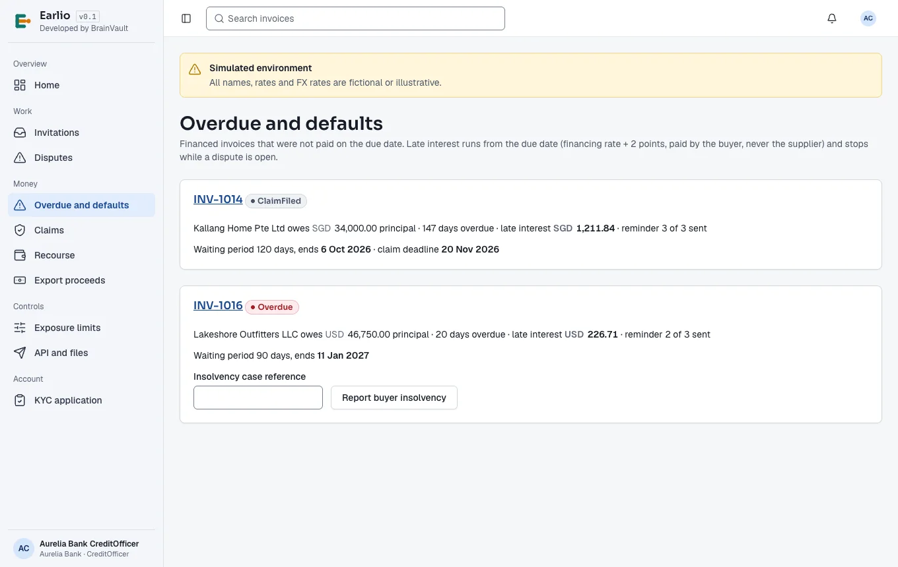
*Figure K-11. Overdue and defaulted invoices with late interest and claim deadlines.*

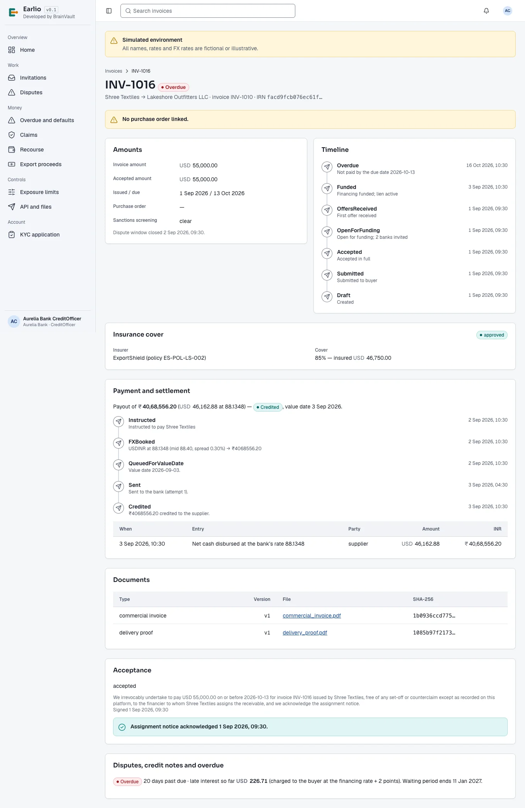
*Figure K-12. An overdue invoice.*

### 7.2 Reporting buyer insolvency

*Role: CreditOfficer.* If the buyer becomes insolvent, enter the **Insolvency case reference** on the overdue invoice and choose **Report buyer insolvency**. The waiting period is waived, so you can claim at once.

### 7.3 Filing an insurance claim

*Role: CreditOfficer.* When the waiting period ends the invoice becomes claim-eligible and a claim form appears on **Overdue and defaults**.

1. Attach the documents: **invoice**, **acceptance**, **delivery proof** and **statement**. Missing documents do not stop you filing, but the insurer treats them as a documentation defect.
2. Answer any extra questions the insurer's terms require.
3. File the claim.

File before the **claim deadline**. A claim not filed in time lapses.

### 7.4 Following a claim

**Claims** lists your claims: the invoice, the amount claimed against the invoice and cover, the filing date, the documents, and the status (**Filed**, **UnderReview**, **Approved**, **PartiallyApproved**, **Rejected**, **Paid**). The insurer checks exclusions (an open dispute, a documentation defect, shipment before the limit was in place, a sanctions breach) and approves, part-approves or rejects it. The payout flows through the waterfall: your principal and charges first.

If the buyer later pays anything, record it as a **recovery**; it is shared with the insurer in proportion to each side's loss.

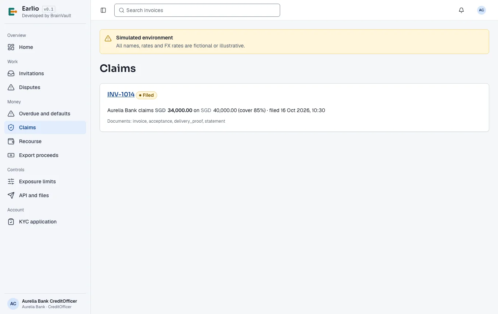
*Figure K-13. A claim filed with the insurer.*

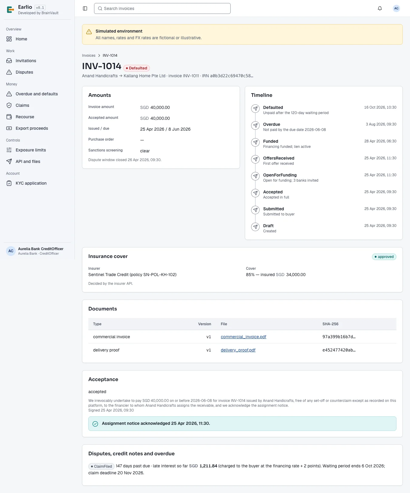
*Figure K-14. The invoice page of a defaulted invoice with a claim filed.*

## 8. Recourse

Financing is non-recourse, except when Earlio decides a dispute against the supplier for a supplier-caused reason, or a credit note reduces a financed invoice. **Recourse** then lists what each supplier owes you and how they repay: an automatic **offset** of up to 20% of each future retention release, or a **90-day plan** of three instalments. *Role: CreditOfficer* — enter the **Amount received** and choose **Record repayment** when a payment arrives.

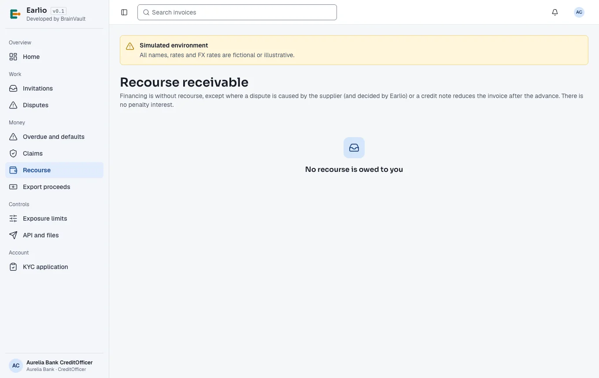
*Figure K-15. Recourse owed to the bank (none here).*

## 9. Export proceeds

As the authorised dealer bank you track the realisation of export proceeds — normally within 9 months of shipment. **Export proceeds** lists each financed export invoice with the shipment date, realise-by date and days left, status (**Pending**, **Realised**, **Reported** or **Overdue**) and rupees received. *Role: Operations* — report realisation when the proceeds are matched to the shipping bill. Overdue items are flagged automatically.

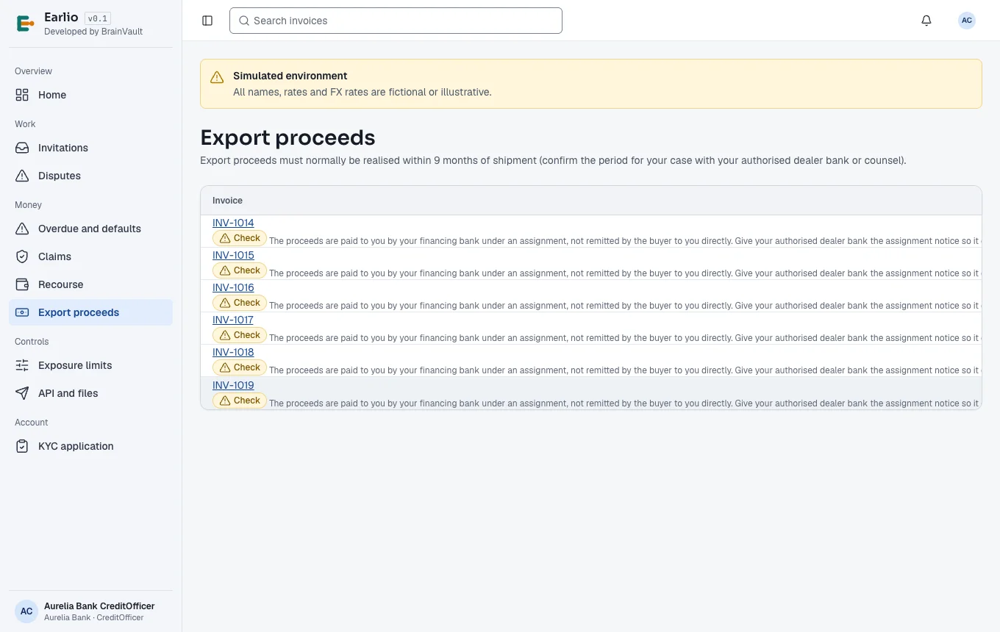
*Figure K-16. Export proceeds by invoice.*

## 10. Exposure limits

*Role: RelationshipManager.* **Exposure limits** shows, in US dollars, your limit on each buyer and supplier and how much is **Reserved** (an offer was chosen), **Used** (funded) and **Available**. A limit is reserved when the supplier chooses your offer, used when the invoice is funded and released on settlement. Reservations are atomic: two suppliers choosing your offers at the same moment can never take you over a limit.

To change a limit, choose **Edit** on its row, enter the **New limit (USD)** and confirm.

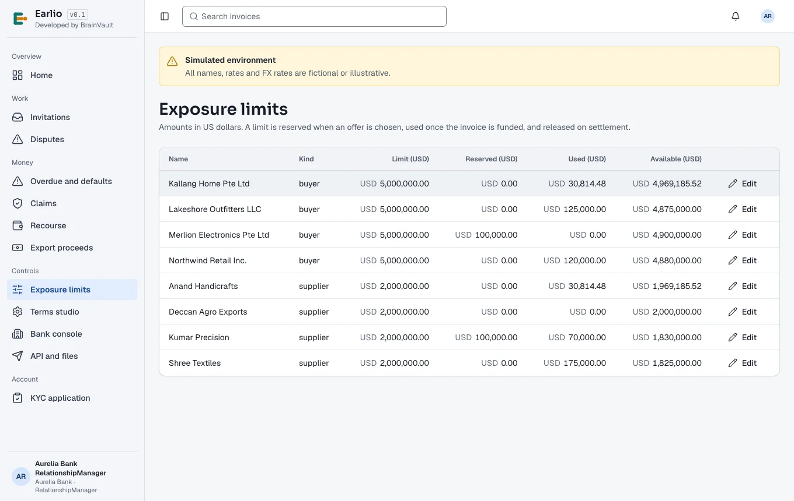
*Figure K-17. Exposure limits per buyer and supplier.*

## 11. The terms studio

*Role: RelationshipManager (maker).* Your pricing, eligibility and timing live in the **terms studio** as versioned terms. Changes are drafted by a maker, checked by a different person (the Approver), then take effect on their effective date. **Invoices already priced keep the version they were priced on**; a version in force can never be edited — a change is always a new version.

### 11.1 Terms sets and overrides

The studio lists your **terms sets**: name, what it applies to, the version in force and the latest version. Choose **Open** to edit one.

- A **default** set applies to everyone.
- An **override** changes only some settings for **one buyer**, **one supplier** or **a corridor** (for example India → Singapore). Fields you do not override fall back to the default.

To create one, under **New terms set** enter a **Name**, choose **Applies to** and choose **Create**.

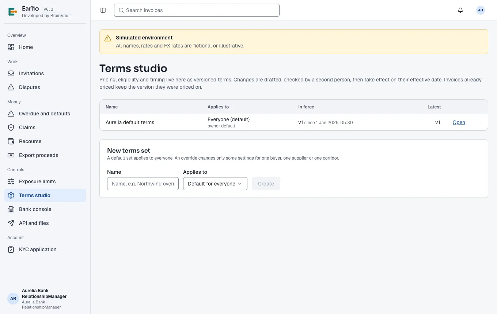
*Figure K-18. Your terms sets.*

### 11.2 Editing terms: the Settings tab

At the top of the editor you can **Start from a template** (*Standard*, *Conservative* or *Growth*), **Reset to latest version** or **Import JSON…**. The **Settings** tab is a form:

| Group | Fields |
| --- | --- |
| **Money** | Advance (% of invoice); Processing fee (%); Processing fee minimum (USD); FX margin (%); Platform fee paid by (bank or supplier). |
| **What the bank funds** | Smallest and largest invoice (USD); Longest tenor (days); Currencies; Buyer countries; Minimum insurance cover (%). |
| **Timing** | Offer valid for (hours); Daily cut-off (HH:MM) and its time zone; Settlement days; Grace days after due date. |
| **Price** | Pricing method — **Fixed annual rate**, or **Benchmark + margin by buyer rating** with a margin for AA, A and BBB buyers. |

In an override set, each field has an **override** tick; only ticked fields apply.

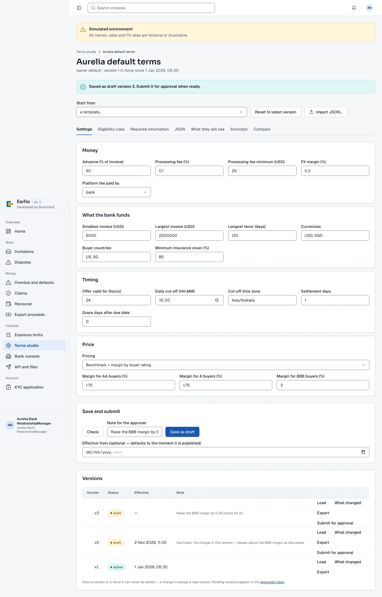
*Figure K-19. The Settings tab, with a new draft saved.*

### 11.3 Eligibility rules

The **Eligibility rules** tab is a visual rule builder. Invoices that fail your rules are not offered to you, and the supplier sees your plain-language sentence instead of a bare "no".

- **Combine with** — **All of these (AND)**, **Any of these (OR)**, **None of these (NOT)**.
- Each condition has a **Fact** (Tenor (days), Invoice amount (USD), Currency, Goods category, Buyer country, Buyer rating, Supplier country, Small supplier, Corridor), an **Operator** (is one of, is none of, is, is not, is below, is at most, is above, is at least, is known) and **Values**.
- **+ Condition** adds a condition; groups can be nested; **Remove** deletes one.

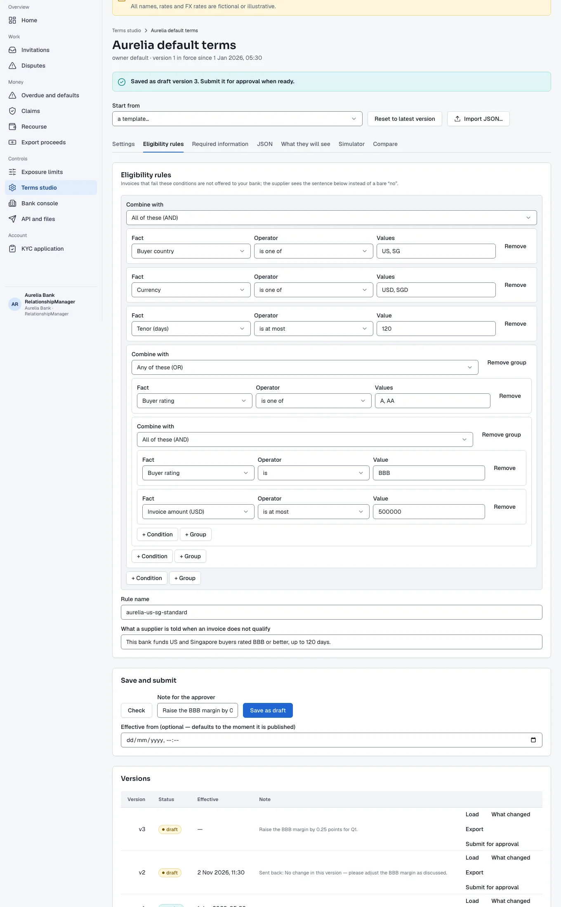
*Figure K-20. The eligibility rule builder.*

### 11.4 Required information

Ask suppliers for extra answers when they give consent (**+ Add a field**: text, number, date or a list; required or optional), and tick **Papers the supplier must attach before consent** — commercial invoice, delivery proof, packing list, shipping bill, transport document. Earlio refuses the supplier's consent until they are provided, and the answers appear on the financing request.

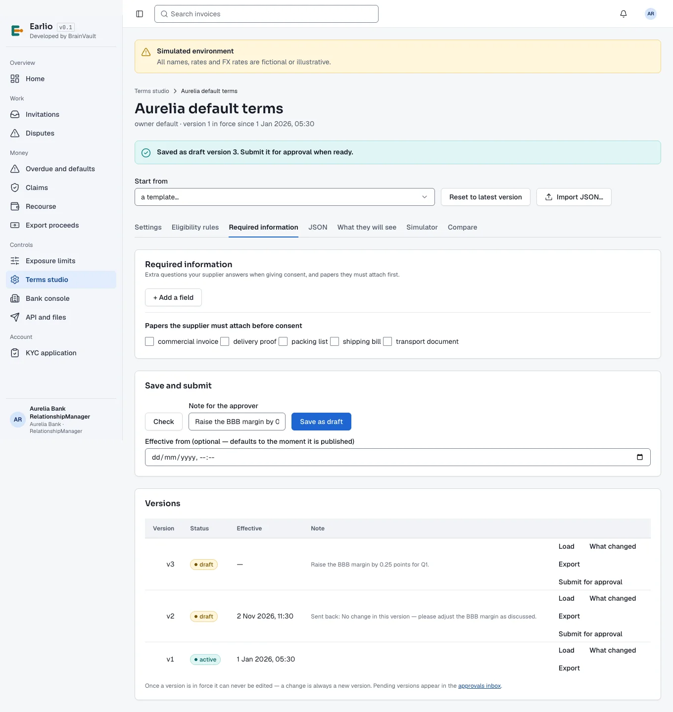
*Figure K-21. Extra questions and required papers.*

### 11.5 What they will see

Choose **Refresh preview** for a plain-language summary of your terms as suppliers and buyers will read it — advance, rate, fees, FX margin, eligible invoices, payment timing, offer validity, minimum cover, and the message shown when an invoice does not qualify. **Summary in Hindi** shows the Hindi version.

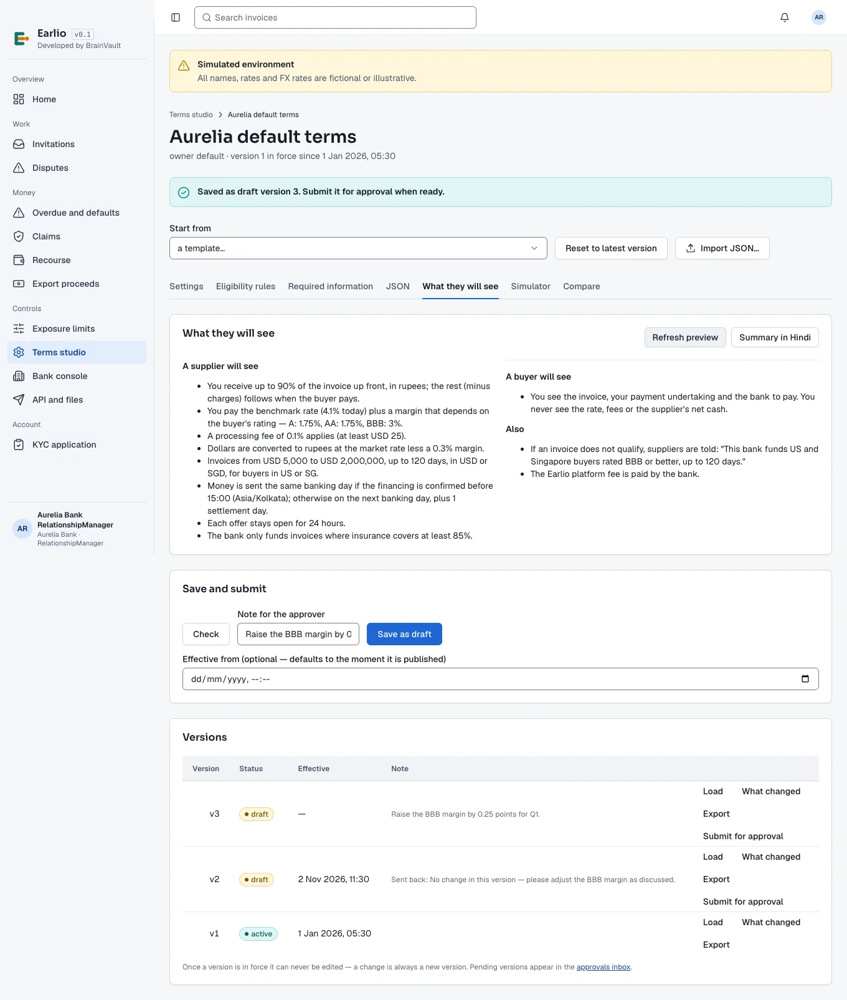
*Figure K-22. The plain-language preview.*

### 11.6 The simulator

Choose **Run simulator** to apply your draft to 20 sample invoices and compare with the terms in force: for each sample, eligible or not (with the reason), net cash and all-in cost, and the change. Use it before submitting to see exactly whom a change affects.

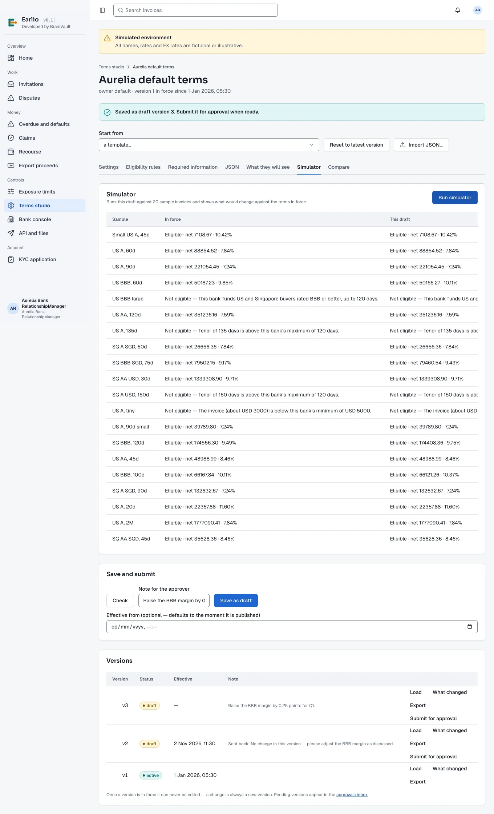
*Figure K-23. The simulator: raising the BBB margin cuts net cash on BBB invoices only.*

### 11.7 JSON, import and export

The **JSON** tab shows the same terms as JSON, validated as you type; **Show the JSON Schema** displays the schema. **Export** (on a version) downloads it; **Import JSON…** loads a file as a new draft, validated like any other.

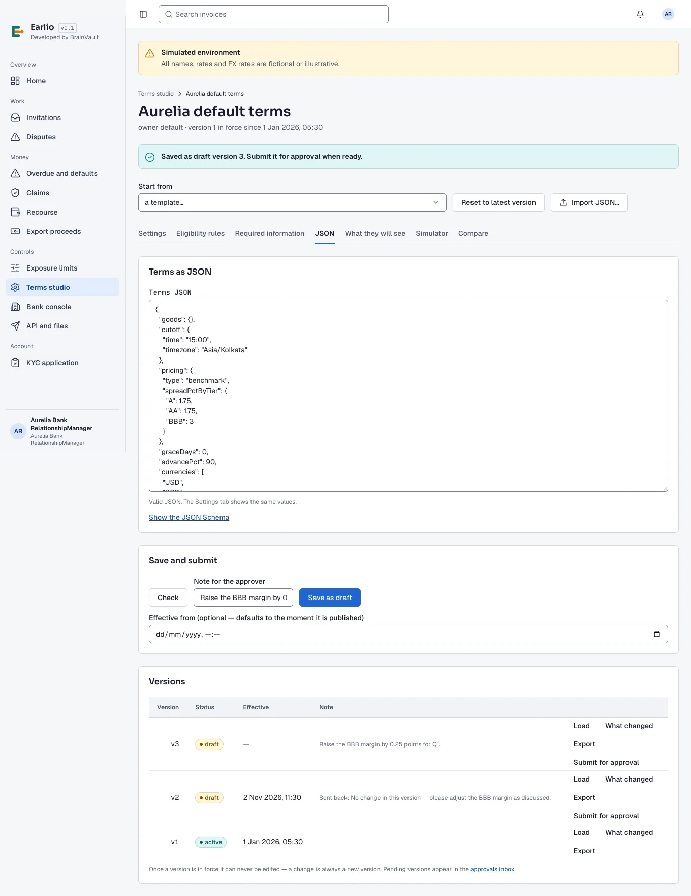
*Figure K-24. The JSON tab.*

### 11.8 Saving, checking and submitting a version

At the bottom of the editor:

1. Choose **Check** to validate the draft and list any guardrail it breaks.
2. Write a **Note for the approver**.
3. Choose **Save as draft**. Earlio confirms "Saved as draft version *n*".
4. Optionally set **Effective from** (a future date); otherwise the version takes effect the moment it is published.
5. In **Versions**, choose **Submit for approval** on the draft (or **Save and submit** in one step).

The **Versions** table lists every version with its status (**draft**, **pending**, **active**, **retired**), effective date and note, with **Load**, **What changed** (a field-by-field diff against the previous version), **Export**, **Submit for approval** and **Withdraw** (back to draft).

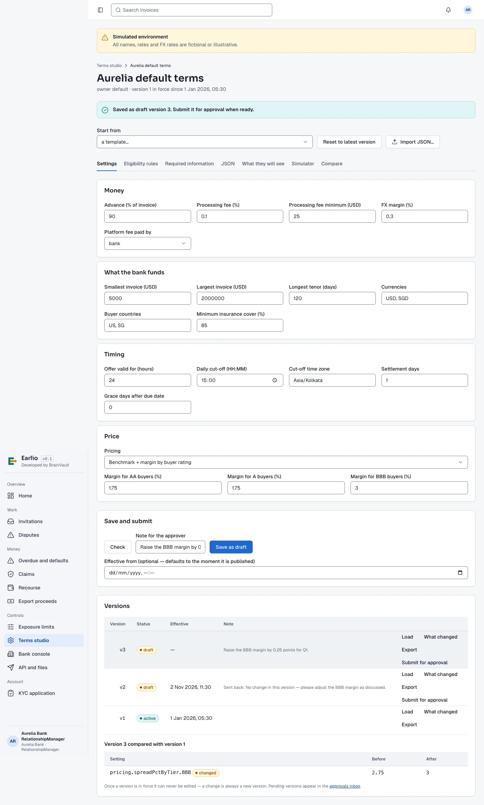
*Figure K-25. The versions table and the change compared with the version in force.*

## 12. Approvals (checker)

*Role: Approver.* **Approvals** is your inbox of terms versions waiting for a checker. Nobody publishes their own changes. Each item shows who prepared it and when, when it takes effect, the version it is compared with, the maker's note, and a table of every setting that changes, **Before** and **After**.

- **Approve and publish** — the version takes effect on its effective date and the previous one is retired.
- **Send back** — enter a **Reason**; the version returns to draft and the maker sees the reason in the versions table.

You cannot approve a version you drafted or submitted; Earlio explains why if you try.

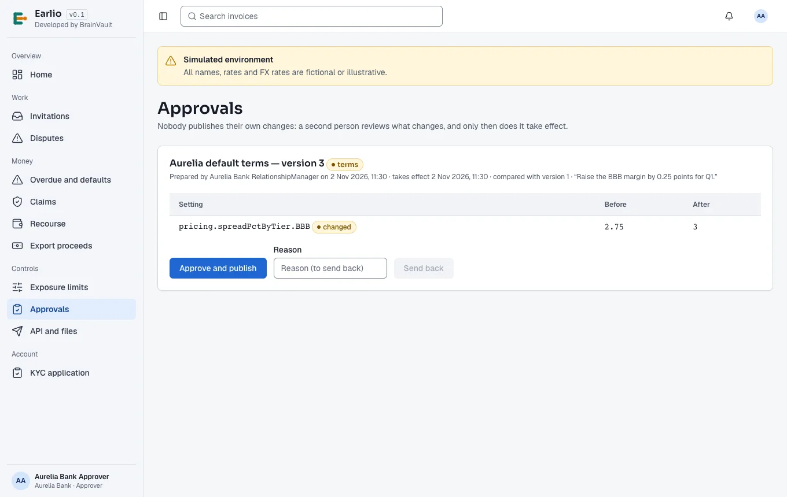
*Figure K-26. An approval request: the BBB margin goes from 2.75 to 3.*

## 13. The bank console: branding and your portal

*Roles: Admin, RelationshipManager.* **Bank console** controls how your portal looks to your suppliers and buyers:

- **Display name**, **Primary colour**, **Accent colour**, **Logo** (PNG, JPEG or SVG, up to 150 KB) and **Welcome text**.
- Your **portal address** (set by Earlio from your tenant name). **Open your portal** to see it.
- A live **Preview**.

Choose **Save branding**. White text must stay readable on your primary colour (contrast at least 4.5 : 1); Earlio rejects colours that fail.

The console also summarises **your fees, rates and limits** (advance, pricing method, processing fee, FX margin, invoice size) with links to the terms studio, exposure limits and the approvals inbox.

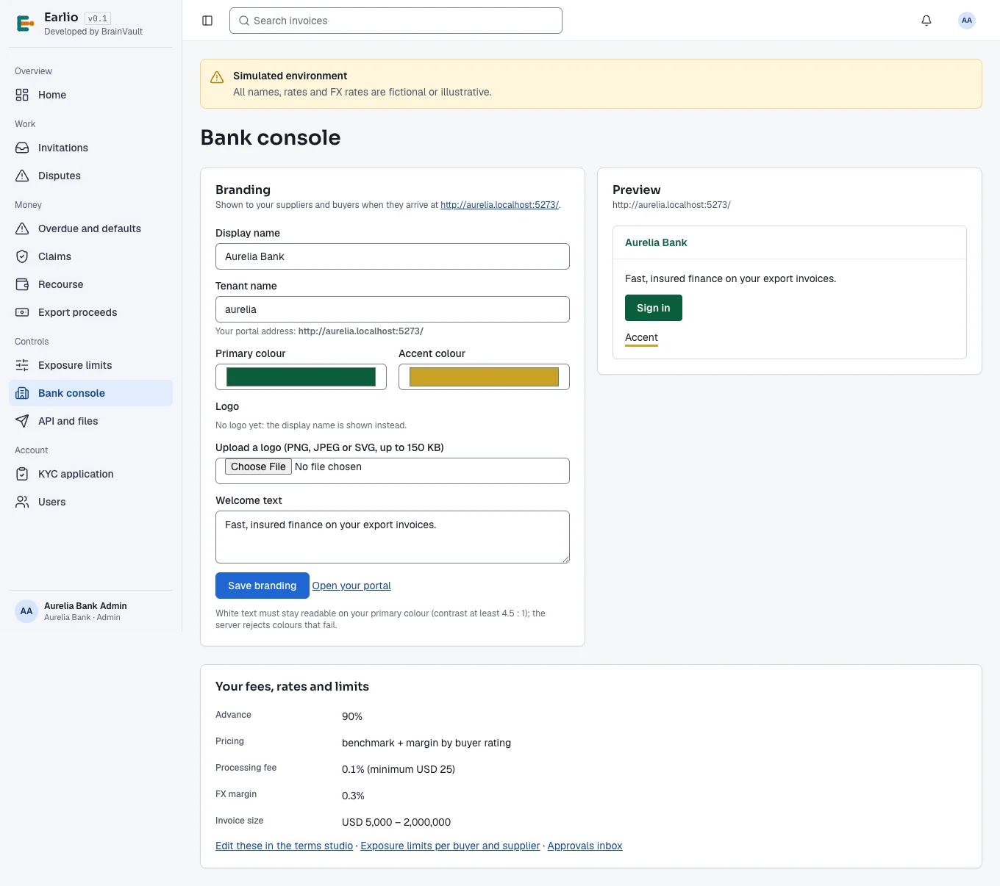
*Figure K-27. Branding with a live preview, and your terms summary.*

## 14. API and files

**API and files** connects your core banking and ERP systems. See the [integration guide](../integration-guide.md) for the signature scheme and file formats.

- **API keys** (*Admin*) — enter a **Name** and **Create key**; rotate or revoke keys. A key's secret is shown once.
- **Webhooks** (*Admin*) — add a **URL** and the **Events** to send (blank = all). **Recent deliveries** shows each delivery, attempts and errors.
- **File drop (CSV)** (*CreditOfficer, Operations*) — upload **Offers** (`invoice, ratePct, advancePct, fxSpreadPct, validityHours`) or a **Statement** (`bankTxnId, reference, currency, amount, valueDate, payer`); download **instructions.csv** with payment instructions waiting for your bank. **History** lists each file with rows processed and problems.

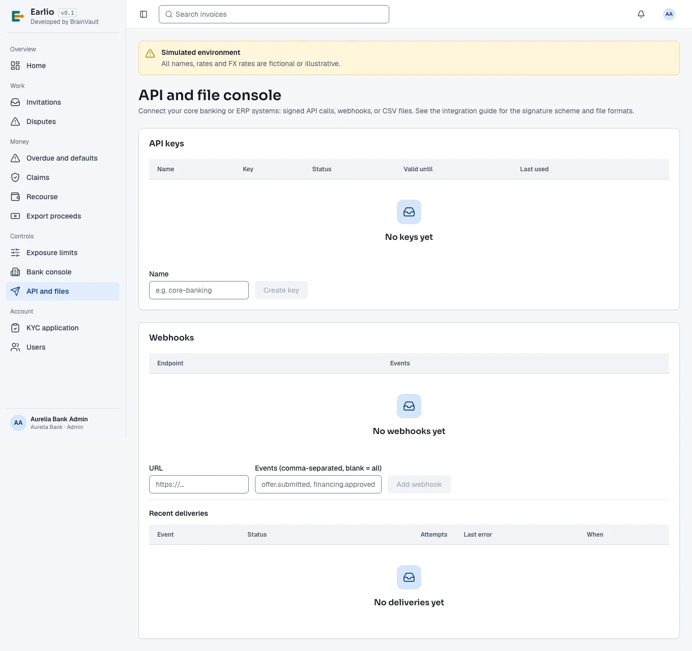
*Figure K-28. API keys and webhooks (Admin view).*

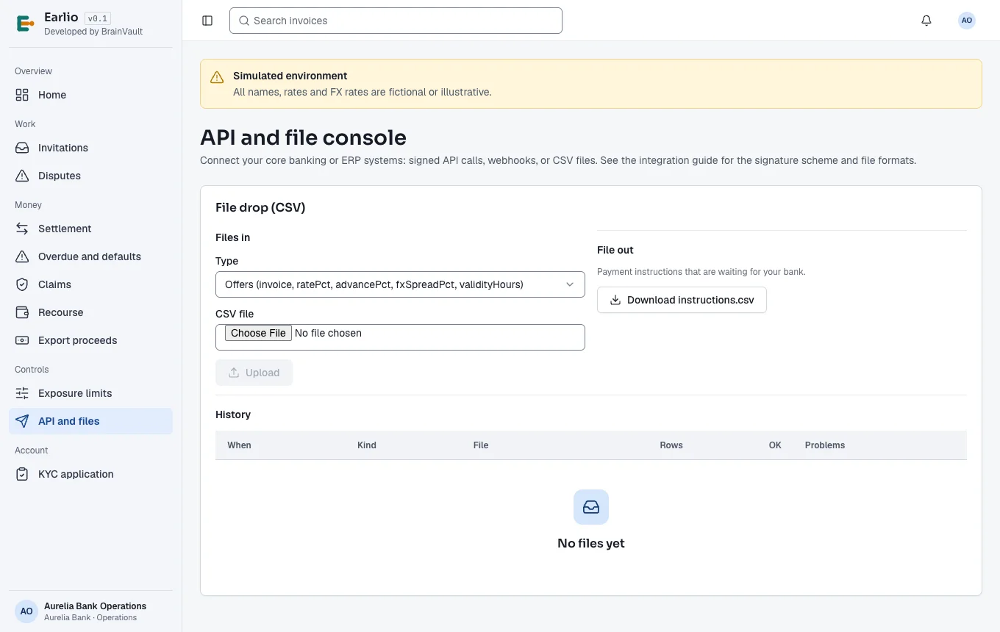
*Figure K-29. The CSV file drop (Operations view).*

## 15. Users and KYC (Admin)

**Users** works as for every organisation: add a user with **Name**, **Work email**, **Role** and **Starting password**. Keep the RelationshipManager (maker) and Approver (checker) roles with different people. **KYC application** holds your bank's own KYC documents.

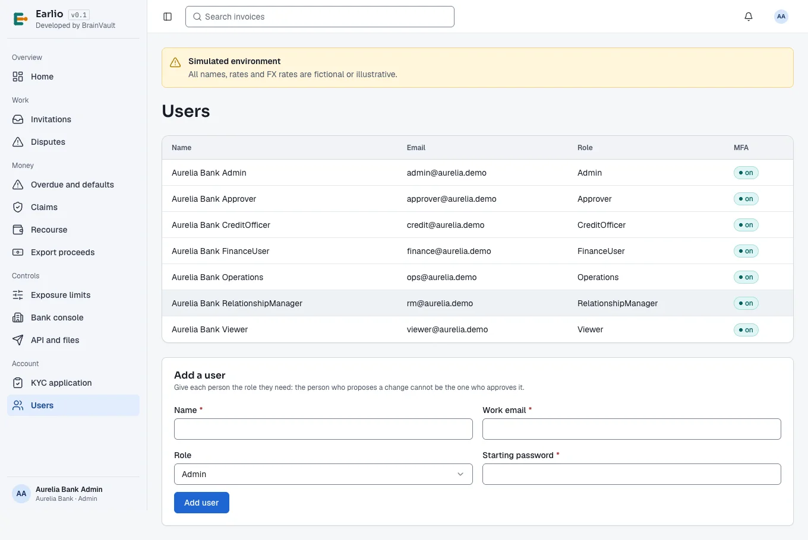
*Figure K-30. The bank's users.*

## 16. Frequently asked questions

**Why don't we see an invoice that another bank is pricing?**
You are only invited if you are the partner bank or one of the supplier's or buyer's preferred banks, and the invoice fits your eligibility rules.

**Can we price below our terms?**
Yes: the rate field accepts any rate from 0 to 60%. You cannot advance more than your terms allow, or exceed the platform's FX-spread cap or small-supplier cost cap.

**The supplier chose us but we cannot confirm.**
Check the panel's message: the buyer may not have acknowledged the assignment notice, the dispute window may still be open, or a re-check (sanctions, cover, limits) failed.

**Two suppliers chose offers at once and our limit was nearly full.**
Limit reservations are atomic. One succeeded; the other was refused with a plain message.

**Can we change terms for invoices already funded?**
No. A funded invoice keeps the terms version it was priced on.

**Who pays the platform fee?**
Your terms decide (**Platform fee paid by**): the bank, or passed on to the supplier.

## 17. List of figures

| Figure | Title |
| --- | --- |
| K-1 | [The bank dashboard](#bnk-home) |
| K-2 | [Funding invitations. INV-1022 has no offer from this bank yet](#bnk-invitations) |
| K-3 | [The offer composer after Price it: 10.51% all-in, net cash USD 83,556.99](#bnk-send-offer) |
| K-4 | [An invoice with your submitted offer, its status and the Withdraw action](#bnk-send-offer) |
| K-5 | [A financing request waiting for the bank's confirmation](#bnk-confirm) |
| K-6 | [A funded invoice: your selected offer and the payout steps](#bnk-disbursement) |
| K-7 | [A short payment in the exceptions queue](#bnk-exceptions) |
| K-8 | [Expected payments and their status](#bnk-expectations) |
| K-9 | [Incoming transactions and how they matched](#bnk-transactions) |
| K-10 | [Payouts to suppliers](#bnk-disbursements) |
| K-11 | [Overdue and defaulted invoices with late interest and claim deadlines](#bnk-overdue) |
| K-12 | [An overdue invoice](#bnk-overdue) |
| K-13 | [A claim filed with the insurer](#bnk-claims) |
| K-14 | [The invoice page of a defaulted invoice with a claim filed](#bnk-claims) |
| K-15 | [Recourse owed to the bank (none here)](#bnk-recourse) |
| K-16 | [Export proceeds by invoice](#bnk-export-proceeds) |
| K-17 | [Exposure limits per buyer and supplier](#bnk-limits) |
| K-18 | [Your terms sets](#bnk-terms-sets) |
| K-19 | [The Settings tab, with a new draft saved](#bnk-terms-settings) |
| K-20 | [The eligibility rule builder](#bnk-terms-rules) |
| K-21 | [Extra questions and required papers](#bnk-terms-required) |
| K-22 | [The plain-language preview](#bnk-terms-preview) |
| K-23 | [The simulator: raising the BBB margin cuts net cash on BBB invoices only](#bnk-terms-simulator) |
| K-24 | [The JSON tab](#bnk-terms-json) |
| K-25 | [The versions table and the change compared with the version in force](#bnk-terms-submit) |
| K-26 | [An approval request: the BBB margin goes from 2.75 to 3](#bnk-approvals) |
| K-27 | [Branding with a live preview, and your terms summary](#bnk-console) |
| K-28 | [API keys and webhooks (Admin view)](#bnk-integration) |
| K-29 | [The CSV file drop (Operations view)](#bnk-integration) |
| K-30 | [The bank's users](#bnk-users) |
