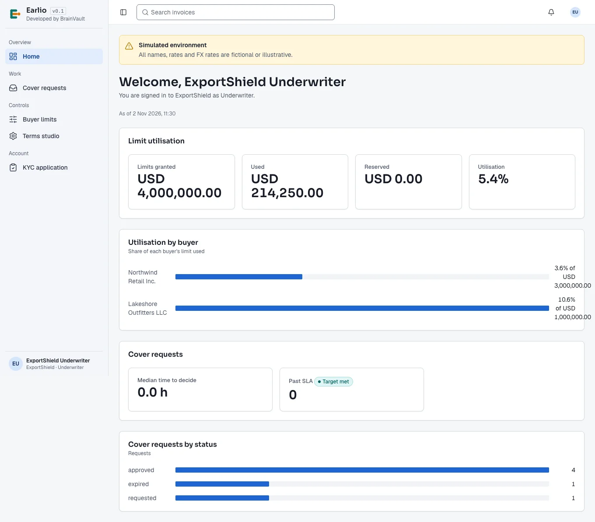
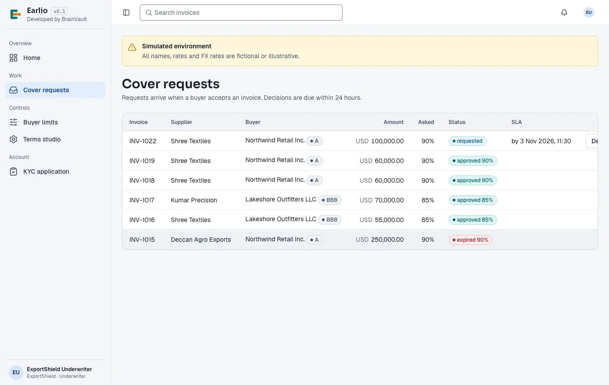
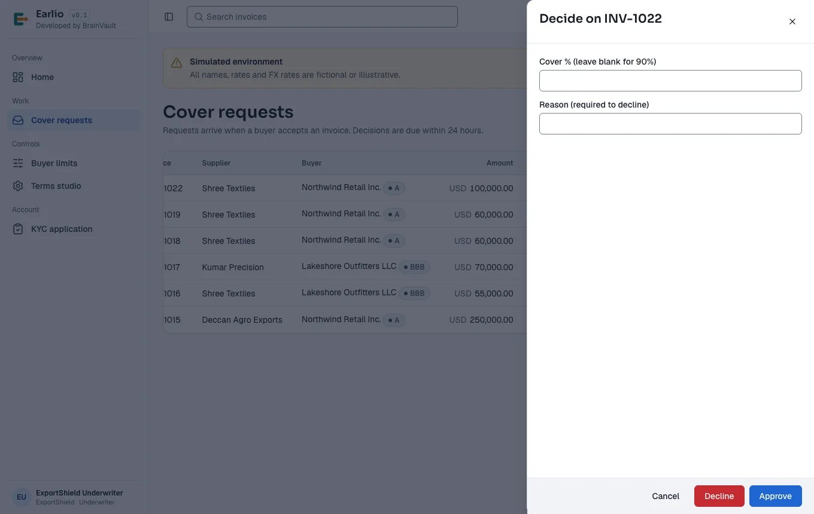
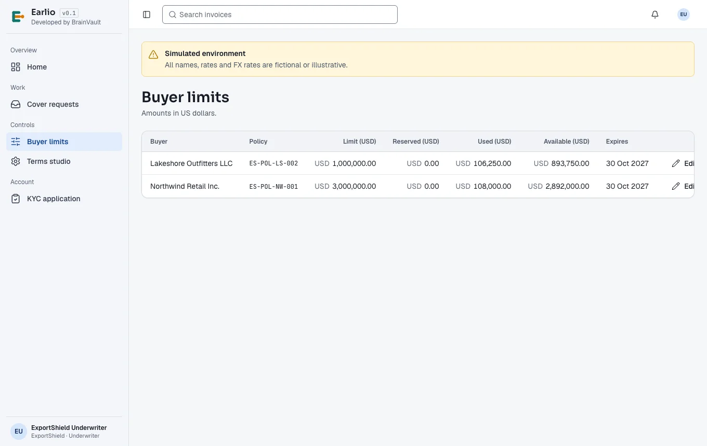
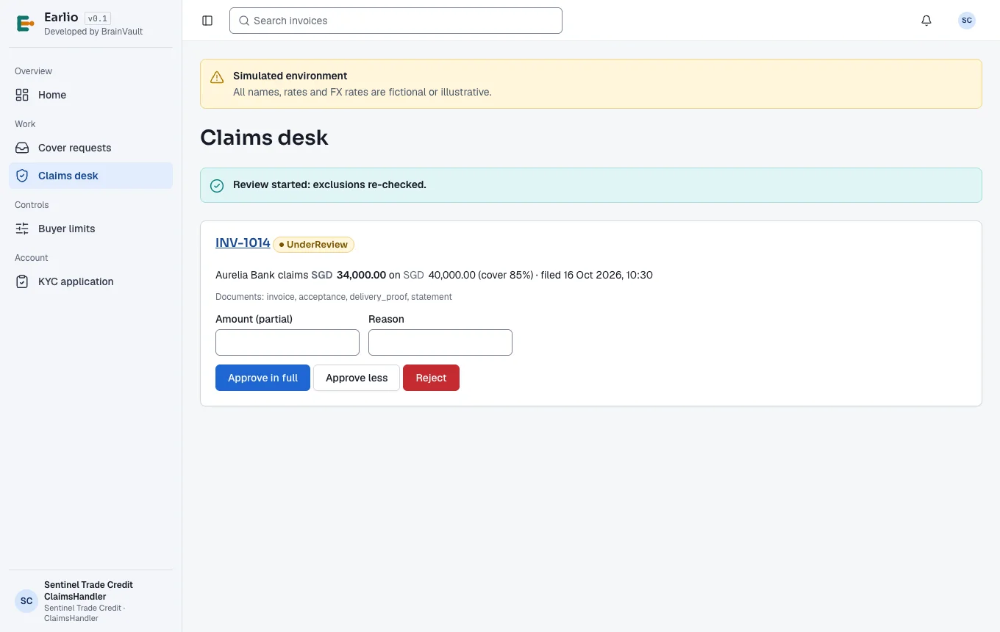
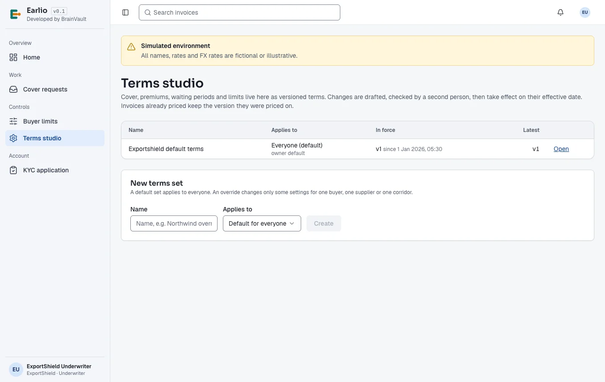
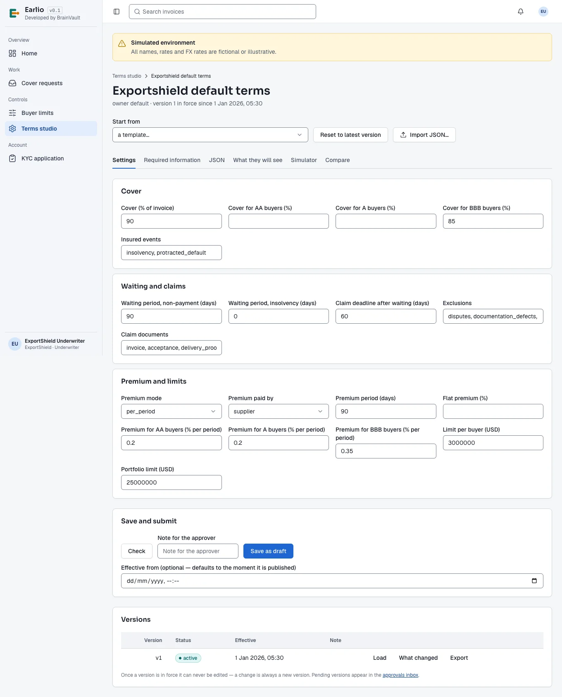
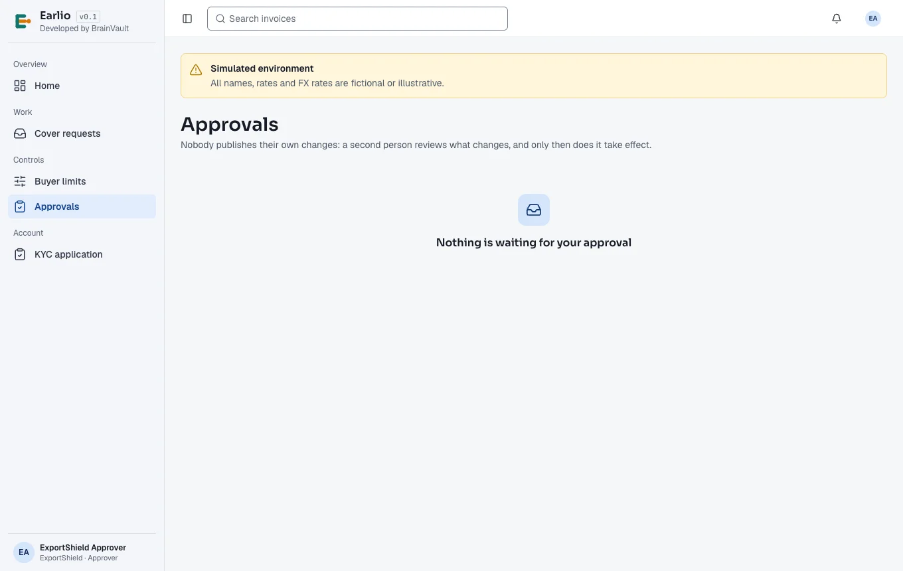
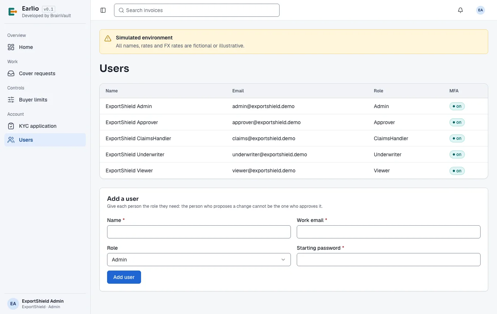

# Earlio user manual — Insurers

*For trade-credit insurers that cover buyers on Earlio and pay claims.*

Read [Getting started](00-getting-started.md) first: it covers signing in with two-step verification, the screen layout, notifications, invoice statuses and the glossary. This manual covers everything an insurer does on Earlio. The screenshots show the demo insurers ExportShield (decisions made by hand on Earlio) and Sentinel Trade Credit (decisions made by its own system through the API).

## Contents

1. [How an insurer works on Earlio](#ins-overview)
2. [Your roles](#ins-roles)
3. [Your pages](#ins-pages)
4. [The insurer dashboard](#ins-home)
5. [Cover requests](#ins-cover)
   1. [The cover request queue](#ins-cover-queue)
   2. [Deciding a request](#ins-decide)
   3. [How a decision affects your limits](#ins-cover-limits)
   4. [Automatic decisions: API and file gateways](#ins-gateways)
6. [Buyer limits](#ins-limits)
7. [The claims desk](#ins-claims)
   1. [Reviewing a claim](#ins-claim-review)
   2. [Deciding a claim](#ins-claim-decide)
   3. [Recording the payout](#ins-claim-payout)
   4. [Recording recoveries](#ins-recoveries)
8. [The terms studio](#ins-terms)
9. [Approvals (checker)](#ins-approvals)
10. [Users and KYC (Admin)](#ins-users)
11. [Frequently asked questions](#ins-faq)
12. [List of figures](#ins-figures)

---

## 1. How an insurer works on Earlio

Banks on Earlio finance invoices **without recourse to the supplier**. What makes that possible is your cover: if the buyer does not pay, the bank claims from you.

1. When a buyer accepts an invoice, Earlio sends you a **cover request** for that invoice, at the cover percentage your terms set for the buyer's rating.
2. You **approve** (at that percentage or lower) or **decline** within 24 hours. Approval reserves the insured amount against your limit on that buyer.
3. If a bank funds the invoice, the reservation becomes **used**. If it is not used within 30 days, the cover expires and the limit is freed.
4. If the buyer does not pay, the bank waits out your **waiting period** and then **files a claim**. You review it against your exclusions, decide, and record the payout.
5. Anything later recovered from the buyer is shared between you and the bank in proportion to each side's loss.

Your cover rules, premiums, waiting periods and exclusions live in your **terms**, which you maintain in the terms studio under maker-checker.

## 2. Your roles

| Role | Can do |
| --- | --- |
| **Admin** | Manage users; KYC. |
| **Underwriter** | Approve (optionally with lower cover) or decline cover requests, including file export and import; set per-buyer insured limits; draft and simulate terms. |
| **ClaimsHandler** | Review claims, approve in full, approve less or reject them, record payouts and recoveries. |
| **Approver** | Approve and publish insurer terms as the checker. Must be a different person from whoever drafted them. |
| **Viewer** | Read only. |

## 3. Your pages

| Sidebar | Page | Used by |
| --- | --- | --- |
| Overview | **Home** | Everyone |
| Work | **Cover requests** | Underwriter |
| Work | **Claims desk** | ClaimsHandler |
| Controls | **Buyer limits** | Underwriter |
| Controls | **Terms studio** | Underwriter (maker) |
| Controls | **Approvals** | Approver (checker) |
| Account | **KYC application**, **Users** | Admin |

## 4. The insurer dashboard

**Home** shows:

- **Limit utilisation** — total limits granted, used, reserved and the utilisation percentage;
- **Utilisation by buyer** — the share of each buyer's limit in use;
- **Cover requests** — the **median time to decide**, how many are **past SLA** (target: none), and requests by status.

*Figure I-1. The insurer dashboard.*

## 5. Cover requests

### 5.1 The cover request queue

*Role: Underwriter.* **Cover requests** lists every request, newest first:

| Column | Meaning |
| --- | --- |
| **Invoice** | The invoice to cover. |
| **Supplier**, **Buyer** | The parties, with the buyer's rating tier. |
| **Amount** | Invoice amount and currency. |
| **Asked** | The cover percentage your terms set for this buyer. |
| **Status** | **requested**, **approved** *n*%, **partial**, **declined**, **expired**. |
| **SLA** | For open requests, the deadline (24 hours after the request), or **overdue** once it has passed. |

*Figure I-2. Cover requests. INV-1022 is waiting for a decision.*

### 5.2 Deciding a request

1. Choose **Decide** on a **requested** row. A panel opens: **Decide on *invoice***.
2. To approve at the requested percentage, leave **Cover %** blank. To approve less, enter a lower percentage — the status becomes **partial**.
3. To decline, enter a **Reason** (required) — the supplier and banks see it.
4. Choose **Approve** or **Decline** (or **Cancel** to close without deciding).

*Figure I-3. Deciding a cover request: leave Cover % blank for the requested 90%.*

Your decision appears at once on the invoice's **Insurance cover** panel for the supplier, the buyer and invited banks (see the [supplier manual, section 6.6](01-supplier.md#sup-cover)). Insurers work from the cover request queue and the claims desk rather than from invoice pages.

A **partial** cover below a bank's minimum means that bank will not offer. A **declined** cover means no bank financing for the invoice; the buyer may still pay early.

### 5.3 How a decision affects your limits

Approval reserves the insured amount, in US dollars, against your limit on the buyer. Earlio does this atomically, so parallel approvals can never take a buyer over its limit. If there is not enough headroom, Earlio reduces the cover to what fits and says so in the reason. The reservation becomes **used** when the invoice is funded and is released when the buyer pays, the financing is cancelled, or the cover expires after 30 days unused.

### 5.4 Automatic decisions: API and file gateways

Earlio can reach you in three ways, set up by Earlio for each insurer:

- **Manual** (default) — your underwriters decide on Earlio as above.
- **API** — Earlio sends each request to your system and polls for the answer. The invoice shows *"Decided by the insurer API."* Every request and response is logged for audit.
- **File exchange** — open requests are exported as a CSV file and your decisions are imported back, with errors reported per row.

Whichever gateway you use, the 24-hour SLA applies.

## 6. Buyer limits

*Role: Underwriter.* **Buyer limits** lists, in US dollars, each buyer you cover: the **Policy**, the **Limit**, how much is **Reserved** (approved cover not yet funded), **Used** (funded) and **Available**, and when the limit **Expires**.

To change a limit, choose **Edit**, enter the **New limit (USD)** and confirm. A limit cannot exceed your own policy caps, and cannot be set below the exposure already in place.

*Figure I-4. Insured limits per buyer.*

## 7. The claims desk

*Role: ClaimsHandler.* **Claims desk** lists claims banks have filed against your cover, each with the invoice, the bank, the amount claimed against the invoice amount and cover percentage, the filing date, the documents attached, and the status (**Filed**, **UnderReview**, **Approved**, **PartiallyApproved**, **Rejected**, **Paid**).

### 7.1 Reviewing a claim

Choose **Start review**. Earlio re-checks the claim against your exclusions and shows the result. The standard exclusions are:

- an **open dispute** on the invoice;
- a **documentation defect** (a required claim document is missing);
- **shipment before the limit** was in place;
- a **sanctions breach**.

Check the documents the bank attached (invoice, acceptance, delivery proof, statement, and any extra documents or answers your terms require).

*Figure I-5. A claim under review on the claims desk.*

### 7.2 Deciding a claim

- **Approve in full** — pay the claimed amount.
- **Approve less** — enter the **Amount (partial)** and a **Reason**.
- **Reject** — enter a **Reason**. If the reason is supplier-caused, the bank may have recourse to the supplier.

### 7.3 Recording the payout

When the claim is approved, choose **Record payout of *amount*** once you have paid. Earlio distributes it through the payment waterfall: the bank's principal and charges first, then anything due to the supplier.

### 7.4 Recording recoveries

If money is later recovered from the buyer, enter the amount **Recovered** and any **Costs** under **Recoveries**, and choose **Record recovery**. Earlio shares the net recovery between you and the bank in proportion to each side's loss (largest-remainder rounding, so the shares add up exactly).

## 8. The terms studio

*Role: Underwriter (maker).* Your cover rules are versioned terms. The studio works exactly like the bank's — sets and overrides, templates (*Standard*, *Cautious*), a JSON editor, a plain-language preview, a simulator, versions, and maker-checker — so see the [bank manual, section 11](03-bank.md#bnk-terms) for the editor itself. The insurer's **Settings** tab has these fields:

| Group | Fields |
| --- | --- |
| **Cover** | Cover (% of invoice); cover for AA, A and BBB buyers (%); insured events. |
| **Waiting and claims** | Waiting period for non-payment (days); waiting period for insolvency (days); claim deadline after waiting (days); exclusions; claim documents. |
| **Premium and limits** | Premium mode (**per_period** or **flat**); premium paid by (**supplier** or **bank**); premium period (days); flat premium (%); premium for AA, A and BBB buyers (% per period); limit per buyer (USD); portfolio limit (USD). |

Under **Required information** you can add extra questions banks answer when they file a claim, and the documents a claim must carry.

The **simulator** runs an insurer draft through the partner bank's terms on 20 sample invoices, so you see the effect on what suppliers would actually receive.

*Figure I-6. The insurer's terms sets.*

*Figure I-7. The insurer's terms editor.*

## 9. Approvals (checker)

*Role: Approver.* **Approvals** lists terms versions waiting for a checker, with who prepared them, when they take effect and a **Before / After** table of every changed setting. Choose **Approve and publish**, or enter a **Reason** and choose **Send back**. You cannot approve a version you drafted. When nothing is waiting, the page says **Nothing is waiting for your approval**.

*Figure I-8. The approvals inbox (empty).*

## 10. Users and KYC (Admin)

**Users** lists your users, roles and two-step verification status; add a user with **Name**, **Work email**, **Role** and **Starting password**. Keep the Underwriter (maker) and Approver (checker) roles with different people. **KYC application** holds your own KYC documents.

*Figure I-9. The insurer's users.*

## 11. Frequently asked questions

**What happens if we miss the 24-hour SLA?**
The request is marked overdue on your queue and dashboard. It stays open until you decide; the supplier cannot get bank financing in the meantime.

**Why was the cover reduced below what we approved?**
There was not enough room on the buyer's limit; Earlio approved what fitted and said so in the reason. Raise the buyer limit if appropriate.

**Can a bank claim while a dispute is open?**
It can file, but an open dispute is an exclusion; the review will flag it. Dispute days are also excluded from the waiting period.

**Who pays the premium?**
Your terms decide (**Premium paid by**). The premium is the rate times the insured amount, for each started period (90 days by default).

## 12. List of figures

| Figure | Title |
| --- | --- |
| I-1 | [The insurer dashboard](#ins-home) |
| I-2 | [Cover requests. INV-1022 is waiting for a decision](#ins-cover-queue) |
| I-3 | [Deciding a cover request: leave Cover % blank for the requested 90%](#ins-decide) |
| I-4 | [Insured limits per buyer](#ins-limits) |
| I-5 | [A claim under review on the claims desk](#ins-claim-review) |
| I-6 | [The insurer's terms sets](#ins-terms) |
| I-7 | [The insurer's terms editor](#ins-terms) |
| I-8 | [The approvals inbox (empty)](#ins-approvals) |
| I-9 | [The insurer's users](#ins-users) |
