# Earlio user manual — Platform (Earlio staff)

*For Earlio operations staff (PlatformAdmin) and auditors (Auditor).*

Read [Getting started](00-getting-started.md) first. This manual covers the platform console: reviewing organisations, sanctions and disputes, operating settlement, governing platform settings and terms, managing bank portals, and the read-only insight and audit tools. The screenshots show the demo platform organisation, Earlio Operations.

## Contents

1. [What the platform team does](#plt-overview)
2. [Your roles](#plt-roles)
3. [Your pages](#plt-pages)
4. [Home and the pilot scorecard](#plt-scorecard)
5. [Review work](#plt-review)
   1. [KYC queue](#plt-kyc)
   2. [Sanctions review](#plt-sanctions)
   3. [Dispute queue and decisions](#plt-disputes)
   4. [Settlement](#plt-settlement)
6. [Platform controls](#plt-controls)
   1. [Lien registry](#plt-liens)
   2. [Platform terms](#plt-terms)
   3. [Defaults and guardrails](#plt-guardrails)
   4. [Approvals](#plt-approvals)
   5. [Tenant domains](#plt-tenants)
7. [Insight](#plt-insight)
   1. [Network map](#plt-network)
   2. [Integration inspector](#plt-integrations)
   3. [Audit log](#plt-audit)
8. [Control room (demo and test only)](#plt-control-room)
9. [Users](#plt-users)
10. [Frequently asked questions](#plt-faq)
11. [List of figures](#plt-figures)

---

## 1. What the platform team does

Earlio staff keep the marketplace safe and running. You:

- **admit organisations** by reviewing their KYC applications;
- **clear or confirm sanctions hits**, which block funding until decided;
- **decide disputes** that the supplier and buyer could not settle themselves;
- **watch settlement** across all banks and resolve exceptions;
- **govern platform settings and terms** under maker-checker — every change needs a second administrator;
- **set up bank portals** (tenant names and custom domains);
- **monitor** the pilot scorecard, the network, integration traffic and the tamper-evident audit log.

You can see across tenants, but every cross-tenant read is itself written to the audit log. You **cannot** publish a bank's or insurer's terms — they decide their own.

## 2. Your roles

| Role | Can do |
| --- | --- |
| **PlatformAdmin** | KYC queue and decisions; sanctions review; decide disputes; suspend relationships; propose and approve governed settings (a second admin must approve); platform terms; bank hostnames; settlement operations; report insolvency; audit log, chain check and anchoring; scorecard, network map and lien registry; integration messages; manage users. In demo and test only: the control room (virtual clock, simulated payments, fault injection). |
| **Auditor** | Read-only cross-tenant views: audit log and chain check, scorecard, network map, lien registry, integration messages. Each cross-tenant read is itself audited. |

## 3. Your pages

| Sidebar | Page | PlatformAdmin | Auditor |
| --- | --- | :---: | :---: |
| Overview | **Home** | ✓ | ✓ |
| Review | **KYC queue** | ✓ | |
| Review | **Sanctions review** | ✓ | |
| Review | **Dispute queue** | ✓ | |
| Review | **Settlement** | ✓ | |
| Platform | **Lien registry** | ✓ | ✓ |
| Platform | **Platform terms** | ✓ | |
| Platform | **Approvals** | ✓ | |
| Platform | **Defaults and guardrails** | ✓ | |
| Platform | **Tenant domains** | ✓ | |
| Insight | **Pilot scorecard** | ✓ | ✓ |
| Insight | **Network map** | ✓ | ✓ |
| Insight | **Control room** | ✓ (demo/test) | |
| Insight | **Integration inspector** | ✓ | ✓ |
| Insight | **Audit log** | ✓ | ✓ |
| Account | **Users** | ✓ | |

## 4. Home and the pilot scorecard

**Home** and **Pilot scorecard** show the six measures of success from the product requirements, each with its target and a **Target met** / **Below target** label:

| Measure | Target |
| --- | --- |
| **Median days, acceptance to cash** | ≤ 2 days |
| **Average cost vs own borrowing** | at least 3 points cheaper than suppliers' own borrowing |
| **Offers per accepted invoice** | ≥ 2 (with the share that got two or more) |
| **Accepted within 3 days** | ≥ 80% |
| **Default and dispute rate** | low (shown as a share of accepted invoices) |
| **Financed volume, latest month** | trend, with a **Monthly financed volume** chart |

The page also counts the network: banks, buyers, insurers and suppliers. A PlatformAdmin also sets the platform's **Notification language** at the bottom of the home page.

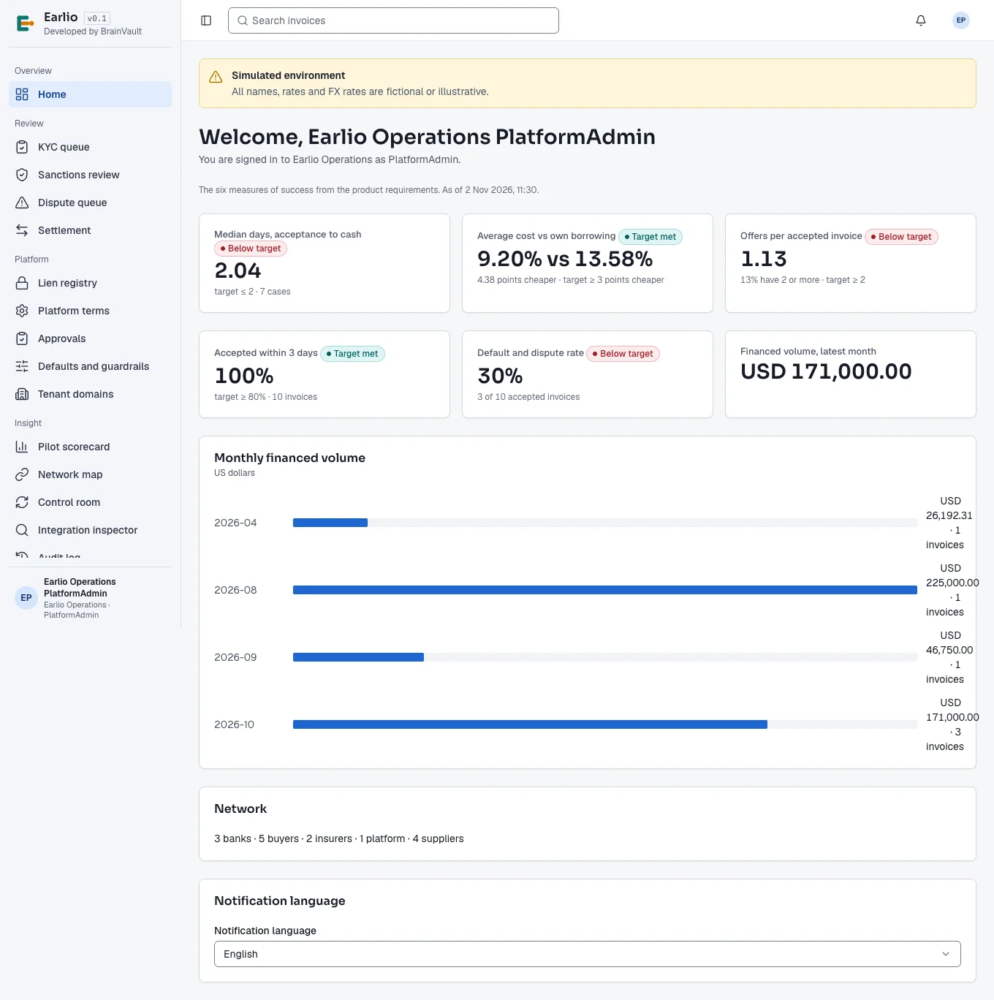
*Figure P-1. The platform home page: the six pilot measures.*

## 5. Review work

### 5.1 KYC queue

**KYC queue** lists organisations whose KYC application is waiting for review: **Organisation**, **Type**, **Country**, **Status** and **Sanctions** result. Check the organisation's documents and screening result, then choose **Approve** or **Reject**. An approved organisation can start trading; a rejected one sees the decision on its KYC application and can upload new documents and resubmit. Applications the automated check referred for a closer look also appear here.

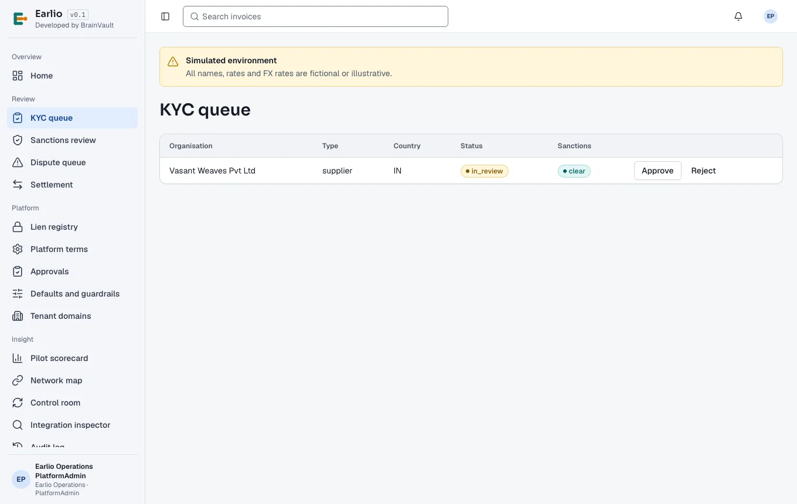
*Figure P-2. A newly registered supplier waiting for KYC review.*

### 5.2 Sanctions review

Every organisation is screened against sanctions lists at registration, and parties are screened again when an invoice is submitted and before funding. **Sanctions review** lists each screening: the **Name screened**, the **Outcome** (`clear` or `hit`), the **Closest match** on the list and its similarity **Score** (1.000 is an exact match).

A hit stops funding until you decide:

- **False positive** — the name only resembles a listed party. The organisation is cleared and the name is whitelisted so it does not trip again.
- **Confirm** — a real match. The organisation is **blocked**: invoices involving it cannot be funded, and suppliers see a plain explanation.

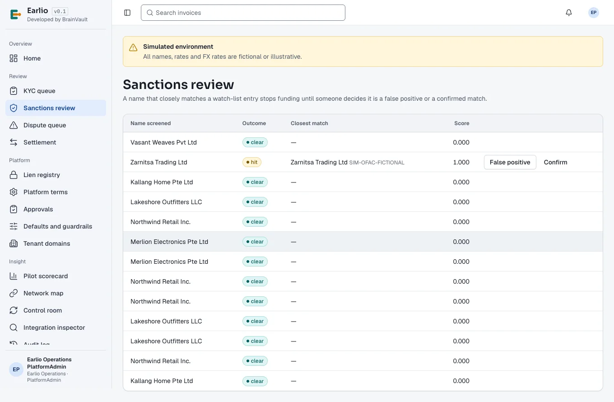
*Figure P-3. Sanctions screenings. Zarnitsa Trading Ltd is an exact match.*

### 5.3 Dispute queue and decisions

**Dispute queue** lists disputes across the platform, with tabs **Open**, **Resolved** and **All**. Disputes reach you when the parties do not resolve them: if the other side does not respond within the response window (48 hours by default) the case is **escalated** to Earlio after 72 hours; an undecided case **times out** after 240 hours. These timers are governed settings (see [Defaults and guardrails](#plt-guardrails)).

On the case page you see the parties, whether the invoice is financed, the reason, the deadlines and the full **Case thread** with evidence. You can post a **Message** or **Attach evidence** like the parties. To decide:

1. Choose **Start review**.
2. Choose **In favour of** — **The supplier** or **The buyer**.
3. Choose the **Cause** (for example non-delivery, quality, wrong documents, misrepresentation).
4. Optionally enter a **Credit note amount** to reduce the invoice.
5. Write your **Reasons** and choose **Record decision**.

Consequences: a **supplier-caused** decision on a financed invoice with no credit note creates **recourse** to the bank (small suppliers repay by 20% offset or a 90-day plan). A credit note reduces the invoice; if it is financed, the advance is cut pro rata. The decision unfreezes the invoice.

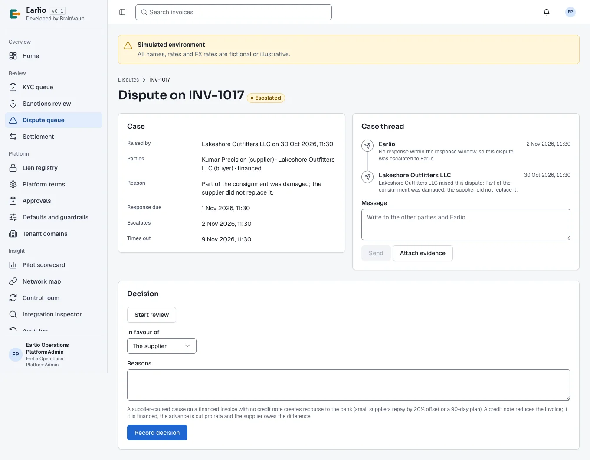
*Figure P-4. An escalated dispute with the decision form.*

### 5.4 Settlement

**Settlement** is the same console banks use — **Exceptions**, **Expectations**, **Transactions** and **Disbursements** — but across all banks. Use it to watch payouts and collections and to resolve exceptions when a bank asks for help. See the [bank manual, section 6](03-bank.md#bnk-settlement) for every exception type and action.

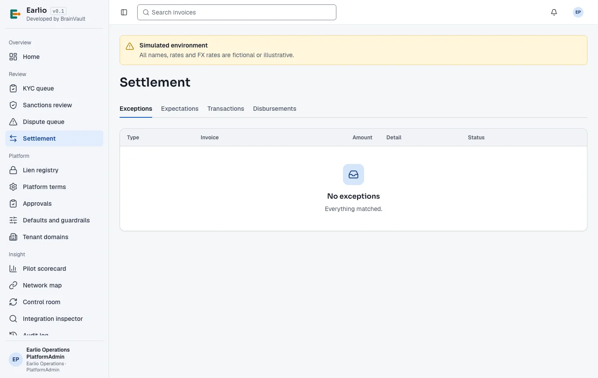
*Figure P-5. The settlement console (no open exceptions).*

## 6. Platform controls

### 6.1 Lien registry

One invoice, one financing. When a supplier chooses an offer, Earlio records a **lien** for that bank. **Lien registry** lists every lien: invoice, bank, supplier, status (**Reserved**, **Active**, **Released**), the assignment notice reference, and when it was reserved and released (with the reason, for example *Settled*). A second financing request on the same invoice is refused and recorded here. The **History** lists every lien event.

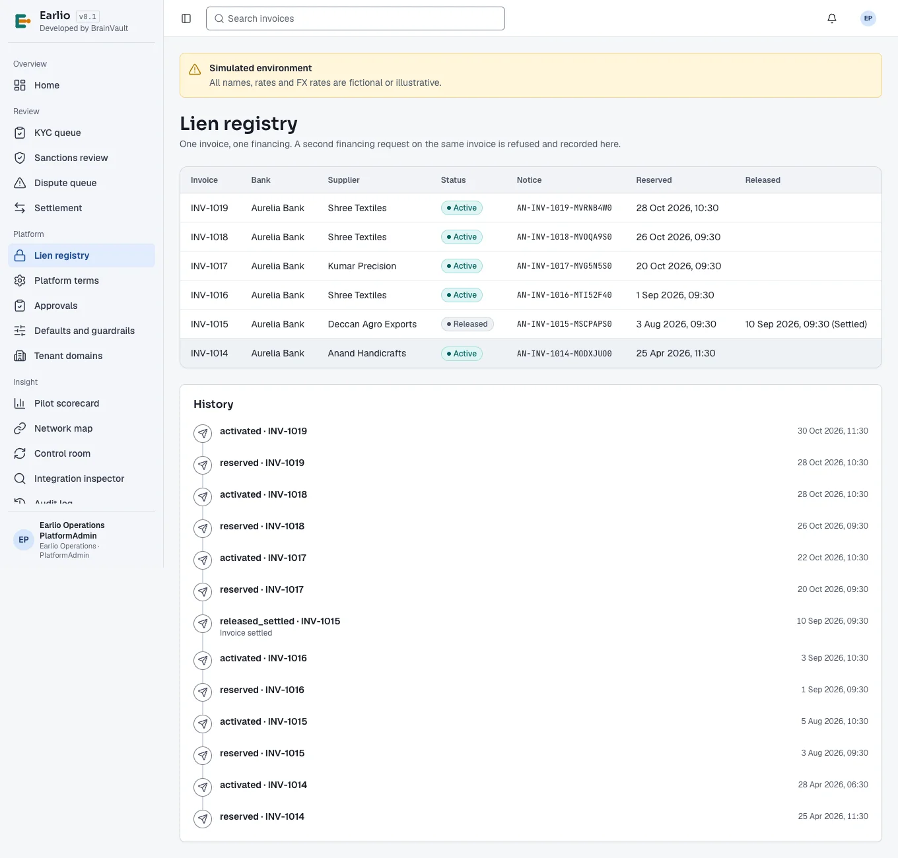
*Figure P-6. The lien registry and its history.*

### 6.2 Platform terms

**Platform terms** holds the platform's own versioned terms — the platform fee, the benchmark rate, the free tier and platform defaults. It works like the banks' terms studio (see the [bank manual, section 11](03-bank.md#bnk-terms)): draft, check, preview, submit, and a second administrator approves under **Approvals**.

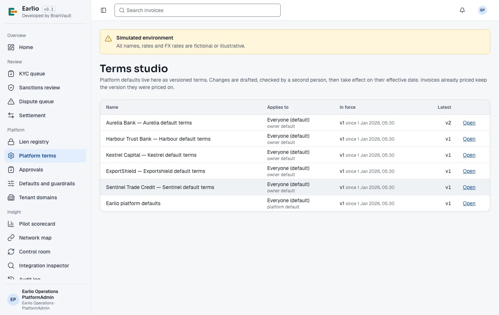
*Figure P-7. Platform terms sets.*

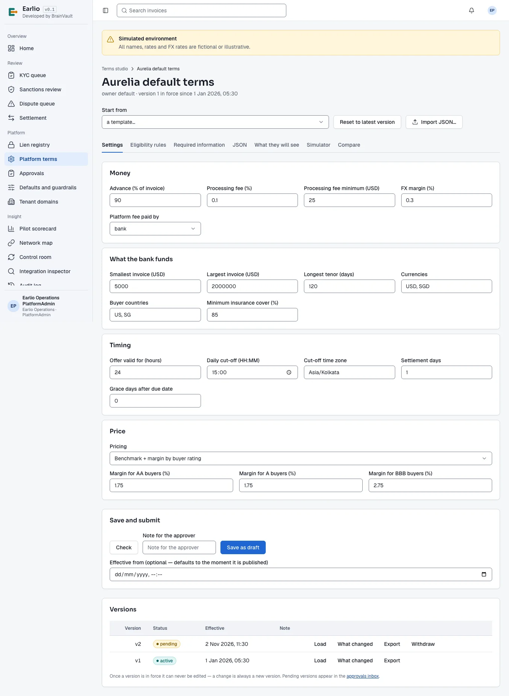
*Figure P-8. Editing the platform terms.*

### 6.3 Defaults and guardrails

**Hard guardrails** are part of the platform itself; nobody can loosen them through a setting:

| Guardrail | Value |
| --- | --- |
| Minimum dispute window (hours) | 24 |
| Maximum FX spread (%) | 1 |
| Cost cap for small suppliers (% a year) | 18 |
| Assignment notice is mandatory | always |
| A sanctions hit blocks funding | always |

**Operating settings** are governed: one administrator proposes, a different one approves.

| Setting | Meaning |
| --- | --- |
| **Dispute timers** | Response hours, escalate-after hours, time-out-after hours. |
| **Reminder days after the due date** | Days overdue on which the buyer is reminded (default 1, 7, 30). |
| **Export realisation period (months)** | Months from shipment to realise export proceeds (default 9). Confirm with counsel. |
| **Supplier-caused dispute causes** | Decision causes that create recourse to the bank. |
| **Dispute window after acceptance (hours)** | Cannot be set below the 24-hour guardrail. |
| **Governing law text** | Appears in every assignment notice. Needs counsel review. |
| **Operating mode** | **Network** (every invited bank can offer) or **White-label** (only the partner bank). |

To propose a change: edit the values, enter a **Reason for the change** and choose **Propose change**. The setting then shows **Waiting for another administrator** with what you proposed. Invalid values are refused at once with the reason.

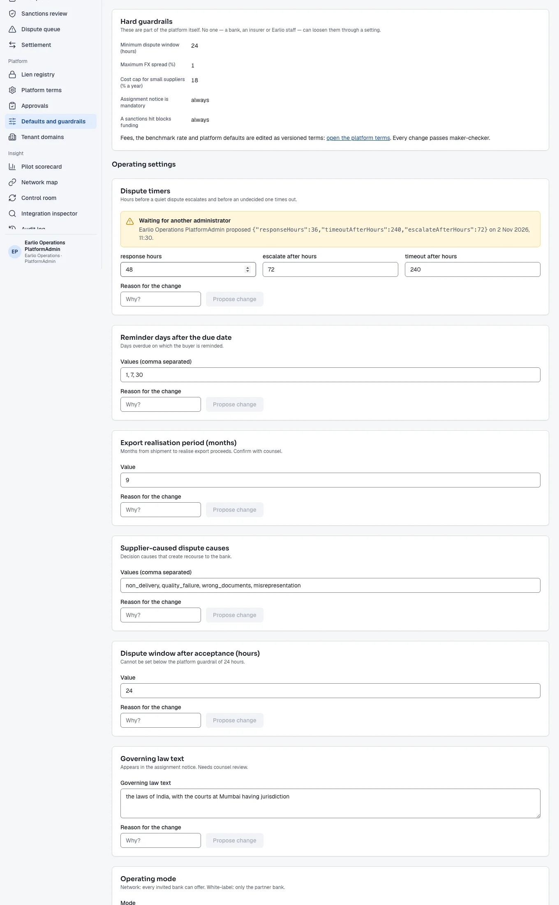
*Figure P-9. A proposed change to the dispute timers, waiting for a second administrator.*

### 6.4 Approvals

**Approvals** lists platform setting changes and platform terms versions waiting for you. Each shows who prepared it, when, their reason, and a **Before / After** table. Choose **Approve and publish**, or enter a **Reason** and choose **Reject**. You cannot approve your own proposal — another PlatformAdmin must.

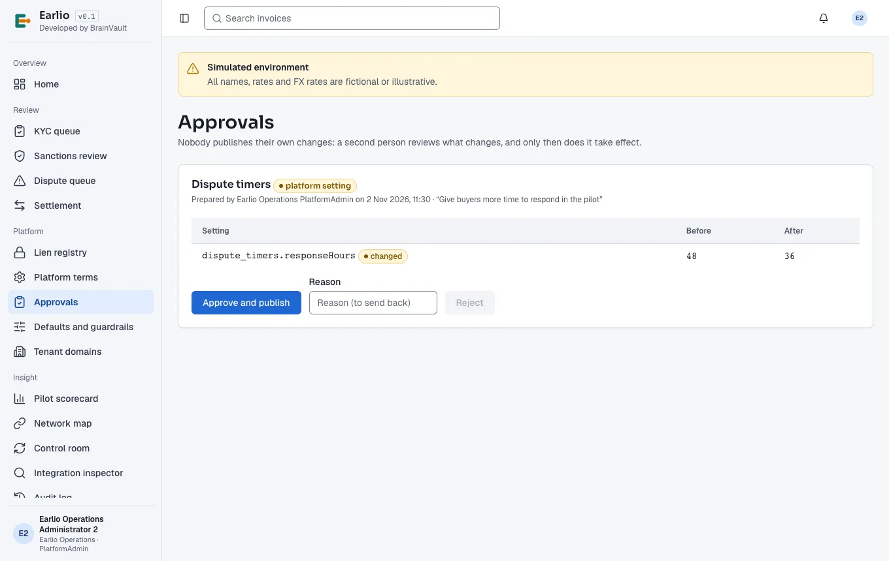
*Figure P-10. A second administrator reviews the dispute-timer change (48 → 36 hours).*

### 6.5 Tenant domains

**Tenant domains** controls where each bank's suppliers and buyers sign in. The **Tenant name** is the first part of the portal address on whichever domain Earlio runs on (for example `aurelia.<earlio-domain>`), and decides whose branding a visitor sees. Optionally enter a **Custom domain** — only once the bank's DNS points that name at Earlio. Choose **Save** for each bank. Banks edit their own colours, logo and welcome text in their bank console.

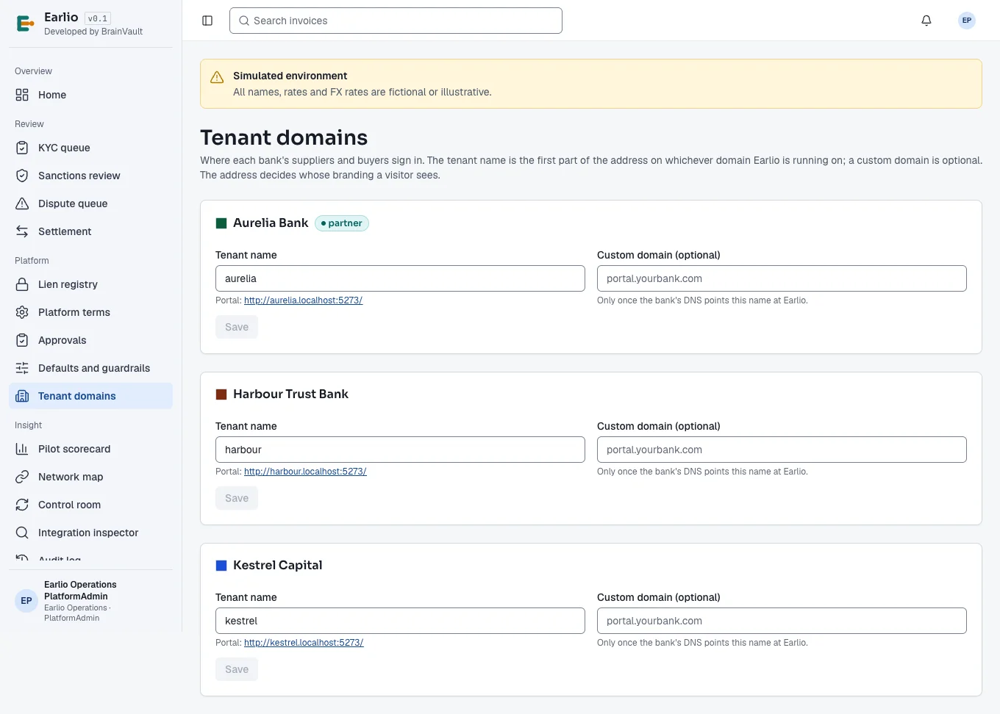
*Figure P-11. Each bank's portal address and optional custom domain.*

## 7. Insight

### 7.1 Network map

**Network map** draws every bank, supplier, buyer and insurer and the links between them. Under **Links to show**, tick the kinds of link: **Trades with** (supplier–buyer, thicker with more invoices), **Financed**, **Bank limit**, **Insurance cover** and **Preferred bank**. Select an organisation to see only its links; **Show everyone** resets. Dashed circles are organisations whose KYC is not yet approved; a struck-through red circle is blocked. Hover a line for its details, or switch from **Map** to **Table**.

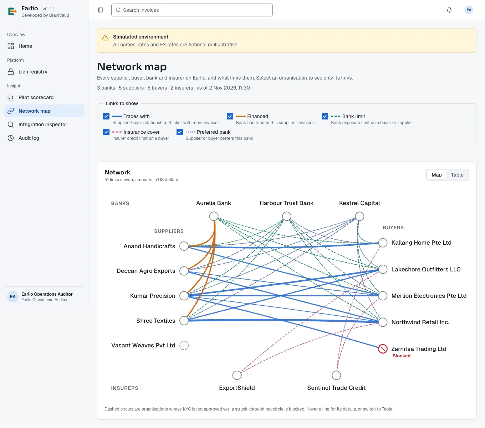
*Figure P-12. The network map.*

### 7.2 Integration inspector

**Integration inspector** shows every message Earlio's adapters sent and received — payments, notifications (email, SMS, WhatsApp), the insurer API and FX rates — with time, adapter, direction, reference and payload. Filter by **Adapter**. Use it to answer "was the buyer actually notified?" or "what did the insurer's system reply?".

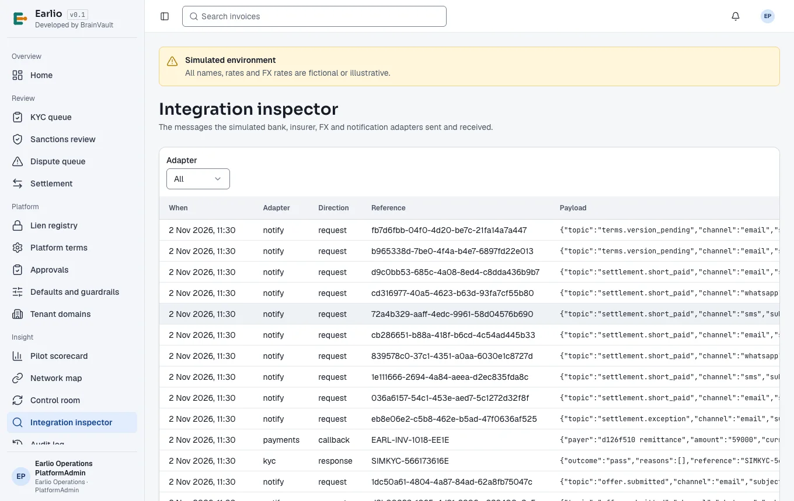
*Figure P-13. Messages sent and received by the integration adapters.*

### 7.3 Audit log

Every change on Earlio writes an audit event, and each event is **chained** to the one before it by a SHA-256 hash, so an edited or deleted entry is detectable. **Audit log** lists the events newest first: sequence number, time, action, entity and hash.

Choose **Verify chain** to recompute the whole chain. Earlio answers **Chain intact: *n* events verified**, or **Tampering detected at event *n*** with the reason. A detected break must be investigated at once and reported. The chain head can also be anchored with a timestamp authority, which proves the log existed in that form at that time.

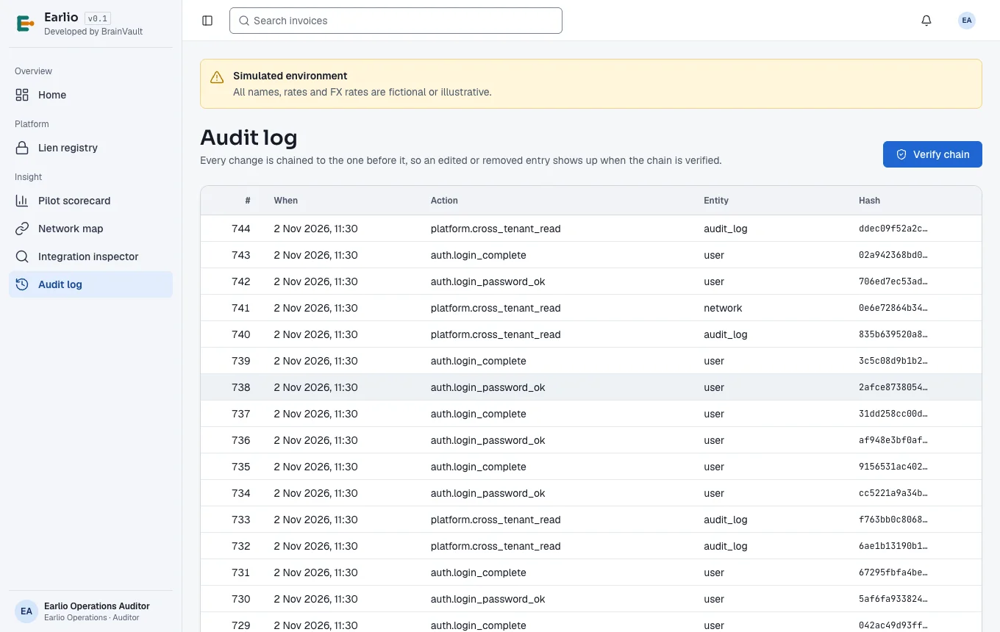
*Figure P-14. The audit log.*

## 8. Control room (demo and test only)

The **Control room** exists only in development, demo and test environments, never in production. It lets you run a realistic demo:

- **Platform time** — the virtual clock. Move it **+1 hour**, **+25 hours**, **+1 day** or **+30 days**, or **Reset**. Background jobs (reminders, expiries, payouts) react within seconds.
- **Bank behaviour** — inject **Payout faults**: none, reject (retried three times, then reversed), timeout, mismatch (credits ₹100 short), return, or a seeded random mix.
- **Simulate the buyer paying** — enter an **Invoice number**, an **Amount** (blank = exact) and how it is **Delivered by** (callback + statement, callback only, statement only), then **Pay**.
- **Holiday calendars** — the India, US and Singapore holidays used for value dates. Verify them with the authorised dealer bank before production use.

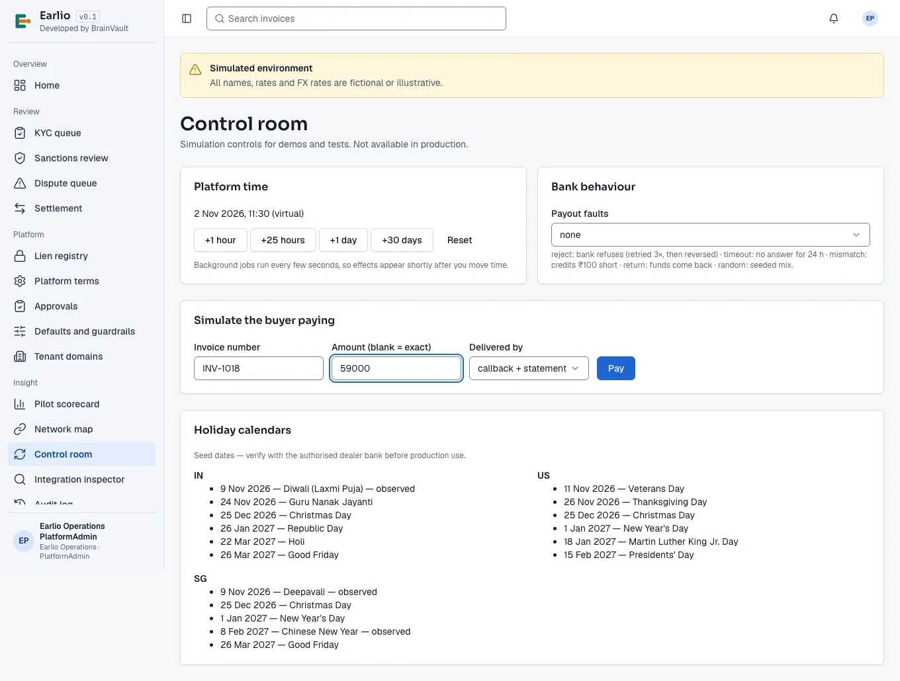
*Figure P-15. The control room: simulating a short payment of USD 59,000 on INV-1018.*

## 9. Users

**Users** lists Earlio staff, their role (PlatformAdmin or Auditor) and two-step verification status. Add a user with **Name**, **Work email**, **Role** and **Starting password**. Keep at least two PlatformAdmins: governed settings need a second administrator to approve.

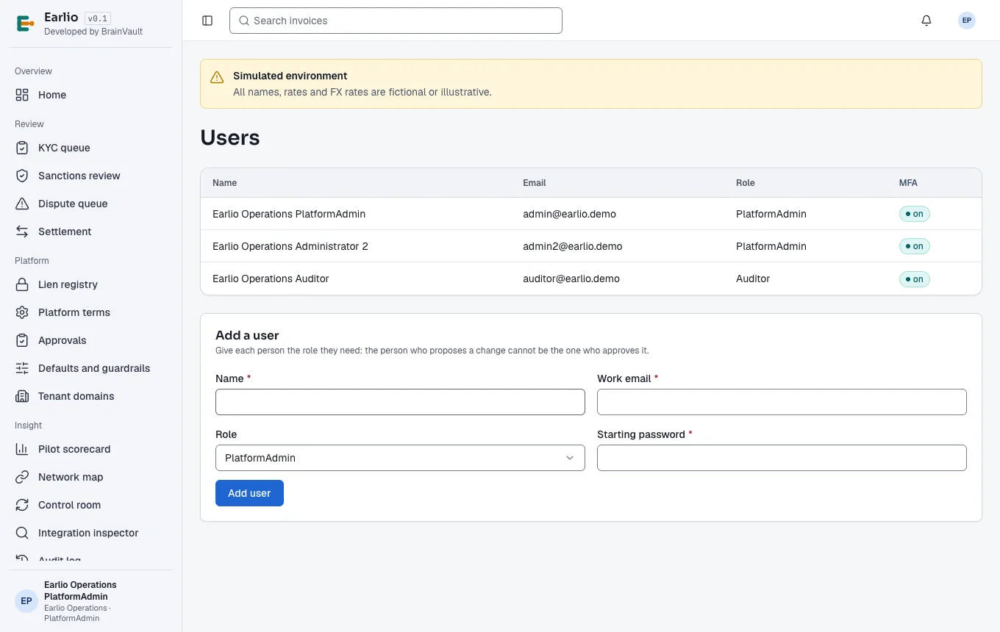
*Figure P-16. Earlio staff accounts.*

## 10. Frequently asked questions

**Why can't I approve my own settings change?**
Maker-checker: another PlatformAdmin must approve it.

**Can I change a bank's terms for them?**
No. Banks and insurers publish their own terms. You govern only the platform's terms and settings.

**A supplier says funding is blocked by sanctions, but the match is wrong.**
Open **Sanctions review**, check the closest match and score, and choose **False positive** if you are satisfied it is a different party.

**Does looking at another organisation's data leave a trace?**
Yes. Every cross-tenant read is written to the audit log as `platform.cross_tenant_read`.

## 11. List of figures

| Figure | Title |
| --- | --- |
| P-1 | [The platform home page: the six pilot measures](#plt-scorecard) |
| P-2 | [A newly registered supplier waiting for KYC review](#plt-kyc) |
| P-3 | [Sanctions screenings. Zarnitsa Trading Ltd is an exact match](#plt-sanctions) |
| P-4 | [An escalated dispute with the decision form](#plt-disputes) |
| P-5 | [The settlement console (no open exceptions)](#plt-settlement) |
| P-6 | [The lien registry and its history](#plt-liens) |
| P-7 | [Platform terms sets](#plt-terms) |
| P-8 | [Editing the platform terms](#plt-terms) |
| P-9 | [A proposed change to the dispute timers, waiting for a second administrator](#plt-guardrails) |
| P-10 | [A second administrator reviews the dispute-timer change (48 → 36 hours)](#plt-approvals) |
| P-11 | [Each bank's portal address and optional custom domain](#plt-tenants) |
| P-12 | [The network map](#plt-network) |
| P-13 | [Messages sent and received by the integration adapters](#plt-integrations) |
| P-14 | [The audit log](#plt-audit) |
| P-15 | [The control room: simulating a short payment of USD 59,000 on INV-1018](#plt-control-room) |
| P-16 | [Earlio staff accounts](#plt-users) |
