# Earlio workflows

BPMN-style process diagrams for the main workflows, drawn from the code (services, the invoice transition table in
`apps/api/src/modules/invoicing/state.ts`, the outbox handlers and background jobs in `apps/api/src/worker.ts`, and the
status constraints in `apps/api/migrations`). Companion to [er-diagrams.md](er-diagrams.md).

## How to read the diagrams

- **Lanes** are the boxes titled with an organisation and role, for example *Supplier · FinanceUser*. A lane named
  *Earlio (system)* is work the platform does itself, in the request or in the background worker.
- **Shapes**: `(( ))` circles are start and end events; rectangles are tasks; diamonds are decisions (gateways);
  stadium shapes `([ ])` are statuses an aggregate reaches.
- **Dashed tasks** (class `sys`) are automatic: a domain check, an outbox event handler or a worker job.
- Every status change writes an audit event and an outbox event (architecture rule 3). The diagrams leave those out.
- Rejections always carry a plain-language reason (rule 8). Where a check can fail, the diagram shows the failure as
  a gateway branch.

| # | Workflow | Main aggregates |
|---|---|---|
| 0 | [Invoice lifecycle](#0-invoice-lifecycle-overview) | invoice |
| 1 | [Onboarding, KYC and sanctions](#1-onboarding-kyc-and-sanctions) | organisation, KYC case, screening |
| 2 | [Supplier–buyer relationship](#2-supplierbuyer-relationship) | relationship |
| 3 | [Invoice submission and acceptance](#3-invoice-submission-and-acceptance) | invoice, acceptance |
| 4 | [Credit insurance cover](#4-credit-insurance-cover) | cover record, insurer buyer limit |
| 5 | [Bank financing](#5-bank-financing-marketplace) | invitation, offer, financing request, lien |
| 6 | [Disbursement](#6-disbursement) | disbursement |
| 7 | [Early payment by the buyer](#7-early-payment-by-the-buyer) | discount schedule, early payment |
| 8 | [Collection and reconciliation](#8-collection-reconciliation-and-exceptions) | expectation, bank transaction, exception |
| 9 | [Disputes](#9-disputes) | dispute, credit note |
| 10 | [Default, claim and recovery](#10-default-insurance-claim-and-recovery) | default, claim, recourse |
| 11 | [Terms and settings](#11-terms-and-platform-settings-maker-checker) | terms version, setting change |

---

## 0. Invoice lifecycle (overview)

The one aggregate every workflow touches. The diagram is exactly the transition table in `state.ts`; anything not
drawn is an illegal transition and throws `DomainError`. Labels say which workflow causes each move.

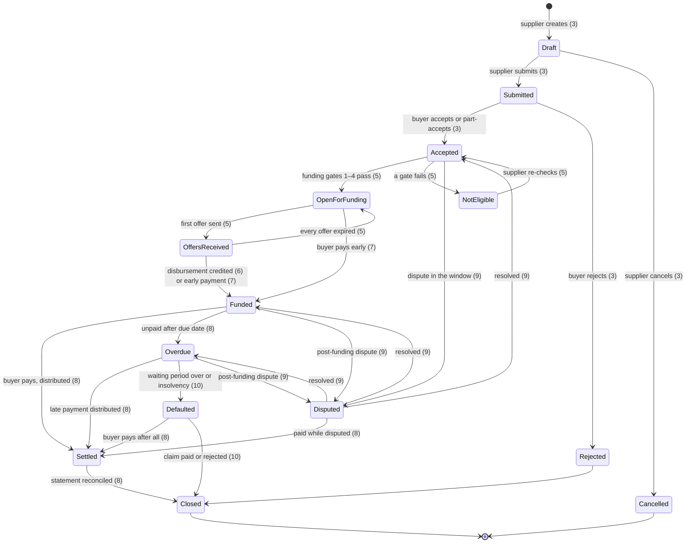

The swimlane diagram below shows the handoffs from creation to closure.

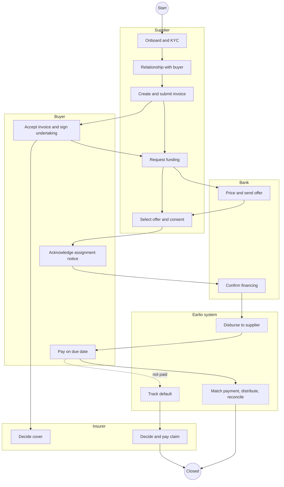

---

## 1. Onboarding, KYC and sanctions

Any organisation type registers itself; platform staff never create one. Nothing can transact until KYC is `approved` and
the organisation is not blocked (`transactBlockReason`). The required documents depend on the organisation type:

| Type | KYC documents |
|---|---|
| Supplier | incorporation certificate, GST registration, IEC code, bank account proof |
| Buyer | incorporation certificate, tax registration |
| Bank | banking licence, authorised signatory |
| Insurer | insurance licence, authorised signatory |

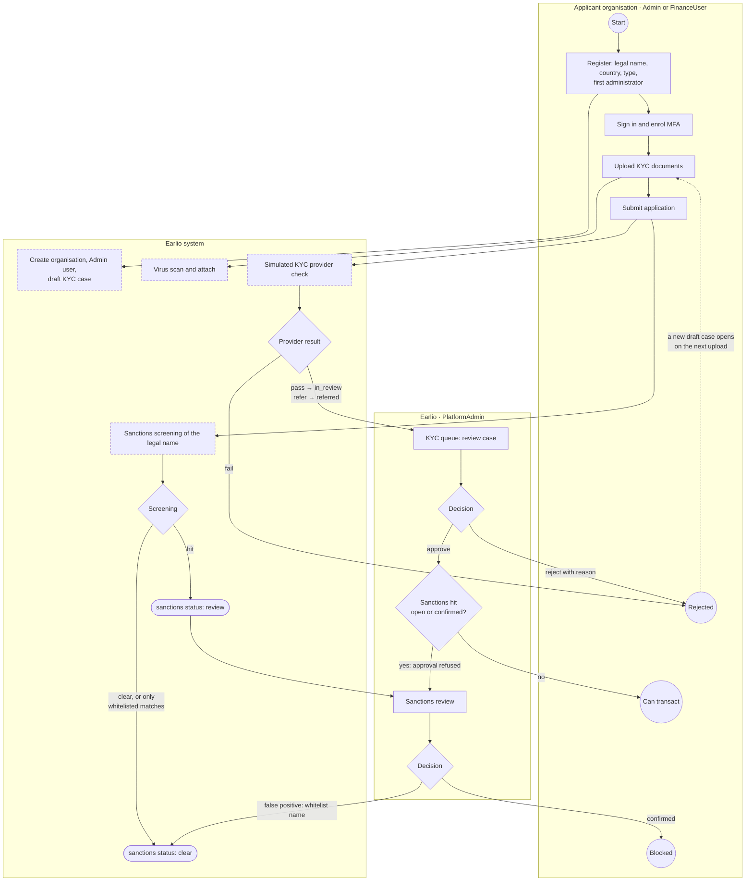

- KYC case statuses: `draft → in_review | referred | rejected`, then `approved | rejected` by platform staff.
- A confirmed sanctions match sets `blocked = true`. A KYC approval is refused while a match is open or confirmed.
- Screening also runs on the buyer's name each time an invoice is submitted (workflow 3) and before a bank confirms
  financing (workflow 5).

---

## 2. Supplier–buyer relationship

A relationship links exactly one supplier with one buyer. It needs a different approver on each side (maker-checker).
Invoices can only be submitted, and funding gate 2 only passes, while the relationship is `active`.

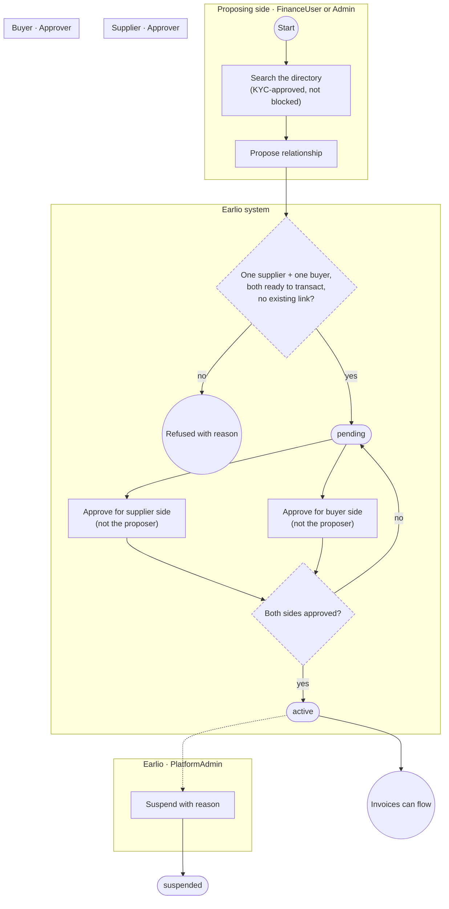

Each side also picks **preferred banks** (`org:settings`). Those banks are invited when the supplier asks for funding
(workflow 5).

---

## 3. Invoice submission and acceptance

The buyer's silence is never acceptance; the worker only sends reminders. Acceptance requires signing a payment
undertaking, which locks the amount and starts the dispute window (at least 24 hours, a governed setting).

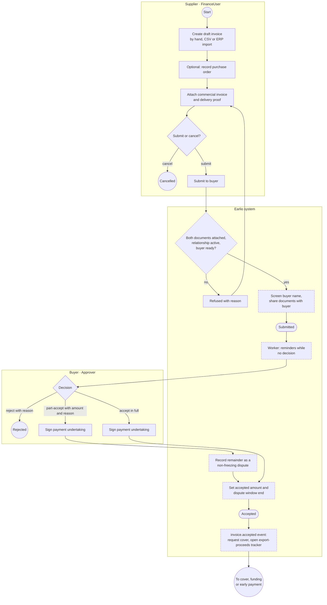

---

## 4. Credit insurance cover

Requested automatically when an invoice is accepted, from the insurer on the supplier–buyer relationship. Cover reserves
headroom on the insurer's per-buyer limit; funding consumes it, and settlement or cancellation releases it.

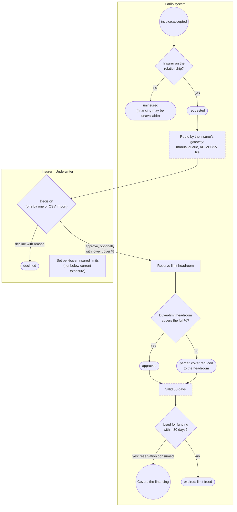

At selection (workflow 5) the cover must meet the bank's minimum cover percentage in its terms.

---

## 5. Bank financing (marketplace)

One funding route per invoice: bank financing **or** early payment (workflow 7). Gates 1–4 run when funding opens; gates
5–7 run per bank inside the rule engine (bank terms, exposure limits, cover). The lien is reserved at selection, which
makes two parallel selections safe: the second one fails with a lien conflict.

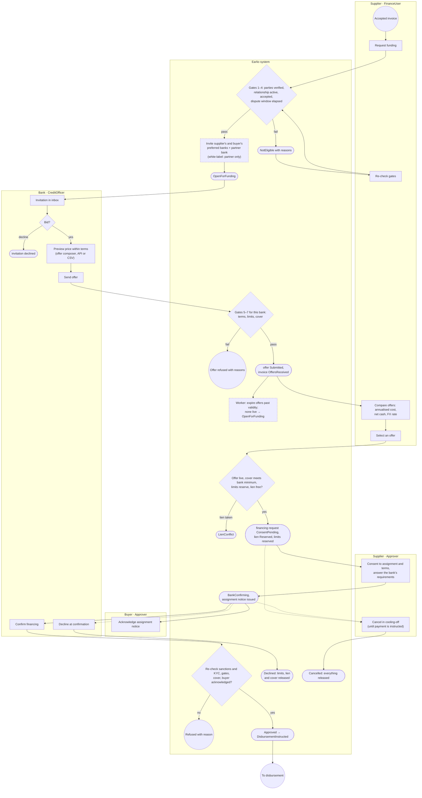

Financing request statuses: `ConsentPending → BankConfirming → Approved → DisbursementInstructed → Funded`, with the
exits `Declined`, `Cancelled`, `LienConflict` and `Failed`. Offer statuses: `Drafted → Submitted → Selected`, or
`Rejected`, `Expired`, `Withdrawn`, `Superseded`.

---

## 6. Disbursement

Starts from the `financing.approved` event. The financing becomes real only when the bank reports the credit
(`completeFunding`).

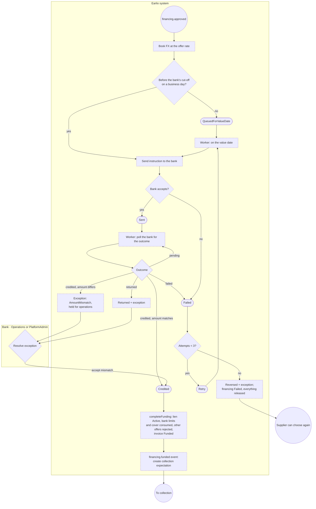

---

## 7. Early payment by the buyer

The alternative route: the buyer pays the supplier early at a published discount. Choosing it withdraws every bank offer.

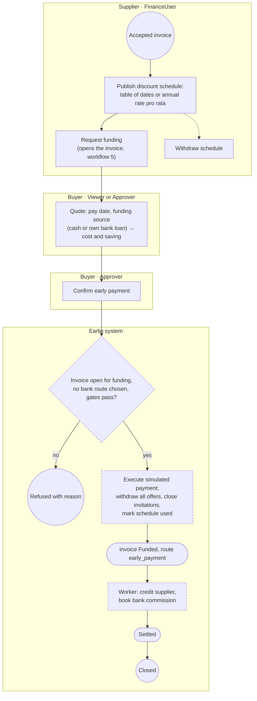

---

## 8. Collection, reconciliation and exceptions

Every funded invoice gets one unique payment reference, issued to the buyer. A payment can arrive by bank callback or
as a statement line; the two reconcile against each other.

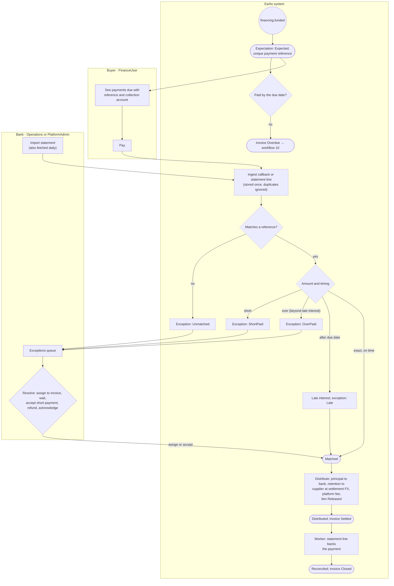

Expectation statuses: `Expected → PartiallyReceived | Received → Matched → Distributed → Reconciled`, or `Exception`.
Exception types: `Unmatched`, `ShortPaid`, `OverPaid`, `Late`, `AmountMismatch`, `DisbursementReturned`, `DisbursementFailed`.

---

## 9. Disputes

A freezing dispute stops the invoice moving on, and while it is open late interest, dunning and the insurer's waiting
period stand still. Default timers: response 48 hours, escalation 72 hours, timeout 240 hours (a governed setting).

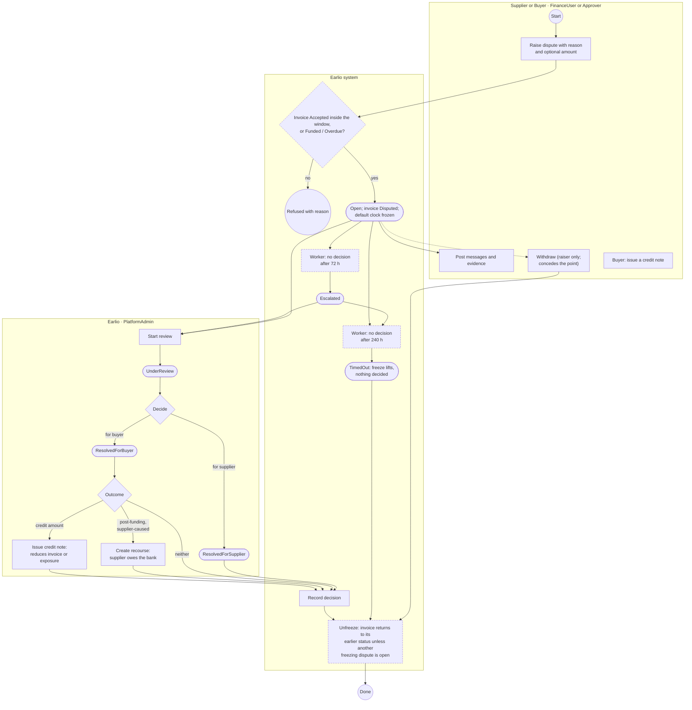

A part-acceptance (workflow 3) records the unaccepted remainder as a **non-freezing** dispute that can later become a
credit note. A buyer can also issue a credit note directly.

---

## 10. Default, insurance claim and recovery

Starts when a financed invoice becomes `Overdue`. The insurer's waiting period counts only unfrozen days. A buyer
insolvency waives the waiting period.

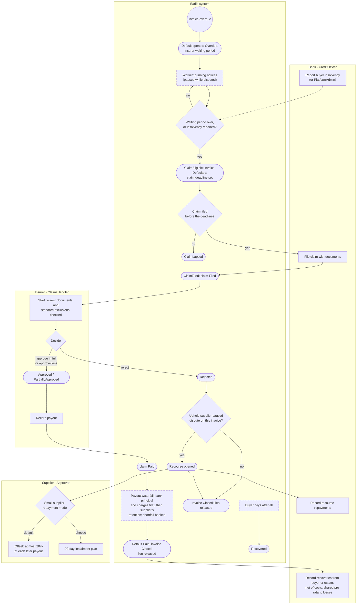

Default statuses: `Overdue → WaitingPeriod → ClaimEligible → ClaimFiled → Paid`, or `ClaimLapsed` / `Recovered`. Claim
statuses: `Filed → UnderReview → Approved | PartiallyApproved | Rejected → Paid`. Recourse is `open` until `settled`, and
carries no penalty interest for small suppliers.

---

## 11. Terms and platform settings (maker-checker)

Rules are data (architecture rule 2): banks and insurers change their terms by publishing a new version, never through
code. Both terms and governed platform settings need a second person to approve.

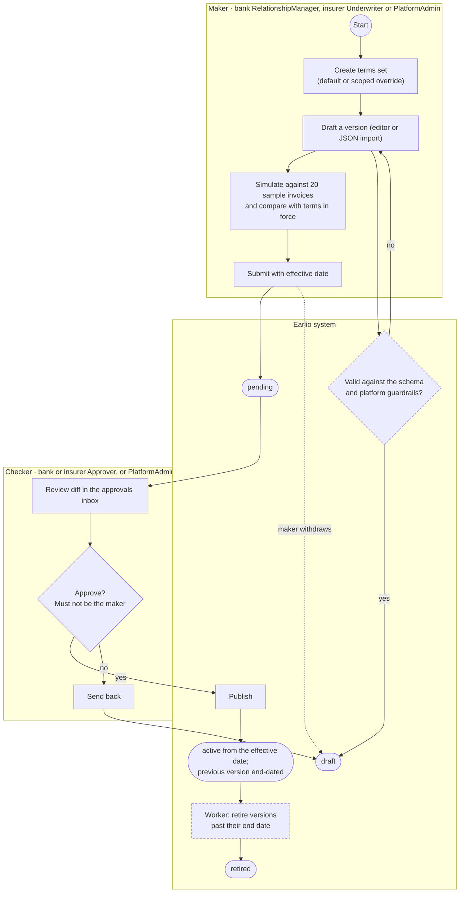

Governed platform settings (dispute window, dispute timers, network or white-label mode and others) follow the same
shape. One PlatformAdmin proposes a value (`pending`), and a **different** PlatformAdmin approves it (`applied`) or
rejects it (`rejected`). The proposer can withdraw it (`withdrawn`).

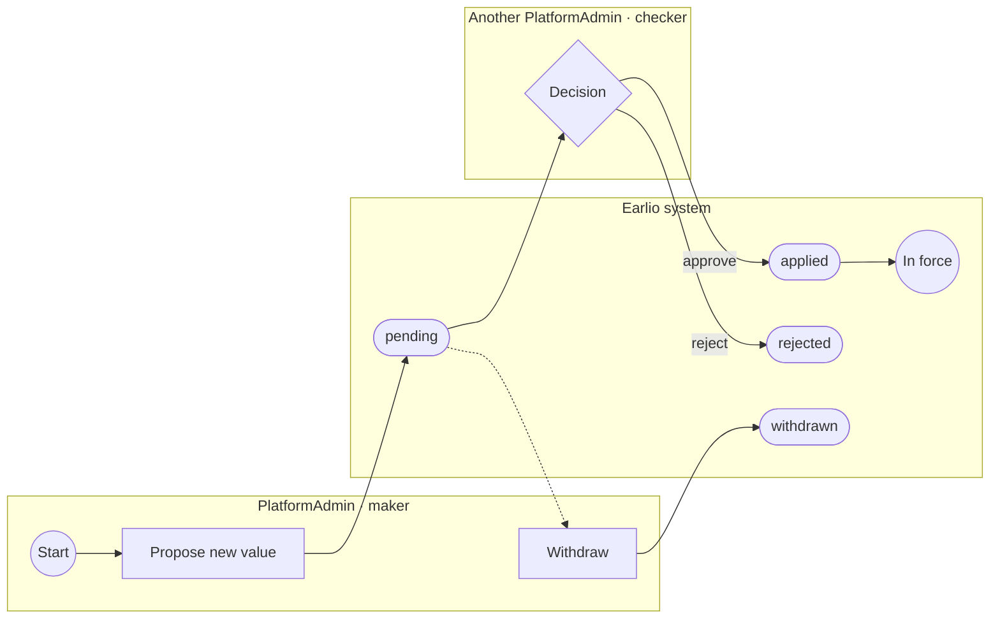
